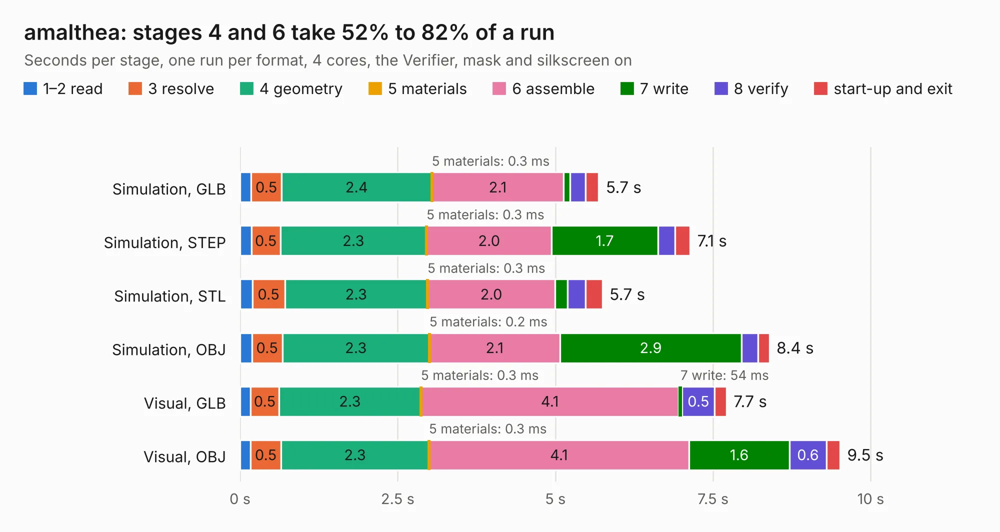

# 1080. amalthea

Board 1,080 of the 3,106 of [Corpus Testing](../Corpus-Testing.md), on [Corpus Page 10](../CorpusTestingPages/Corpus-Testing-10.md#1080-amalthea).

| Mode and format | 1–2 read | 3 resolve | 4 geometry | 5 materials | 6 assemble | 7 write | 8 verify | start-up and exit | Total |
|---|---:|---:|---:|---:|---:|---:|---:|---:|---:|
| Simulation, GLB | 0.2 | 0.5 | 2.4 | 0.3&nbsp;ms | 2.1 | 0.1 | 0.2 | 0.2 | 5.7 |
| Simulation, STEP | 0.2 | 0.5 | 2.3 | 0.3&nbsp;ms | 2.0 | 1.7 | 0.3 | 0.2 | 7.1 |
| Simulation, STL | 0.2 | 0.5 | 2.3 | 0.3&nbsp;ms | 2.0 | 0.2 | 0.3 | 0.3 | 5.7 |
| Simulation, OBJ | 0.2 | 0.5 | 2.3 | 0.2&nbsp;ms | 2.1 | 2.9 | 0.3 | 0.2 | 8.4 |
| Visual, GLB | 0.2 | 0.5 | 2.3 | 0.3&nbsp;ms | 4.1 | 54&nbsp;ms | 0.5 | 0.2 | 7.7 |
| Visual, OBJ | 0.2 | 0.5 | 2.3 | 0.3&nbsp;ms | 4.1 | 1.6 | 0.6 | 0.2 | 9.5 |

<table align="center"><tr><td valign="top">

| Board | Repo: [greatscottgadgets/amalthea-hardware](https://github.com/greatscottgadgets/amalthea-hardware) Board: `amalthea.kicad_pcb` |
|---|---|
| Complexity | 334&nbsp;/&nbsp;1000 (size&nbsp;219, features&nbsp;115) |
| KESE&nbsp;features | through vias, rounded, trapezoid or chamfered pads, arc tracks, filled zones, copper text, curved board outline, stack-up, dielectric εr and tanδ, mask and silkscreen colours |
| Tested | 9th November 2026 |
| Copper&nbsp;layers | 4 |
| File&nbsp;format | KiCad 7 (20221018) |
| Parts,&nbsp;tracks,&nbsp;vias | 41, 440, 63 |
| Triangles,&nbsp;simulation | 747,338 in 69 parts |
| Verifier | PASS in all six runs |

</td><td valign="top">

<table>
<tr><th>File type</th><th>File size</th><th>Peak memory used</th></tr>
<tr><th colspan="3" align="left">Simulation</th></tr>
<tr><td>GLB</td><td align="right">26&nbsp;MB</td><td align="right">350&nbsp;MB</td></tr>
<tr><td>STEP</td><td align="right">103&nbsp;MB</td><td align="right">410&nbsp;MB</td></tr>
<tr><td>STL</td><td align="right">37&nbsp;MB</td><td align="right">342&nbsp;MB</td></tr>
<tr><td>OBJ</td><td align="right">76&nbsp;MB</td><td align="right">532&nbsp;MB</td></tr>
<tr><th colspan="3" align="left">Visual</th></tr>
<tr><td>GLB</td><td align="right">14&nbsp;MB</td><td align="right">388&nbsp;MB</td></tr>
<tr><td>OBJ</td><td align="right">41&nbsp;MB</td><td align="right">388&nbsp;MB</td></tr>
</table>

</td></tr></table>

| Previous | Next |
|:---|---:|
| [1079. librem5_mainboard](b1079b_l5-schematic_CAD-PADS-librem5-mainboard-librem5-mainboard-kicad-conversion_librem5-mainboard.md) | [1081. cydonia](b1081b_cydonia_cydonia.md) |
