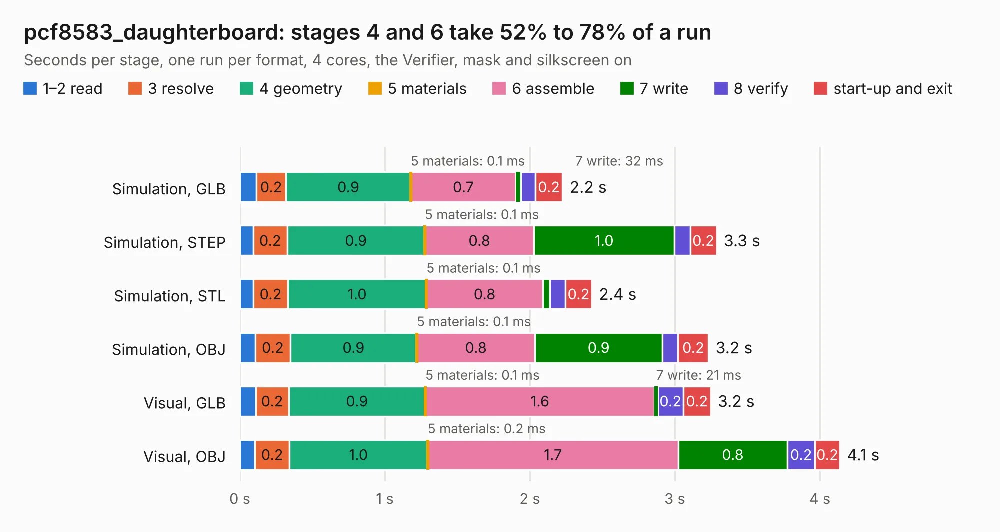

# 1080. pcf8583_daughterboard

Board 1,080 of the 3,123 of [Corpus Testing](../Corpus-Testing.md), on [Corpus Page 10](../CorpusTestingPages/Corpus-Testing-10.md#1080-pcf8583_daughterboard).

| Mode and format | 1–2 read | 3 resolve | 4 geometry | 5 materials | 6 assemble | 7 write | 8 verify | start-up and exit | Total |
|---|---:|---:|---:|---:|---:|---:|---:|---:|---:|
| Simulation, GLB | 0.1 | 0.2 | 0.9 | 0.1&nbsp;ms | 0.7 | 32&nbsp;ms | 0.1 | 0.2 | 2.2 |
| Simulation, STEP | 93&nbsp;ms | 0.2 | 0.9 | 0.1&nbsp;ms | 0.8 | 1.0 | 0.1 | 0.2 | 3.3 |
| Simulation, STL | 92&nbsp;ms | 0.2 | 1.0 | 0.1&nbsp;ms | 0.8 | 50&nbsp;ms | 0.1 | 0.2 | 2.4 |
| Simulation, OBJ | 0.1 | 0.2 | 0.9 | 0.1&nbsp;ms | 0.8 | 0.9 | 0.1 | 0.2 | 3.2 |
| Visual, GLB | 0.1 | 0.2 | 0.9 | 0.1&nbsp;ms | 1.6 | 21&nbsp;ms | 0.2 | 0.2 | 3.2 |
| Visual, OBJ | 0.1 | 0.2 | 1.0 | 0.2&nbsp;ms | 1.7 | 0.8 | 0.2 | 0.2 | 4.1 |

<table align="center"><tr><td valign="top">

| Board | Repo: [google/myelin-acorn-electron-hardware](https://github.com/google/myelin-acorn-electron-hardware) Board: `pcf8583_daughterboard.kicad_pcb` |
|---|---|
| Folder | pcf8583_daughterboard / pcb |
| Complexity | 171&nbsp;/&nbsp;1000 (size&nbsp;116, features&nbsp;55) |
| KESE&nbsp;features | through vias, rounded, trapezoid or chamfered pads, filled zones, curved board outline |
| Tested | 9th November 2026 |
| Copper&nbsp;layers | 2 |
| File&nbsp;format | KiCad 5 (20171130) |
| Parts,&nbsp;tracks,&nbsp;vias | 14, 65, 2 |
| Triangles,&nbsp;simulation | 214,068 in 23 parts |
| Verifier | PASS in all six runs |

</td><td valign="top">

<table>
<tr><th>File type</th><th>File size</th><th>Peak memory used</th></tr>
<tr><th colspan="3" align="left">Simulation</th></tr>
<tr><td>GLB</td><td align="right">7.4&nbsp;MB</td><td align="right">215&nbsp;MB</td></tr>
<tr><td>STEP</td><td align="right">37&nbsp;MB</td><td align="right">237&nbsp;MB</td></tr>
<tr><td>STL</td><td align="right">11&nbsp;MB</td><td align="right">212&nbsp;MB</td></tr>
<tr><td>OBJ</td><td align="right">21&nbsp;MB</td><td align="right">213&nbsp;MB</td></tr>
<tr><th colspan="3" align="left">Visual</th></tr>
<tr><td>GLB</td><td align="right">5.7&nbsp;MB</td><td align="right">212&nbsp;MB</td></tr>
<tr><td>OBJ</td><td align="right">16&nbsp;MB</td><td align="right">216&nbsp;MB</td></tr>
</table>

</td></tr></table>

| Previous | Next |
|:---|---:|
| [1079. minus_one](b1079b_myelin-acorn-electron-hardware_minus-one.md) | [1081. post_box_usb](b1081b_myelin-acorn-electron-hardware_post-box-usb.md) |
