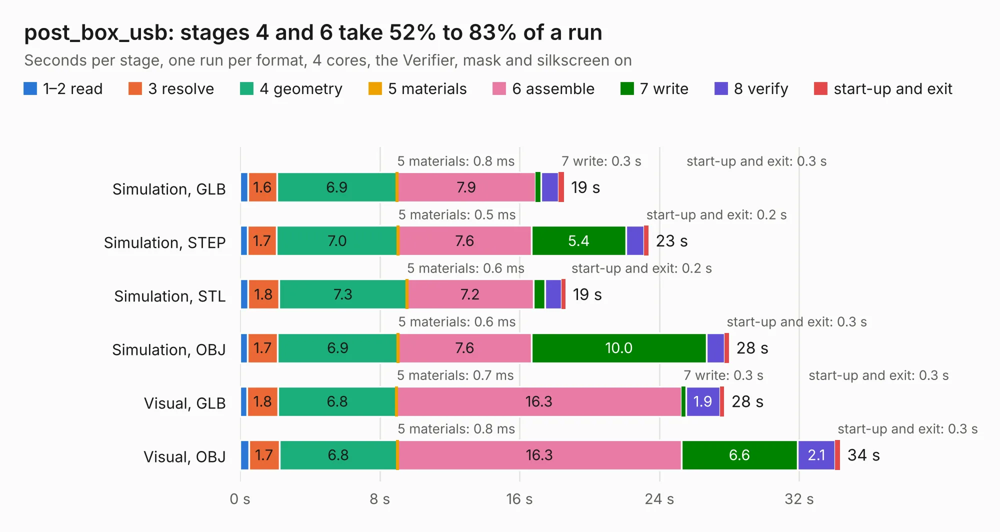

# 1083 post_box_usb

Board 1,083 of the 3,138 of [Corpus Testing](../Corpus-Testing.md), on [Corpus Page 11](../CorpusTestingPages/Corpus-Testing-11.md#1083-post_box_usb).

| Mode and format | 1–2 read | 3 resolve | 4 geometry | 5 materials | 6 assemble | 7 write | 8 verify | start-up and exit | Total |
|---|---:|---:|---:|---:|---:|---:|---:|---:|---:|
| Simulation, GLB | 0.5 | 1.6 | 6.9 | 0.8&nbsp;ms | 7.9 | 0.3 | 1.0 | 0.3 | 18.5 |
| Simulation, STEP | 0.4 | 1.7 | 7.0 | 0.5&nbsp;ms | 7.6 | 5.4 | 1.0 | 0.2 | 23.4 |
| Simulation, STL | 0.4 | 1.8 | 7.3 | 0.6&nbsp;ms | 7.2 | 0.7 | 0.9 | 0.2 | 18.6 |
| Simulation, OBJ | 0.4 | 1.7 | 6.9 | 0.6&nbsp;ms | 7.6 | 10.0 | 1.0 | 0.3 | 28.0 |
| Visual, GLB | 0.4 | 1.8 | 6.8 | 0.7&nbsp;ms | 16.3 | 0.3 | 1.9 | 0.3 | 27.7 |
| Visual, OBJ | 0.5 | 1.7 | 6.8 | 0.8&nbsp;ms | 16.3 | 6.6 | 2.1 | 0.3 | 34.3 |

<table align="center"><tr><td valign="top">

| Board | Repo: [google/myelin-acorn-electron-hardware](https://github.com/google/myelin-acorn-electron-hardware) Board: `post_box_usb.kicad_pcb` |
|---|---|
| Folder | post_box_usb / pcb |
| Complexity | 293&nbsp;/&nbsp;1000 (size&nbsp;238, features&nbsp;55) |
| KESE&nbsp;features | through vias, slotted holes, rounded, trapezoid or chamfered pads, filled zones |
| Tested | 9th November 2026 |
| Copper&nbsp;layers | 4 |
| File&nbsp;format | KiCad 5 (20171130) |
| Parts,&nbsp;tracks,&nbsp;vias | 66, 1,109, 99 |
| Triangles,&nbsp;simulation | 2,050,030 in 121 parts |
| Verifier | PASS in all six runs |

</td><td valign="top">

<table>
<tr><th>File type</th><th>File size</th><th>Peak memory used</th></tr>
<tr><th colspan="3" align="left">Simulation</th></tr>
<tr><td>GLB</td><td align="right">70&nbsp;MB</td><td align="right">673&nbsp;MB</td></tr>
<tr><td>STEP</td><td align="right">262&nbsp;MB</td><td align="right">871&nbsp;MB</td></tr>
<tr><td>STL</td><td align="right">103&nbsp;MB</td><td align="right">671&nbsp;MB</td></tr>
<tr><td>OBJ</td><td align="right">213&nbsp;MB</td><td align="right">1.4&nbsp;GB</td></tr>
<tr><th colspan="3" align="left">Visual</th></tr>
<tr><td>GLB</td><td align="right">46&nbsp;MB</td><td align="right">956&nbsp;MB</td></tr>
<tr><td>OBJ</td><td align="right">141&nbsp;MB</td><td align="right">1.0&nbsp;GB</td></tr>
</table>

</td></tr></table>

| Previous | Next |
|:---|---:|
| [1082 pcf8583_daughterboard](b1082b_myelin-acorn-electron-hardware_pcf8583-daughterboard.md) | [1084 rom_socket_level_shifter](b1084b_myelin-acorn-electron-hardware_rom-socket-level-shifter.md) |
