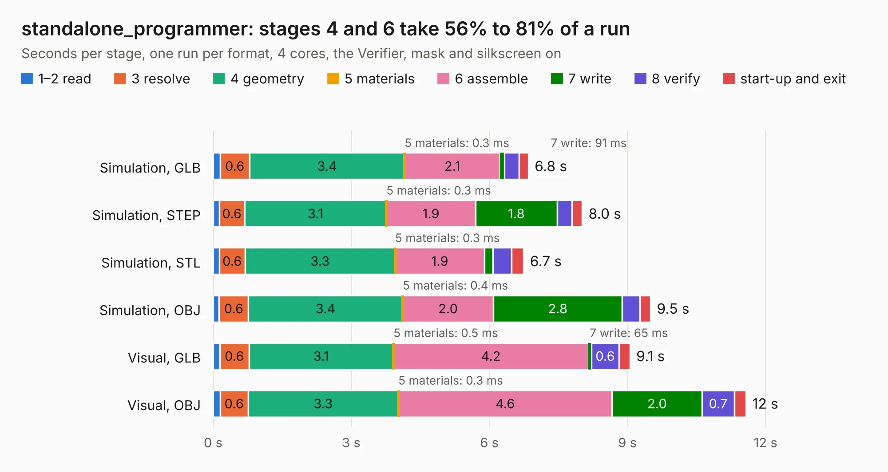

# 1084. standalone_programmer

Board 1,084 of the 3,127 of [Corpus Testing](../Corpus-Testing.md), on [Corpus Page 11](../CorpusTestingPages/Corpus-Testing-11.md#1084-standalone_programmer).

| Mode and format | 1–2 read | 3 resolve | 4 geometry | 5 materials | 6 assemble | 7 write | 8 verify | start-up and exit | Total |
|---|---:|---:|---:|---:|---:|---:|---:|---:|---:|
| Simulation, GLB | 0.2 | 0.6 | 3.4 | 0.3&nbsp;ms | 2.1 | 91&nbsp;ms | 0.3 | 0.2 | 6.8 |
| Simulation, STEP | 0.1 | 0.6 | 3.1 | 0.3&nbsp;ms | 1.9 | 1.8 | 0.3 | 0.2 | 8.0 |
| Simulation, STL | 0.1 | 0.6 | 3.3 | 0.3&nbsp;ms | 1.9 | 0.2 | 0.4 | 0.3 | 6.7 |
| Simulation, OBJ | 0.1 | 0.6 | 3.4 | 0.4&nbsp;ms | 2.0 | 2.8 | 0.4 | 0.2 | 9.5 |
| Visual, GLB | 0.1 | 0.6 | 3.1 | 0.5&nbsp;ms | 4.2 | 65&nbsp;ms | 0.6 | 0.2 | 9.1 |
| Visual, OBJ | 0.2 | 0.6 | 3.3 | 0.3&nbsp;ms | 4.6 | 2.0 | 0.7 | 0.3 | 11.6 |

<table align="center"><tr><td valign="top">

| Board | Repo: [google/myelin-acorn-electron-hardware](https://github.com/google/myelin-acorn-electron-hardware) Board: `standalone_programmer.kicad_pcb` |
|---|---|
| Folder | standalone_cartridge_programmer / pcb |
| Complexity | 198&nbsp;/&nbsp;1000 (size&nbsp;143, features&nbsp;55) |
| KESE&nbsp;features | through vias, rounded, trapezoid or chamfered pads, filled zones, curved board outline |
| Tested | 9th November 2026 |
| Copper&nbsp;layers | 2 |
| File&nbsp;format | KiCad 5 (20171130) |
| Parts,&nbsp;tracks,&nbsp;vias | 11, 366, 18 |
| Triangles,&nbsp;simulation | 681,416 in 58 parts |
| Verifier | PASS in all six runs |

</td><td valign="top">

<table>
<tr><th>File type</th><th>File size</th><th>Peak memory used</th></tr>
<tr><th colspan="3" align="left">Simulation</th></tr>
<tr><td>GLB</td><td align="right">24&nbsp;MB</td><td align="right">348&nbsp;MB</td></tr>
<tr><td>STEP</td><td align="right">120&nbsp;MB</td><td align="right">390&nbsp;MB</td></tr>
<tr><td>STL</td><td align="right">34&nbsp;MB</td><td align="right">326&nbsp;MB</td></tr>
<tr><td>OBJ</td><td align="right">70&nbsp;MB</td><td align="right">492&nbsp;MB</td></tr>
<tr><th colspan="3" align="left">Visual</th></tr>
<tr><td>GLB</td><td align="right">15&nbsp;MB</td><td align="right">406&nbsp;MB</td></tr>
<tr><td>OBJ</td><td align="right">45&nbsp;MB</td><td align="right">405&nbsp;MB</td></tr>
</table>

</td></tr></table>

| Previous | Next |
|:---|---:|
| [1083. bbc_1mhz_serial_sd](b1083b_myelin-acorn-electron-hardware_bbc-1mhz-serial-sd.md) | [1085. xc9500xl_44_breakout](b1085b_myelin-acorn-electron-hardware_xc9500xl-44-breakout.md) |
