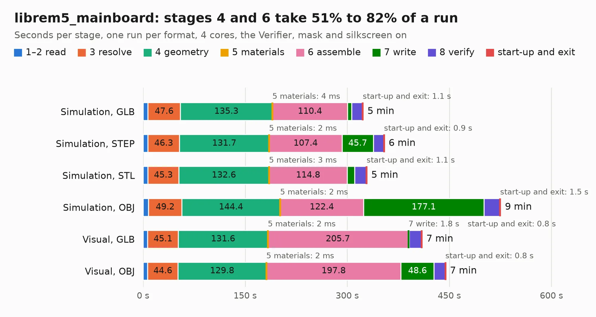

# 1085. librem5_mainboard

Board 1,085 of the 3,119 of [Corpus Testing](../Corpus-Testing.md), on [Corpus Page 11](../CorpusTestingPages/Corpus-Testing-11.md#1085-librem5_mainboard).

| Mode and format | 1–2 read | 3 resolve | 4 geometry | 5 materials | 6 assemble | 7 write | 8 verify | start-up and exit | Total |
|---|---:|---:|---:|---:|---:|---:|---:|---:|---:|
| Simulation, GLB | 7.2 | 47.6 | 135.3 | 4&nbsp;ms | 110.4 | 6.2 | 15.7 | 1.1 | 323.3 |
| Simulation, STEP | 7.2 | 46.3 | 131.7 | 2&nbsp;ms | 107.4 | 45.7 | 15.4 | 0.9 | 354.5 |
| Simulation, STL | 7.2 | 45.3 | 132.6 | 3&nbsp;ms | 114.8 | 11.0 | 17.0 | 1.1 | 329.0 |
| Simulation, OBJ | 7.8 | 49.2 | 144.4 | 2&nbsp;ms | 122.4 | 177.1 | 23.0 | 1.5 | 525.4 |
| Visual, GLB | 6.7 | 45.1 | 131.6 | 2&nbsp;ms | 205.7 | 1.8 | 18.3 | 0.8 | 409.9 |
| Visual, OBJ | 6.8 | 44.6 | 129.8 | 2&nbsp;ms | 197.8 | 48.6 | 16.3 | 0.8 | 444.6 |

<table align="center"><tr><td valign="top">

| Board | Repo: [gralco/l5-schematic](https://github.com/gralco/l5-schematic) Board: `librem5_mainboard.kicad_pcb` |
|---|---|
| Folder | CAD / KiCad / librem5_mainboard |
| Complexity | 600&nbsp;/&nbsp;1000 (size&nbsp;370, features&nbsp;230) |
| KESE&nbsp;features | through vias, blind and buried vias, microvias, slotted holes, custom pads, rounded, trapezoid or chamfered pads, arc tracks, filled zones, copper drawings, copper text, curved board outline, stack-up, dielectric εr and tanδ, mask and silkscreen colours |
| Tested | 9th November 2026 to 11th November 2026 |
| Copper&nbsp;layers | 10 |
| File&nbsp;format | KiCad 10 (20260206) |
| Parts,&nbsp;tracks,&nbsp;vias | 1,164, 19,488, 5,044 |
| Triangles,&nbsp;simulation | 21,846,464 in 866 parts |
| Verifier | PASS in all six runs |
| Run&nbsp;again | Simulation, OBJ: failed in the corpus run, run again with no memory cap and no time limit (swap added to a 16 GB machine), and passed |

</td><td valign="top">

<table>
<tr><th>File type</th><th>File size</th><th>Peak memory used</th></tr>
<tr><th colspan="3" align="left">Simulation</th></tr>
<tr><td>GLB</td><td align="right">751&nbsp;MB</td><td align="right">4.8&nbsp;GB</td></tr>
<tr><td>STEP</td><td align="right">2.5&nbsp;GB</td><td align="right">6.1&nbsp;GB</td></tr>
<tr><td>STL</td><td align="right">1.1&nbsp;GB</td><td align="right">4.7&nbsp;GB</td></tr>
<tr><td>OBJ</td><td align="right">2.5&nbsp;GB</td><td align="right">14&nbsp;GB</td></tr>
<tr><th colspan="3" align="left">Visual</th></tr>
<tr><td>GLB</td><td align="right">283&nbsp;MB</td><td align="right">5.3&nbsp;GB</td></tr>
<tr><td>OBJ</td><td align="right">948&nbsp;MB</td><td align="right">6.3&nbsp;GB</td></tr>
</table>

</td></tr></table>

| Previous | Next |
|:---|---:|
| [1084. dvk-mx8m-bsb](b1084b_dvk-mx8m-bsb_dvk-mx8m-bsb.md) | [1086. librem5_usb-c_board](b1086b_l5-schematic_librem5-usb-c-board.md) |
