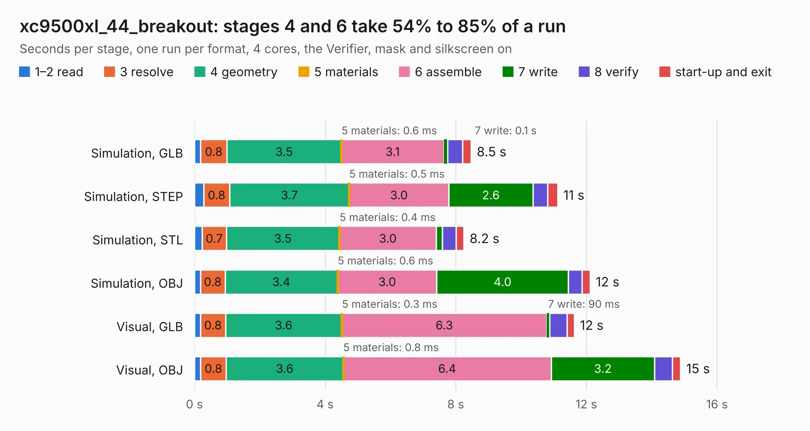

# 1085. xc9500xl_44_breakout

Board 1,085 of the 3,128 of [Corpus Testing](../Corpus-Testing.md), on [Corpus Page 11](../CorpusTestingPages/Corpus-Testing-11.md#1085-xc9500xl_44_breakout).

| Mode and format | 1–2 read | 3 resolve | 4 geometry | 5 materials | 6 assemble | 7 write | 8 verify | start-up and exit | Total |
|---|---:|---:|---:|---:|---:|---:|---:|---:|---:|
| Simulation, GLB | 0.2 | 0.8 | 3.5 | 0.6&nbsp;ms | 3.1 | 0.1 | 0.5 | 0.3 | 8.5 |
| Simulation, STEP | 0.3 | 0.8 | 3.7 | 0.5&nbsp;ms | 3.0 | 2.6 | 0.5 | 0.3 | 11.1 |
| Simulation, STL | 0.2 | 0.7 | 3.5 | 0.4&nbsp;ms | 3.0 | 0.2 | 0.4 | 0.2 | 8.2 |
| Simulation, OBJ | 0.2 | 0.8 | 3.4 | 0.6&nbsp;ms | 3.0 | 4.0 | 0.4 | 0.2 | 12.1 |
| Visual, GLB | 0.2 | 0.8 | 3.6 | 0.3&nbsp;ms | 6.3 | 90&nbsp;ms | 0.5 | 0.2 | 11.6 |
| Visual, OBJ | 0.2 | 0.8 | 3.6 | 0.8&nbsp;ms | 6.4 | 3.2 | 0.5 | 0.3 | 14.9 |

<table align="center"><tr><td valign="top">

| Board | Repo: [google/myelin-acorn-electron-hardware](https://github.com/google/myelin-acorn-electron-hardware) Board: `xc9500xl_44_breakout.kicad_pcb` |
|---|---|
| Folder | xc9500xl_44_breakout / pcb |
| Complexity | 188&nbsp;/&nbsp;1000 (size&nbsp;143, features&nbsp;45) |
| KESE&nbsp;features | through vias, rounded, trapezoid or chamfered pads, filled zones |
| Tested | 9th November 2026 |
| Copper&nbsp;layers | 2 |
| File&nbsp;format | KiCad 5 (20171130) |
| Parts,&nbsp;tracks,&nbsp;vias | 13, 269, 40 |
| Triangles,&nbsp;simulation | 750,304 in 53 parts |
| Verifier | PASS in all six runs |

</td><td valign="top">

<table>
<tr><th>File type</th><th>File size</th><th>Peak memory used</th></tr>
<tr><th colspan="3" align="left">Simulation</th></tr>
<tr><td>GLB</td><td align="right">26&nbsp;MB</td><td align="right">405&nbsp;MB</td></tr>
<tr><td>STEP</td><td align="right">123&nbsp;MB</td><td align="right">460&nbsp;MB</td></tr>
<tr><td>STL</td><td align="right">38&nbsp;MB</td><td align="right">405&nbsp;MB</td></tr>
<tr><td>OBJ</td><td align="right">76&nbsp;MB</td><td align="right">535&nbsp;MB</td></tr>
<tr><th colspan="3" align="left">Visual</th></tr>
<tr><td>GLB</td><td align="right">18&nbsp;MB</td><td align="right">442&nbsp;MB</td></tr>
<tr><td>OBJ</td><td align="right">55&nbsp;MB</td><td align="right">488&nbsp;MB</td></tr>
</table>

</td></tr></table>

| Previous | Next |
|:---|---:|
| [1084. standalone_programmer](b1084b_myelin-acorn-electron-hardware_standalone-programmer.md) | [1086. dvk-mx8m-bsb](b1086b_dvk-mx8m-bsb_dvk-mx8m-bsb.md) |
