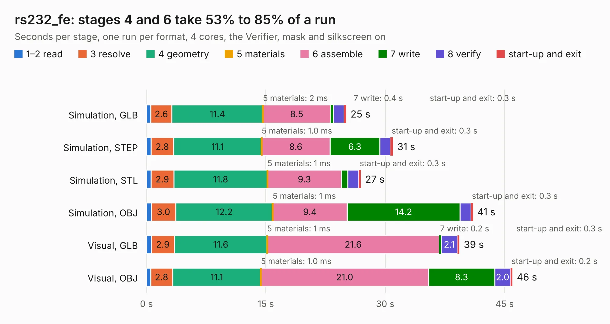

# 1087. rs232_fe

Board 1,087 of the 3,107 of [Corpus Testing](../Corpus-Testing.md), on [Corpus Page 11](../CorpusTestingPages/Corpus-Testing-11.md#1087-rs232_fe).

| Mode and format | 1–2 read | 3 resolve | 4 geometry | 5 materials | 6 assemble | 7 write | 8 verify | start-up and exit | Total |
|---|---:|---:|---:|---:|---:|---:|---:|---:|---:|
| Simulation, GLB | 0.5 | 2.6 | 11.4 | 2&nbsp;ms | 8.5 | 0.4 | 1.3 | 0.3 | 25.1 |
| Simulation, STEP | 0.6 | 2.8 | 11.1 | 1.0&nbsp;ms | 8.6 | 6.3 | 1.3 | 0.3 | 31.0 |
| Simulation, STL | 0.6 | 2.9 | 11.8 | 1&nbsp;ms | 9.3 | 0.8 | 1.4 | 0.3 | 26.9 |
| Simulation, OBJ | 0.6 | 3.0 | 12.2 | 1&nbsp;ms | 9.4 | 14.2 | 1.4 | 0.3 | 41.0 |
| Visual, GLB | 0.6 | 2.9 | 11.6 | 1&nbsp;ms | 21.6 | 0.2 | 2.1 | 0.3 | 39.3 |
| Visual, OBJ | 0.5 | 2.8 | 11.1 | 1.0&nbsp;ms | 21.0 | 8.3 | 2.0 | 0.2 | 46.0 |

<table align="center"><tr><td valign="top">

| Board | Repo: [greatscottgadgets/daisho](https://github.com/greatscottgadgets/daisho) Board: `rs232_fe.kicad_pcb` |
|---|---|
| Folder | hw / frontend / daisho_rs232_fe / rs232_fe |
| Complexity | 275&nbsp;/&nbsp;1000 (size&nbsp;220, features&nbsp;55) |
| KESE&nbsp;features | through vias, filled zones, copper text, curved board outline |
| Tested | 9th November 2026 |
| Copper&nbsp;layers | 4 |
| File&nbsp;format | KiCad 4 (4) |
| Parts,&nbsp;tracks,&nbsp;vias | 165, 2,512, 181 |
| Triangles,&nbsp;simulation | 2,309,022 in 309 parts |
| Verifier | PASS in all six runs |

</td><td valign="top">

<table>
<tr><th>File type</th><th>File size</th><th>Peak memory used</th></tr>
<tr><th colspan="3" align="left">Simulation</th></tr>
<tr><td>GLB</td><td align="right">82&nbsp;MB</td><td align="right">871&nbsp;MB</td></tr>
<tr><td>STEP</td><td align="right">345&nbsp;MB</td><td align="right">921&nbsp;MB</td></tr>
<tr><td>STL</td><td align="right">115&nbsp;MB</td><td align="right">817&nbsp;MB</td></tr>
<tr><td>OBJ</td><td align="right">250&nbsp;MB</td><td align="right">1.6&nbsp;GB</td></tr>
<tr><th colspan="3" align="left">Visual</th></tr>
<tr><td>GLB</td><td align="right">52&nbsp;MB</td><td align="right">1.0&nbsp;GB</td></tr>
<tr><td>OBJ</td><td align="right">161&nbsp;MB</td><td align="right">1.1&nbsp;GB</td></tr>
</table>

</td></tr></table>

| Previous | Next |
|:---|---:|
| [1086. gige_fe](b1086b_daisho_gige-fe.md) | [1088. hdmi](b1088b_daisho_hw-frontend-hdmi_hdmi.md) |
