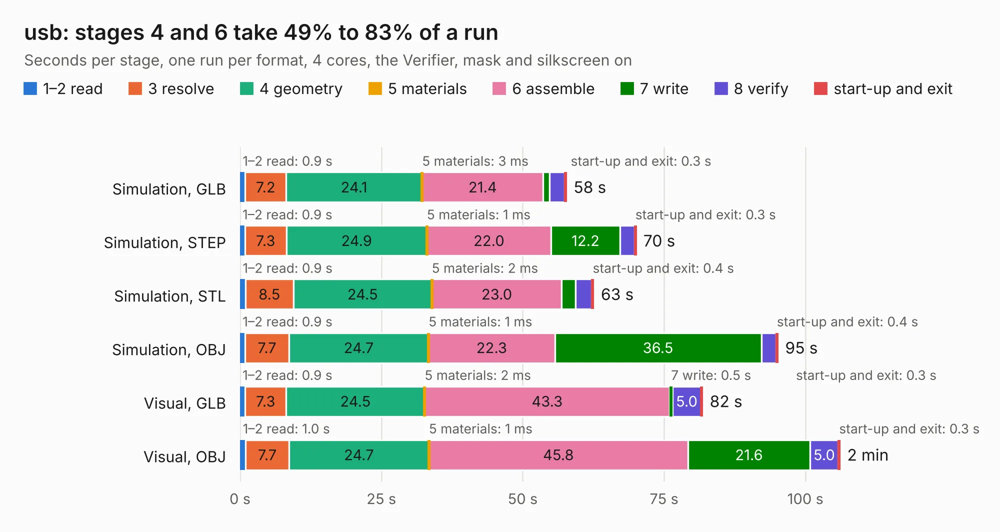

# 1087. usb

Board 1,087 of the 3,103 of [Corpus Testing](../Corpus-Testing.md), on [Corpus Page 11](../CorpusTestingPages/Corpus-Testing-11.md#1087-usb).

| Mode and format | 1–2 read | 3 resolve | 4 geometry | 5 materials | 6 assemble | 7 write | 8 verify | start-up and exit | Total |
|---|---:|---:|---:|---:|---:|---:|---:|---:|---:|
| Simulation, GLB | 0.9 | 7.2 | 24.1 | 3&nbsp;ms | 21.4 | 1.1 | 2.7 | 0.3 | 57.7 |
| Simulation, STEP | 0.9 | 7.3 | 24.9 | 1&nbsp;ms | 22.0 | 12.2 | 2.6 | 0.3 | 70.1 |
| Simulation, STL | 0.9 | 8.5 | 24.5 | 2&nbsp;ms | 23.0 | 2.4 | 2.9 | 0.4 | 62.6 |
| Simulation, OBJ | 0.9 | 7.7 | 24.7 | 1&nbsp;ms | 22.3 | 36.5 | 2.6 | 0.4 | 95.2 |
| Visual, GLB | 0.9 | 7.3 | 24.5 | 2&nbsp;ms | 43.3 | 0.5 | 5.0 | 0.3 | 81.8 |
| Visual, OBJ | 1.0 | 7.7 | 24.7 | 1&nbsp;ms | 45.8 | 21.6 | 5.0 | 0.3 | 106.1 |

<table align="center"><tr><td valign="top">

| Board | Repo: [greatscottgadgets/daisho](https://github.com/greatscottgadgets/daisho) Board: `usb.kicad_pcb` |
|---|---|
| Folder | hw / frontend / usb |
| Complexity | 333&nbsp;/&nbsp;1000 (size&nbsp;308, features&nbsp;25) |
| KESE&nbsp;features | through vias, curved board outline |
| Tested | 9th November 2026 |
| Copper&nbsp;layers | 6 |
| File&nbsp;format | KiCad 4 (4) |
| Parts,&nbsp;tracks,&nbsp;vias | 249, 5,119, 831 |
| Triangles,&nbsp;simulation | 5,867,216 in 325 parts |
| Verifier | PASS in all six runs |

</td><td valign="top">

<table>
<tr><th>File type</th><th>File size</th><th>Peak memory used</th></tr>
<tr><th colspan="3" align="left">Simulation</th></tr>
<tr><td>GLB</td><td align="right">202&nbsp;MB</td><td align="right">1.5&nbsp;GB</td></tr>
<tr><td>STEP</td><td align="right">706&nbsp;MB</td><td align="right">2.0&nbsp;GB</td></tr>
<tr><td>STL</td><td align="right">293&nbsp;MB</td><td align="right">1.6&nbsp;GB</td></tr>
<tr><td>OBJ</td><td align="right">640&nbsp;MB</td><td align="right">3.8&nbsp;GB</td></tr>
<tr><th colspan="3" align="left">Visual</th></tr>
<tr><td>GLB</td><td align="right">110&nbsp;MB</td><td align="right">1.8&nbsp;GB</td></tr>
<tr><td>OBJ</td><td align="right">360&nbsp;MB</td><td align="right">2.4&nbsp;GB</td></tr>
</table>

</td></tr></table>

| Previous | Next |
|:---|---:|
| [1086. prod_fe](b1086b_daisho_prod-fe.md) | [1088. main_board](b1088b_daisho_main-board.md) |
