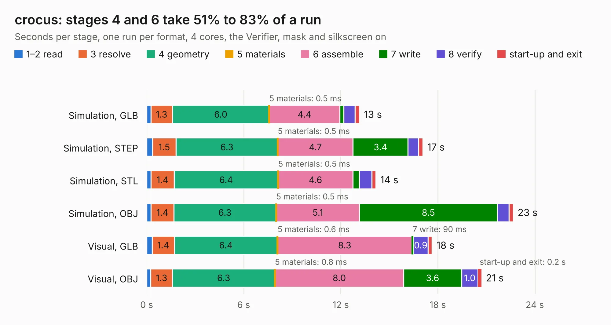

# 1088. crocus

Board 1,088 of the 3,100 of [Corpus Testing](../Corpus-Testing.md), on [Corpus Page 11](../CorpusTestingPages/Corpus-Testing-11.md#1088-crocus).

| Mode and format | 1–2 read | 3 resolve | 4 geometry | 5 materials | 6 assemble | 7 write | 8 verify | start-up and exit | Total |
|---|---:|---:|---:|---:|---:|---:|---:|---:|---:|
| Simulation, GLB | 0.3 | 1.3 | 6.0 | 0.5&nbsp;ms | 4.4 | 0.3 | 0.7 | 0.3 | 13.2 |
| Simulation, STEP | 0.4 | 1.5 | 6.3 | 0.5&nbsp;ms | 4.7 | 3.4 | 0.7 | 0.3 | 17.1 |
| Simulation, STL | 0.3 | 1.4 | 6.4 | 0.5&nbsp;ms | 4.6 | 0.4 | 0.8 | 0.2 | 14.2 |
| Simulation, OBJ | 0.3 | 1.4 | 6.3 | 0.5&nbsp;ms | 5.1 | 8.5 | 0.7 | 0.3 | 22.7 |
| Visual, GLB | 0.3 | 1.4 | 6.4 | 0.6&nbsp;ms | 8.3 | 90&nbsp;ms | 0.9 | 0.2 | 17.6 |
| Visual, OBJ | 0.3 | 1.3 | 6.3 | 0.8&nbsp;ms | 8.0 | 3.6 | 1.0 | 0.2 | 20.7 |

<table align="center"><tr><td valign="top">

| Board | Repo: [greatscottgadgets/greatfet-hardware](https://github.com/greatscottgadgets/greatfet-hardware) Board: `crocus.kicad_pcb` |
|---|---|
| Folder | crocus |
| Complexity | 220&nbsp;/&nbsp;1000 (size&nbsp;175, features&nbsp;45) |
| KESE&nbsp;features | through vias, filled zones, curved board outline |
| Tested | 9th November 2026 |
| Copper&nbsp;layers | 4 |
| File&nbsp;format | KiCad 4 (4) |
| Parts,&nbsp;tracks,&nbsp;vias | 49, 298, 46 |
| Triangles,&nbsp;simulation | 1,310,436 in 132 parts |
| Verifier | PASS in all six runs |

</td><td valign="top">

<table>
<tr><th>File type</th><th>File size</th><th>Peak memory used</th></tr>
<tr><th colspan="3" align="left">Simulation</th></tr>
<tr><td>GLB</td><td align="right">44&nbsp;MB</td><td align="right">471&nbsp;MB</td></tr>
<tr><td>STEP</td><td align="right">169&nbsp;MB</td><td align="right">546&nbsp;MB</td></tr>
<tr><td>STL</td><td align="right">66&nbsp;MB</td><td align="right">486&nbsp;MB</td></tr>
<tr><td>OBJ</td><td align="right">135&nbsp;MB</td><td align="right">870&nbsp;MB</td></tr>
<tr><th colspan="3" align="left">Visual</th></tr>
<tr><td>GLB</td><td align="right">21&nbsp;MB</td><td align="right">577&nbsp;MB</td></tr>
<tr><td>OBJ</td><td align="right">62&nbsp;MB</td><td align="right">529&nbsp;MB</td></tr>
</table>

</td></tr></table>

| Previous | Next |
|:---|---:|
| [1087. begonia](b1087b_greatfet-hardware_begonia.md) | [1089. daffodil](b1089b_greatfet-hardware_daffodil.md) |
