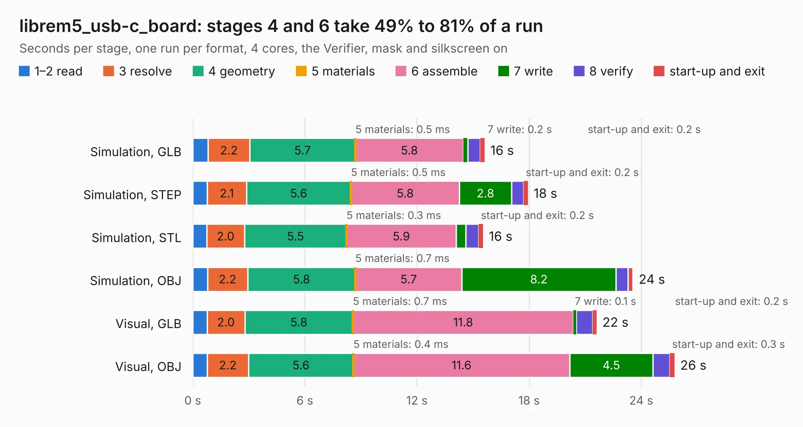

# 1088. librem5_usb-c_board

Board 1,088 of the 3,129 of [Corpus Testing](../Corpus-Testing.md), on [Corpus Page 11](../CorpusTestingPages/Corpus-Testing-11.md#1088-librem5_usb-c_board).

| Mode and format | 1–2 read | 3 resolve | 4 geometry | 5 materials | 6 assemble | 7 write | 8 verify | start-up and exit | Total |
|---|---:|---:|---:|---:|---:|---:|---:|---:|---:|
| Simulation, GLB | 0.8 | 2.2 | 5.7 | 0.5&nbsp;ms | 5.8 | 0.2 | 0.7 | 0.2 | 15.6 |
| Simulation, STEP | 0.8 | 2.1 | 5.6 | 0.5&nbsp;ms | 5.8 | 2.8 | 0.7 | 0.2 | 17.9 |
| Simulation, STL | 0.7 | 2.0 | 5.5 | 0.3&nbsp;ms | 5.9 | 0.5 | 0.7 | 0.2 | 15.5 |
| Simulation, OBJ | 0.8 | 2.2 | 5.8 | 0.7&nbsp;ms | 5.7 | 8.2 | 0.7 | 0.3 | 23.6 |
| Visual, GLB | 0.8 | 2.0 | 5.8 | 0.7&nbsp;ms | 11.8 | 0.1 | 0.9 | 0.2 | 21.6 |
| Visual, OBJ | 0.8 | 2.2 | 5.6 | 0.4&nbsp;ms | 11.6 | 4.5 | 0.9 | 0.3 | 25.8 |

<table align="center"><tr><td valign="top">

| Board | Repo: [gralco/l5-schematic](https://github.com/gralco/l5-schematic) Board: `librem5_usb-c_board.kicad_pcb` |
|---|---|
| Folder | CAD / KiCad / librem5_usb-c_board |
| Complexity | 397&nbsp;/&nbsp;1000 (size&nbsp;212, features&nbsp;185) |
| KESE&nbsp;features | through vias, blind and buried vias, microvias, slotted holes, custom pads, rounded, trapezoid or chamfered pads, arc tracks, filled zones, copper drawings, curved board outline |
| Tested | 9th November 2026 |
| Copper&nbsp;layers | 6 |
| File&nbsp;format | KiCad 9 (20241229) |
| Parts,&nbsp;tracks,&nbsp;vias | 52, 1,102, 355 |
| Triangles,&nbsp;simulation | 1,417,846 in 76 parts |
| Verifier | PASS in all six runs |

</td><td valign="top">

<table>
<tr><th>File type</th><th>File size</th><th>Peak memory used</th></tr>
<tr><th colspan="3" align="left">Simulation</th></tr>
<tr><td>GLB</td><td align="right">49&nbsp;MB</td><td align="right">563&nbsp;MB</td></tr>
<tr><td>STEP</td><td align="right">149&nbsp;MB</td><td align="right">640&nbsp;MB</td></tr>
<tr><td>STL</td><td align="right">71&nbsp;MB</td><td align="right">564&nbsp;MB</td></tr>
<tr><td>OBJ</td><td align="right">147&nbsp;MB</td><td align="right">978&nbsp;MB</td></tr>
<tr><th colspan="3" align="left">Visual</th></tr>
<tr><td>GLB</td><td align="right">25&nbsp;MB</td><td align="right">594&nbsp;MB</td></tr>
<tr><td>OBJ</td><td align="right">77&nbsp;MB</td><td align="right">639&nbsp;MB</td></tr>
</table>

</td></tr></table>

| Previous | Next |
|:---|---:|
| [1087. librem5_mainboard](b1087b_l5-schematic_CAD-KiCad-librem5-mainboard_librem5-mainboard.md) | [1089. librem5_usb-c_fpc](b1089b_l5-schematic_librem5-usb-c-fpc.md) |
