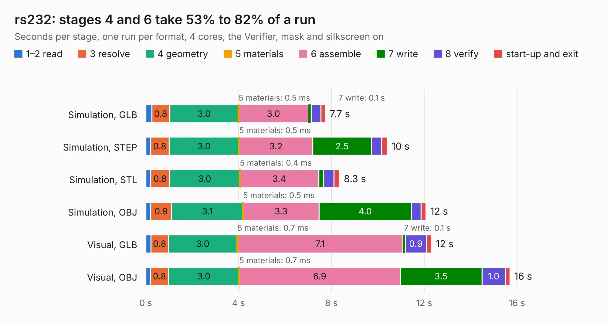

# 1091. rs232

Board 1,091 of the 3,116 of [Corpus Testing](../Corpus-Testing.md), on [Corpus Page 11](../CorpusTestingPages/Corpus-Testing-11.md#1091-rs232).

| Mode and format | 1–2 read | 3 resolve | 4 geometry | 5 materials | 6 assemble | 7 write | 8 verify | start-up and exit | Total |
|---|---:|---:|---:|---:|---:|---:|---:|---:|---:|
| Simulation, GLB | 0.3 | 0.8 | 3.0 | 0.5&nbsp;ms | 3.0 | 0.1 | 0.4 | 0.2 | 7.7 |
| Simulation, STEP | 0.2 | 0.8 | 3.0 | 0.5&nbsp;ms | 3.2 | 2.5 | 0.4 | 0.2 | 10.4 |
| Simulation, STL | 0.2 | 0.8 | 3.0 | 0.4&nbsp;ms | 3.4 | 0.2 | 0.4 | 0.2 | 8.3 |
| Simulation, OBJ | 0.2 | 0.9 | 3.1 | 0.5&nbsp;ms | 3.3 | 4.0 | 0.4 | 0.2 | 12.1 |
| Visual, GLB | 0.2 | 0.8 | 3.0 | 0.7&nbsp;ms | 7.1 | 0.1 | 0.9 | 0.2 | 12.3 |
| Visual, OBJ | 0.2 | 0.8 | 3.0 | 0.7&nbsp;ms | 6.9 | 3.5 | 1.0 | 0.2 | 15.7 |

<table align="center"><tr><td valign="top">

| Board | Repo: [greatscottgadgets/daisho](https://github.com/greatscottgadgets/daisho) Board: `rs232.kicad_pcb` |
|---|---|
| Folder | hw / de2-115-frontend / rs232 |
| Complexity | 222&nbsp;/&nbsp;1000 (size&nbsp;177, features&nbsp;45) |
| KESE&nbsp;features | through vias, filled zones, curved board outline |
| Tested | 9th November 2026 |
| Copper&nbsp;layers | 2 |
| File&nbsp;format | KiCad 3 (3) |
| Parts,&nbsp;tracks,&nbsp;vias | 41, 1,007, 149 |
| Triangles,&nbsp;simulation | 780,252 in 111 parts |
| Verifier | PASS in all six runs |

</td><td valign="top">

<table>
<tr><th>File type</th><th>File size</th><th>Peak memory used</th></tr>
<tr><th colspan="3" align="left">Simulation</th></tr>
<tr><td>GLB</td><td align="right">27&nbsp;MB</td><td align="right">447&nbsp;MB</td></tr>
<tr><td>STEP</td><td align="right">129&nbsp;MB</td><td align="right">483&nbsp;MB</td></tr>
<tr><td>STL</td><td align="right">39&nbsp;MB</td><td align="right">423&nbsp;MB</td></tr>
<tr><td>OBJ</td><td align="right">79&nbsp;MB</td><td align="right">563&nbsp;MB</td></tr>
<tr><th colspan="3" align="left">Visual</th></tr>
<tr><td>GLB</td><td align="right">23&nbsp;MB</td><td align="right">577&nbsp;MB</td></tr>
<tr><td>OBJ</td><td align="right">71&nbsp;MB</td><td align="right">596&nbsp;MB</td></tr>
</table>

</td></tr></table>

| Previous | Next |
|:---|---:|
| [1090. hdmi](b1090b_daisho_hw-de2-115-frontend-hdmi_hdmi.md) | [1092. gige_fe](b1092b_daisho_gige-fe.md) |
