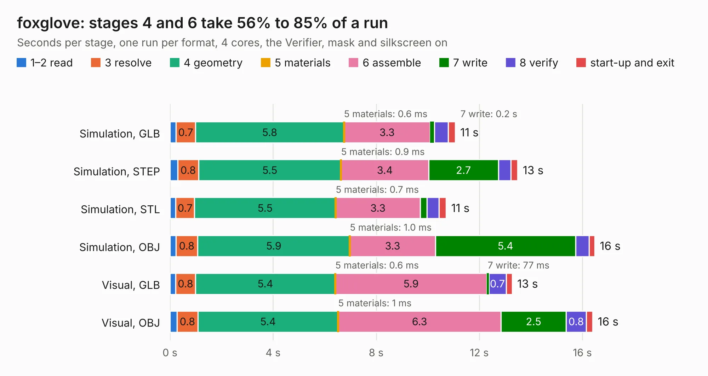

# 1091. foxglove

Board 1,091 of the 3,100 of [Corpus Testing](../Corpus-Testing.md), on [Corpus Page 11](../CorpusTestingPages/Corpus-Testing-11.md#1091-foxglove).

| Mode and format | 1–2 read | 3 resolve | 4 geometry | 5 materials | 6 assemble | 7 write | 8 verify | start-up and exit | Total |
|---|---:|---:|---:|---:|---:|---:|---:|---:|---:|
| Simulation, GLB | 0.2 | 0.7 | 5.8 | 0.6&nbsp;ms | 3.3 | 0.2 | 0.5 | 0.3 | 11.1 |
| Simulation, STEP | 0.3 | 0.8 | 5.5 | 0.9&nbsp;ms | 3.4 | 2.7 | 0.5 | 0.3 | 13.5 |
| Simulation, STL | 0.2 | 0.7 | 5.5 | 0.7&nbsp;ms | 3.3 | 0.3 | 0.5 | 0.3 | 10.7 |
| Simulation, OBJ | 0.2 | 0.8 | 5.9 | 1.0&nbsp;ms | 3.3 | 5.4 | 0.5 | 0.2 | 16.5 |
| Visual, GLB | 0.2 | 0.8 | 5.4 | 0.6&nbsp;ms | 5.9 | 77&nbsp;ms | 0.7 | 0.2 | 13.3 |
| Visual, OBJ | 0.3 | 0.8 | 5.4 | 1&nbsp;ms | 6.3 | 2.5 | 0.8 | 0.3 | 16.4 |

<table align="center"><tr><td valign="top">

| Board | Repo: [greatscottgadgets/greatfet-hardware](https://github.com/greatscottgadgets/greatfet-hardware) Board: `foxglove.kicad_pcb` |
|---|---|
| Folder | foxglove |
| Complexity | 242&nbsp;/&nbsp;1000 (size&nbsp;187, features&nbsp;55) |
| KESE&nbsp;features | through vias, filled zones, copper text, curved board outline |
| Tested | 9th November 2026 |
| Copper&nbsp;layers | 2 |
| File&nbsp;format | KiCad 4 (4) |
| Parts,&nbsp;tracks,&nbsp;vias | 19, 318, 24 |
| Triangles,&nbsp;simulation | 855,148 in 137 parts |
| Verifier | PASS in all six runs |

</td><td valign="top">

<table>
<tr><th>File type</th><th>File size</th><th>Peak memory used</th></tr>
<tr><th colspan="3" align="left">Simulation</th></tr>
<tr><td>GLB</td><td align="right">29&nbsp;MB</td><td align="right">375&nbsp;MB</td></tr>
<tr><td>STEP</td><td align="right">133&nbsp;MB</td><td align="right">464&nbsp;MB</td></tr>
<tr><td>STL</td><td align="right">43&nbsp;MB</td><td align="right">361&nbsp;MB</td></tr>
<tr><td>OBJ</td><td align="right">87&nbsp;MB</td><td align="right">632&nbsp;MB</td></tr>
<tr><th colspan="3" align="left">Visual</th></tr>
<tr><td>GLB</td><td align="right">15&nbsp;MB</td><td align="right">433&nbsp;MB</td></tr>
<tr><td>OBJ</td><td align="right">44&nbsp;MB</td><td align="right">427&nbsp;MB</td></tr>
</table>

</td></tr></table>

| Previous | Next |
|:---|---:|
| [1090. edelweiss](b1090b_greatfet-hardware_edelweiss.md) | [1092. gladiolus](b1092b_greatfet-hardware_gladiolus.md) |
