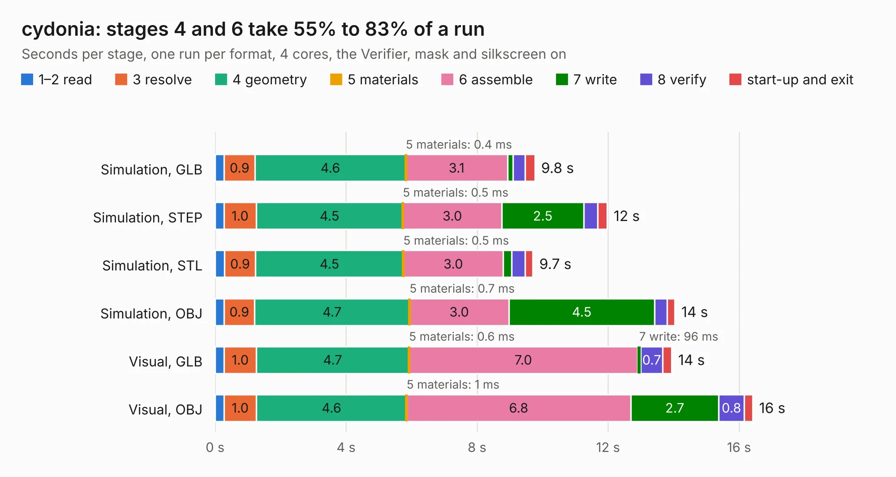

# 1094 cydonia

Board 1,094 of the 3,138 of [Corpus Testing](../Corpus-Testing.md), on [Corpus Page 11](../CorpusTestingPages/Corpus-Testing-11.md#1094-cydonia).

| Mode and format | 1–2 read | 3 resolve | 4 geometry | 5 materials | 6 assemble | 7 write | 8 verify | start-up and exit | Total |
|---|---:|---:|---:|---:|---:|---:|---:|---:|---:|
| Simulation, GLB | 0.3 | 0.9 | 4.6 | 0.4&nbsp;ms | 3.1 | 0.2 | 0.4 | 0.3 | 9.8 |
| Simulation, STEP | 0.3 | 1.0 | 4.5 | 0.5&nbsp;ms | 3.0 | 2.5 | 0.4 | 0.3 | 12.0 |
| Simulation, STL | 0.3 | 0.9 | 4.5 | 0.5&nbsp;ms | 3.0 | 0.3 | 0.4 | 0.2 | 9.7 |
| Simulation, OBJ | 0.3 | 0.9 | 4.7 | 0.7&nbsp;ms | 3.0 | 4.5 | 0.4 | 0.2 | 14.0 |
| Visual, GLB | 0.3 | 1.0 | 4.7 | 0.6&nbsp;ms | 7.0 | 96&nbsp;ms | 0.7 | 0.3 | 13.9 |
| Visual, OBJ | 0.3 | 1.0 | 4.6 | 1&nbsp;ms | 6.8 | 2.7 | 0.8 | 0.3 | 16.4 |

<table align="center"><tr><td valign="top">

| Board | Repo: [greatscottgadgets/cydonia](https://github.com/greatscottgadgets/cydonia) Board: `cydonia.kicad_pcb` |
|---|---|
| Complexity | 299&nbsp;/&nbsp;1000 (size&nbsp;234, features&nbsp;65) |
| KESE&nbsp;features | through vias, rounded, trapezoid or chamfered pads, filled zones, copper text, curved board outline |
| Tested | 9th November 2026 |
| Copper&nbsp;layers | 4 |
| File&nbsp;format | KiCad 5 (20171130) |
| Parts,&nbsp;tracks,&nbsp;vias | 107, 574, 74 |
| Triangles,&nbsp;simulation | 920,804 in 93 parts |
| Verifier | PASS in all six runs |

</td><td valign="top">

<table>
<tr><th>File type</th><th>File size</th><th>Peak memory used</th></tr>
<tr><th colspan="3" align="left">Simulation</th></tr>
<tr><td>GLB</td><td align="right">33&nbsp;MB</td><td align="right">452&nbsp;MB</td></tr>
<tr><td>STEP</td><td align="right">124&nbsp;MB</td><td align="right">484&nbsp;MB</td></tr>
<tr><td>STL</td><td align="right">46&nbsp;MB</td><td align="right">454&nbsp;MB</td></tr>
<tr><td>OBJ</td><td align="right">96&nbsp;MB</td><td align="right">679&nbsp;MB</td></tr>
<tr><th colspan="3" align="left">Visual</th></tr>
<tr><td>GLB</td><td align="right">19&nbsp;MB</td><td align="right">473&nbsp;MB</td></tr>
<tr><td>OBJ</td><td align="right">57&nbsp;MB</td><td align="right">499&nbsp;MB</td></tr>
</table>

</td></tr></table>

| Previous | Next |
|:---|---:|
| [1093 amalthea](b1093b_amalthea-hardware_amalthea.md) | [1095 cynthion](b1095b_cynthion-hardware_cynthion.md) |
