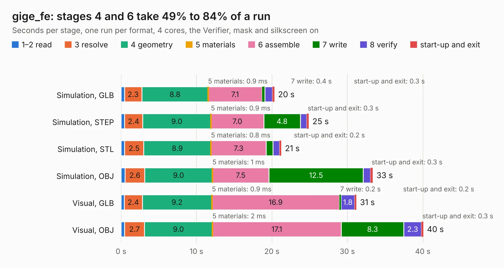

# 1094. gige_fe

Board 1,094 of the 3,118 of [Corpus Testing](../Corpus-Testing.md), on [Corpus Page 11](../CorpusTestingPages/Corpus-Testing-11.md#1094-gige_fe).

| Mode and format | 1–2 read | 3 resolve | 4 geometry | 5 materials | 6 assemble | 7 write | 8 verify | start-up and exit | Total |
|---|---:|---:|---:|---:|---:|---:|---:|---:|---:|
| Simulation, GLB | 0.5 | 2.3 | 8.8 | 0.9&nbsp;ms | 7.1 | 0.4 | 1.0 | 0.3 | 20.3 |
| Simulation, STEP | 0.5 | 2.4 | 9.0 | 0.9&nbsp;ms | 7.0 | 4.8 | 0.9 | 0.3 | 24.9 |
| Simulation, STL | 0.5 | 2.5 | 8.9 | 0.8&nbsp;ms | 7.3 | 0.9 | 0.9 | 0.2 | 21.3 |
| Simulation, OBJ | 0.5 | 2.6 | 9.0 | 1&nbsp;ms | 7.5 | 12.5 | 1.0 | 0.3 | 33.4 |
| Visual, GLB | 0.4 | 2.4 | 9.2 | 0.9&nbsp;ms | 16.9 | 0.2 | 1.8 | 0.2 | 31.2 |
| Visual, OBJ | 0.5 | 2.7 | 9.0 | 2&nbsp;ms | 17.1 | 8.3 | 2.3 | 0.3 | 40.1 |

<table align="center"><tr><td valign="top">

| Board | Repo: [greatscottgadgets/daisho](https://github.com/greatscottgadgets/daisho) Board: `gige_fe.kicad_pcb` |
|---|---|
| Folder | hw / frontend / daisho_gige_fe |
| Complexity | 306&nbsp;/&nbsp;1000 (size&nbsp;261, features&nbsp;45) |
| KESE&nbsp;features | through vias, filled zones, curved board outline |
| Tested | 9th November 2026 |
| Copper&nbsp;layers | 4 |
| File&nbsp;format | KiCad 4 (4) |
| Parts,&nbsp;tracks,&nbsp;vias | 138, 1,686, 264 |
| Triangles,&nbsp;simulation | 2,142,834 in 260 parts |
| Verifier | PASS in all six runs |

</td><td valign="top">

<table>
<tr><th>File type</th><th>File size</th><th>Peak memory used</th></tr>
<tr><th colspan="3" align="left">Simulation</th></tr>
<tr><td>GLB</td><td align="right">75&nbsp;MB</td><td align="right">801&nbsp;MB</td></tr>
<tr><td>STEP</td><td align="right">291&nbsp;MB</td><td align="right">856&nbsp;MB</td></tr>
<tr><td>STL</td><td align="right">107&nbsp;MB</td><td align="right">840&nbsp;MB</td></tr>
<tr><td>OBJ</td><td align="right">228&nbsp;MB</td><td align="right">1.4&nbsp;GB</td></tr>
<tr><th colspan="3" align="left">Visual</th></tr>
<tr><td>GLB</td><td align="right">46&nbsp;MB</td><td align="right">890&nbsp;MB</td></tr>
<tr><td>OBJ</td><td align="right">140&nbsp;MB</td><td align="right">1.0&nbsp;GB</td></tr>
</table>

</td></tr></table>

| Previous | Next |
|:---|---:|
| [1093. rs232](b1093b_daisho_rs232.md) | [1095. rs232_fe](b1095b_daisho_rs232-fe.md) |
