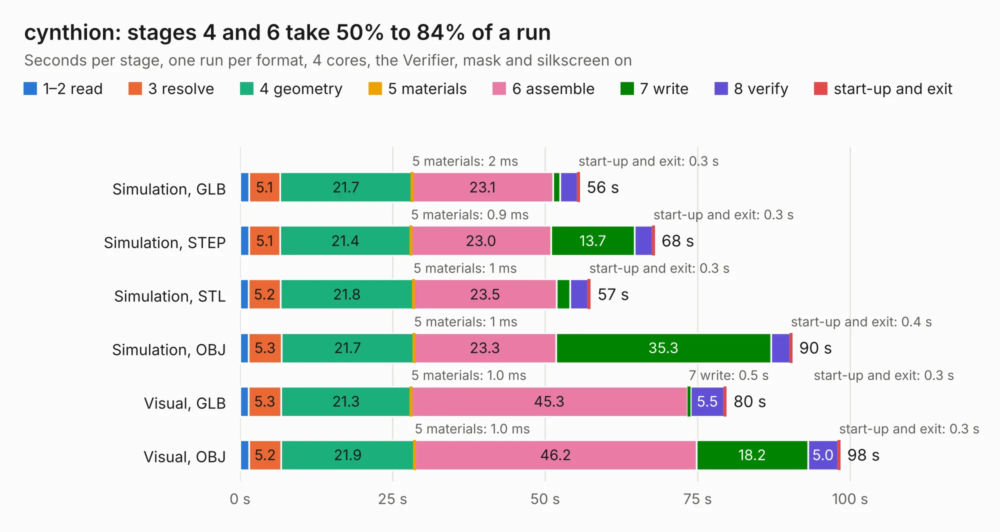

# 1095. cynthion

Board 1,095 of the 3,138 of [Corpus Testing](../Corpus-Testing.md), on [Corpus Page 11](../CorpusTestingPages/Corpus-Testing-11.md#1095-cynthion).

| Mode and format | 1–2 read | 3 resolve | 4 geometry | 5 materials | 6 assemble | 7 write | 8 verify | start-up and exit | Total |
|---|---:|---:|---:|---:|---:|---:|---:|---:|---:|
| Simulation, GLB | 1.4 | 5.1 | 21.7 | 2&nbsp;ms | 23.1 | 1.2 | 2.9 | 0.3 | 55.6 |
| Simulation, STEP | 1.5 | 5.1 | 21.4 | 0.9&nbsp;ms | 23.0 | 13.7 | 2.9 | 0.3 | 67.9 |
| Simulation, STL | 1.4 | 5.2 | 21.8 | 1&nbsp;ms | 23.5 | 2.2 | 3.0 | 0.3 | 57.4 |
| Simulation, OBJ | 1.4 | 5.3 | 21.7 | 1&nbsp;ms | 23.3 | 35.3 | 3.1 | 0.4 | 90.5 |
| Visual, GLB | 1.4 | 5.3 | 21.3 | 1.0&nbsp;ms | 45.3 | 0.5 | 5.5 | 0.3 | 79.7 |
| Visual, OBJ | 1.5 | 5.2 | 21.9 | 1.0&nbsp;ms | 46.2 | 18.2 | 5.0 | 0.3 | 98.3 |

<table align="center"><tr><td valign="top">

| Board | Repo: [greatscottgadgets/cynthion-hardware](https://github.com/greatscottgadgets/cynthion-hardware) Board: `cynthion.kicad_pcb` |
|---|---|
| Complexity | 454&nbsp;/&nbsp;1000 (size&nbsp;304, features&nbsp;150) |
| KESE&nbsp;features | through vias, slotted holes, custom pads, rounded, trapezoid or chamfered pads, arc tracks, filled zones, copper drawings, copper text, curved board outline, stack-up, dielectric εr and tanδ, mask and silkscreen colours |
| Tested | 9th November 2026 |
| Copper&nbsp;layers | 6 |
| File&nbsp;format | KiCad 7 (20221018) |
| Parts,&nbsp;tracks,&nbsp;vias | 294, 3,622, 651 |
| Triangles,&nbsp;simulation | 6,192,160 in 391 parts |
| Verifier | PASS in all six runs |

</td><td valign="top">

<table>
<tr><th>File type</th><th>File size</th><th>Peak memory used</th></tr>
<tr><th colspan="3" align="left">Simulation</th></tr>
<tr><td>GLB</td><td align="right">212&nbsp;MB</td><td align="right">1.5&nbsp;GB</td></tr>
<tr><td>STEP</td><td align="right">929&nbsp;MB</td><td align="right">2.1&nbsp;GB</td></tr>
<tr><td>STL</td><td align="right">310&nbsp;MB</td><td align="right">1.7&nbsp;GB</td></tr>
<tr><td>OBJ</td><td align="right">676&nbsp;MB</td><td align="right">4.0&nbsp;GB</td></tr>
<tr><th colspan="3" align="left">Visual</th></tr>
<tr><td>GLB</td><td align="right">112&nbsp;MB</td><td align="right">1.9&nbsp;GB</td></tr>
<tr><td>OBJ</td><td align="right">364&nbsp;MB</td><td align="right">2.5&nbsp;GB</td></tr>
</table>

</td></tr></table>

| Previous | Next |
|:---|---:|
| [1094. cydonia](b1094b_cydonia_cydonia.md) | [1096. gig-e](b1096b_daisho_gig-e.md) |
