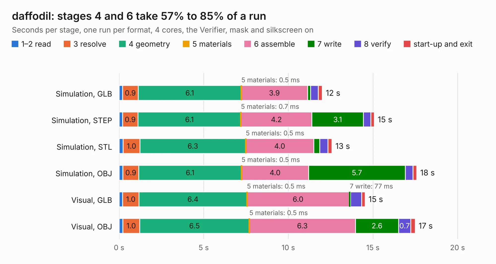

# 1095. daffodil

Board 1,095 of the 3,106 of [Corpus Testing](../Corpus-Testing.md), on [Corpus Page 11](../CorpusTestingPages/Corpus-Testing-11.md#1095-daffodil).

| Mode and format | 1–2 read | 3 resolve | 4 geometry | 5 materials | 6 assemble | 7 write | 8 verify | start-up and exit | Total |
|---|---:|---:|---:|---:|---:|---:|---:|---:|---:|
| Simulation, GLB | 0.2 | 0.9 | 6.1 | 0.5&nbsp;ms | 3.9 | 0.2 | 0.4 | 0.2 | 12.0 |
| Simulation, STEP | 0.2 | 0.9 | 6.1 | 0.7&nbsp;ms | 4.2 | 3.1 | 0.4 | 0.2 | 15.1 |
| Simulation, STL | 0.2 | 1.0 | 6.3 | 0.5&nbsp;ms | 4.0 | 0.4 | 0.5 | 0.2 | 12.6 |
| Simulation, OBJ | 0.2 | 0.9 | 6.1 | 0.5&nbsp;ms | 4.0 | 5.7 | 0.5 | 0.2 | 17.6 |
| Visual, GLB | 0.2 | 1.0 | 6.4 | 0.5&nbsp;ms | 6.0 | 77&nbsp;ms | 0.7 | 0.2 | 14.5 |
| Visual, OBJ | 0.2 | 1.0 | 6.5 | 0.5&nbsp;ms | 6.3 | 2.6 | 0.7 | 0.3 | 17.5 |

<table align="center"><tr><td valign="top">

| Board | Repo: [greatscottgadgets/greatfet-hardware](https://github.com/greatscottgadgets/greatfet-hardware) Board: `daffodil.kicad_pcb` |
|---|---|
| Folder | daffodil |
| Complexity | 137&nbsp;/&nbsp;1000 (size&nbsp;97, features&nbsp;40) |
| KESE&nbsp;features | filled zones, copper text, curved board outline |
| Tested | 9th November 2026 |
| Copper&nbsp;layers | 2 |
| File&nbsp;format | KiCad 5 (20171130) |
| Parts,&nbsp;tracks,&nbsp;vias | 8, 30, 0 |
| Triangles,&nbsp;simulation | 1,112,878 in 154 parts |
| Verifier | PASS in all six runs |

</td><td valign="top">

<table>
<tr><th>File type</th><th>File size</th><th>Peak memory used</th></tr>
<tr><th colspan="3" align="left">Simulation</th></tr>
<tr><td>GLB</td><td align="right">37&nbsp;MB</td><td align="right">443&nbsp;MB</td></tr>
<tr><td>STEP</td><td align="right">172&nbsp;MB</td><td align="right">558&nbsp;MB</td></tr>
<tr><td>STL</td><td align="right">56&nbsp;MB</td><td align="right">430&nbsp;MB</td></tr>
<tr><td>OBJ</td><td align="right">113&nbsp;MB</td><td align="right">786&nbsp;MB</td></tr>
<tr><th colspan="3" align="left">Visual</th></tr>
<tr><td>GLB</td><td align="right">18&nbsp;MB</td><td align="right">491&nbsp;MB</td></tr>
<tr><td>OBJ</td><td align="right">53&nbsp;MB</td><td align="right">513&nbsp;MB</td></tr>
</table>

</td></tr></table>

| Previous | Next |
|:---|---:|
| [1094. crocus](b1094b_greatfet-hardware_crocus.md) | [1096. edelweiss](b1096b_greatfet-hardware_edelweiss.md) |
