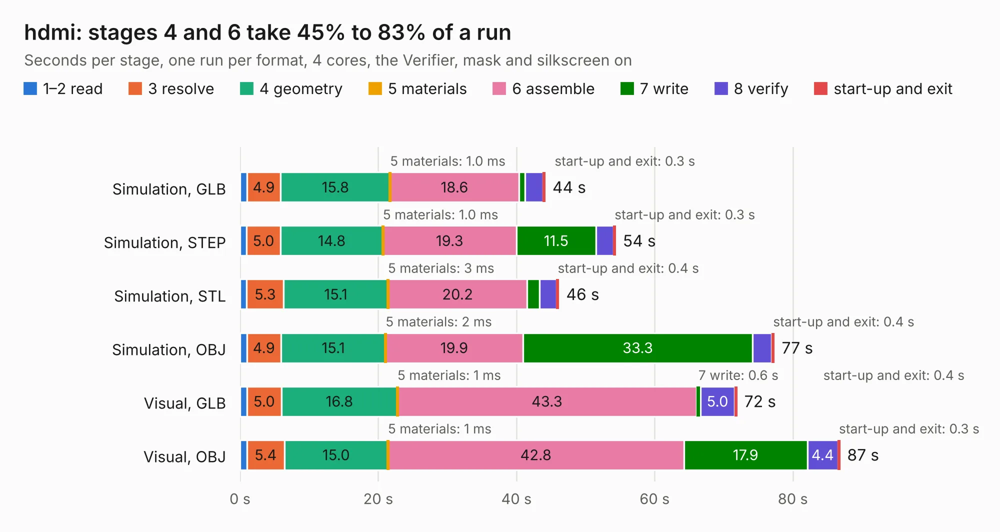

# 1096. hdmi

Board 1,096 of the 3,131 of [Corpus Testing](../Corpus-Testing.md), on [Corpus Page 11](../CorpusTestingPages/Corpus-Testing-11.md#1096-hdmi).

| Mode and format | 1–2 read | 3 resolve | 4 geometry | 5 materials | 6 assemble | 7 write | 8 verify | start-up and exit | Total |
|---|---:|---:|---:|---:|---:|---:|---:|---:|---:|
| Simulation, GLB | 1.0 | 4.9 | 15.8 | 1.0&nbsp;ms | 18.6 | 0.9 | 2.6 | 0.3 | 44.2 |
| Simulation, STEP | 0.9 | 5.0 | 14.8 | 1.0&nbsp;ms | 19.3 | 11.5 | 2.5 | 0.3 | 54.4 |
| Simulation, STL | 1.0 | 5.3 | 15.1 | 3&nbsp;ms | 20.2 | 1.8 | 2.5 | 0.4 | 46.2 |
| Simulation, OBJ | 1.0 | 4.9 | 15.1 | 2&nbsp;ms | 19.9 | 33.3 | 2.8 | 0.4 | 77.4 |
| Visual, GLB | 1.0 | 5.0 | 16.8 | 1&nbsp;ms | 43.3 | 0.6 | 5.0 | 0.4 | 71.9 |
| Visual, OBJ | 1.0 | 5.4 | 15.0 | 1&nbsp;ms | 42.8 | 17.9 | 4.4 | 0.3 | 86.8 |

<table align="center"><tr><td valign="top">

| Board | Repo: [greatscottgadgets/daisho](https://github.com/greatscottgadgets/daisho) Board: `hdmi.kicad_pcb` |
|---|---|
| Folder | hw / de2-115-frontend / hdmi |
| Complexity | 354&nbsp;/&nbsp;1000 (size&nbsp;299, features&nbsp;55) |
| KESE&nbsp;features | through vias, slotted holes, filled zones, copper text |
| Tested | 9th November 2026 |
| Copper&nbsp;layers | 6 |
| File&nbsp;format | KiCad 3 (3) |
| Parts,&nbsp;tracks,&nbsp;vias | 221, 2,755, 605 |
| Triangles,&nbsp;simulation | 4,787,176 in 387 parts |
| Verifier | PASS in all six runs |

</td><td valign="top">

<table>
<tr><th>File type</th><th>File size</th><th>Peak memory used</th></tr>
<tr><th colspan="3" align="left">Simulation</th></tr>
<tr><td>GLB</td><td align="right">164&nbsp;MB</td><td align="right">1.4&nbsp;GB</td></tr>
<tr><td>STEP</td><td align="right">555&nbsp;MB</td><td align="right">1.7&nbsp;GB</td></tr>
<tr><td>STL</td><td align="right">239&nbsp;MB</td><td align="right">1.3&nbsp;GB</td></tr>
<tr><td>OBJ</td><td align="right">513&nbsp;MB</td><td align="right">3.0&nbsp;GB</td></tr>
<tr><th colspan="3" align="left">Visual</th></tr>
<tr><td>GLB</td><td align="right">92&nbsp;MB</td><td align="right">1.7&nbsp;GB</td></tr>
<tr><td>OBJ</td><td align="right">296&nbsp;MB</td><td align="right">1.9&nbsp;GB</td></tr>
</table>

</td></tr></table>

| Previous | Next |
|:---|---:|
| [1095. gig-e](b1095b_daisho_gig-e.md) | [1097. rs232](b1097b_daisho_rs232.md) |
