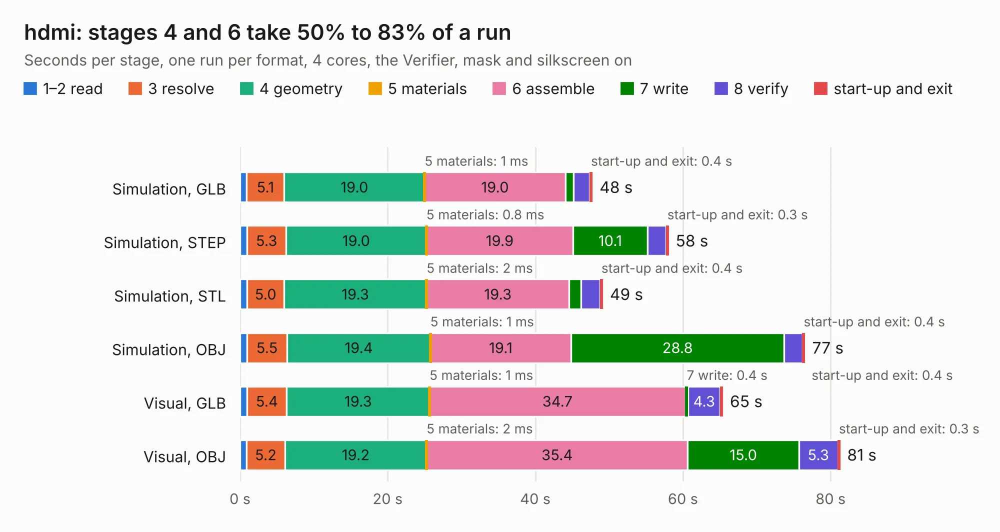

# 1096. hdmi

Board 1,096 of the 3,118 of [Corpus Testing](../Corpus-Testing.md), on [Corpus Page 11](../CorpusTestingPages/Corpus-Testing-11.md#1096-hdmi).

| Mode and format | 1–2 read | 3 resolve | 4 geometry | 5 materials | 6 assemble | 7 write | 8 verify | start-up and exit | Total |
|---|---:|---:|---:|---:|---:|---:|---:|---:|---:|
| Simulation, GLB | 0.9 | 5.1 | 19.0 | 1&nbsp;ms | 19.0 | 1.1 | 2.2 | 0.4 | 47.7 |
| Simulation, STEP | 1.0 | 5.3 | 19.0 | 0.8&nbsp;ms | 19.9 | 10.1 | 2.6 | 0.3 | 58.0 |
| Simulation, STL | 1.0 | 5.0 | 19.3 | 2&nbsp;ms | 19.3 | 1.6 | 2.6 | 0.4 | 49.1 |
| Simulation, OBJ | 0.9 | 5.5 | 19.4 | 1&nbsp;ms | 19.1 | 28.8 | 2.5 | 0.4 | 76.5 |
| Visual, GLB | 1.0 | 5.4 | 19.3 | 1&nbsp;ms | 34.7 | 0.4 | 4.3 | 0.4 | 65.4 |
| Visual, OBJ | 0.9 | 5.2 | 19.2 | 2&nbsp;ms | 35.4 | 15.0 | 5.3 | 0.3 | 81.3 |

<table align="center"><tr><td valign="top">

| Board | Repo: [greatscottgadgets/daisho](https://github.com/greatscottgadgets/daisho) Board: `hdmi.kicad_pcb` |
|---|---|
| Folder | hw / frontend / hdmi |
| Complexity | 346&nbsp;/&nbsp;1000 (size&nbsp;301, features&nbsp;45) |
| KESE&nbsp;features | through vias, filled zones, curved board outline |
| Tested | 9th November 2026 |
| Copper&nbsp;layers | 6 |
| File&nbsp;format | KiCad 4 (4) |
| Parts,&nbsp;tracks,&nbsp;vias | 224, 3,608, 525 |
| Triangles,&nbsp;simulation | 4,443,754 in 345 parts |
| Verifier | PASS in all six runs |

</td><td valign="top">

<table>
<tr><th>File type</th><th>File size</th><th>Peak memory used</th></tr>
<tr><th colspan="3" align="left">Simulation</th></tr>
<tr><td>GLB</td><td align="right">155&nbsp;MB</td><td align="right">1.3&nbsp;GB</td></tr>
<tr><td>STEP</td><td align="right">527&nbsp;MB</td><td align="right">1.6&nbsp;GB</td></tr>
<tr><td>STL</td><td align="right">222&nbsp;MB</td><td align="right">1.3&nbsp;GB</td></tr>
<tr><td>OBJ</td><td align="right">480&nbsp;MB</td><td align="right">2.9&nbsp;GB</td></tr>
<tr><th colspan="3" align="left">Visual</th></tr>
<tr><td>GLB</td><td align="right">83&nbsp;MB</td><td align="right">1.6&nbsp;GB</td></tr>
<tr><td>OBJ</td><td align="right">264&nbsp;MB</td><td align="right">1.8&nbsp;GB</td></tr>
</table>

</td></tr></table>

| Previous | Next |
|:---|---:|
| [1095. rs232_fe](b1095b_daisho_rs232-fe.md) | [1097. prod_fe](b1097b_daisho_prod-fe.md) |
