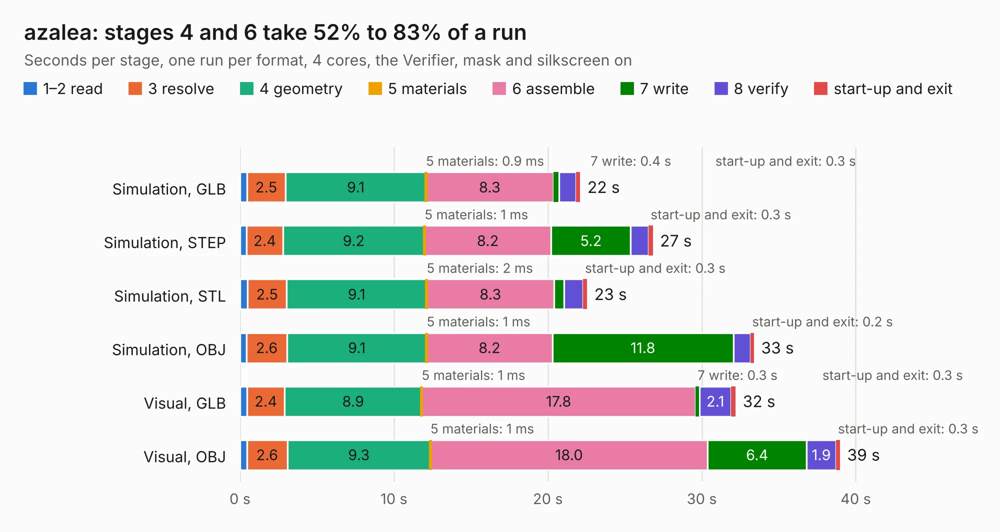

# 1098. azalea

Board 1,098 of the 3,116 of [Corpus Testing](../Corpus-Testing.md), on [Corpus Page 11](../CorpusTestingPages/Corpus-Testing-11.md#1098-azalea).

| Mode and format | 1–2 read | 3 resolve | 4 geometry | 5 materials | 6 assemble | 7 write | 8 verify | start-up and exit | Total |
|---|---:|---:|---:|---:|---:|---:|---:|---:|---:|
| Simulation, GLB | 0.4 | 2.5 | 9.1 | 0.9&nbsp;ms | 8.3 | 0.4 | 1.1 | 0.3 | 22.1 |
| Simulation, STEP | 0.4 | 2.4 | 9.2 | 1&nbsp;ms | 8.2 | 5.2 | 1.2 | 0.3 | 26.8 |
| Simulation, STL | 0.5 | 2.5 | 9.1 | 2&nbsp;ms | 8.3 | 0.7 | 1.2 | 0.3 | 22.6 |
| Simulation, OBJ | 0.4 | 2.6 | 9.1 | 1&nbsp;ms | 8.2 | 11.8 | 1.1 | 0.2 | 33.4 |
| Visual, GLB | 0.5 | 2.4 | 8.9 | 1&nbsp;ms | 17.8 | 0.3 | 2.1 | 0.3 | 32.2 |
| Visual, OBJ | 0.4 | 2.6 | 9.3 | 1&nbsp;ms | 18.0 | 6.4 | 1.9 | 0.3 | 39.0 |

<table align="center"><tr><td valign="top">

| Board | Repo: [greatscottgadgets/greatfet-hardware](https://github.com/greatscottgadgets/greatfet-hardware) Board: `azalea.kicad_pcb` |
|---|---|
| Folder | azalea |
| Complexity | 300&nbsp;/&nbsp;1000 (size&nbsp;245, features&nbsp;55) |
| KESE&nbsp;features | through vias, filled zones, copper text, curved board outline |
| Tested | 9th November 2026 |
| Copper&nbsp;layers | 4 |
| File&nbsp;format | KiCad 4 (4) |
| Parts,&nbsp;tracks,&nbsp;vias | 84, 1,412, 176 |
| Triangles,&nbsp;simulation | 2,293,082 in 149 parts |
| Verifier | PASS in all six runs |

</td><td valign="top">

<table>
<tr><th>File type</th><th>File size</th><th>Peak memory used</th></tr>
<tr><th colspan="3" align="left">Simulation</th></tr>
<tr><td>GLB</td><td align="right">80&nbsp;MB</td><td align="right">702&nbsp;MB</td></tr>
<tr><td>STEP</td><td align="right">329&nbsp;MB</td><td align="right">832&nbsp;MB</td></tr>
<tr><td>STL</td><td align="right">115&nbsp;MB</td><td align="right">717&nbsp;MB</td></tr>
<tr><td>OBJ</td><td align="right">244&nbsp;MB</td><td align="right">1.5&nbsp;GB</td></tr>
<tr><th colspan="3" align="left">Visual</th></tr>
<tr><td>GLB</td><td align="right">48&nbsp;MB</td><td align="right">870&nbsp;MB</td></tr>
<tr><td>OBJ</td><td align="right">149&nbsp;MB</td><td align="right">1.1&nbsp;GB</td></tr>
</table>

</td></tr></table>

| Previous | Next |
|:---|---:|
| [1097. main_board](b1097b_daisho_main-board.md) | [1099. begonia](b1099b_greatfet-hardware_begonia.md) |
