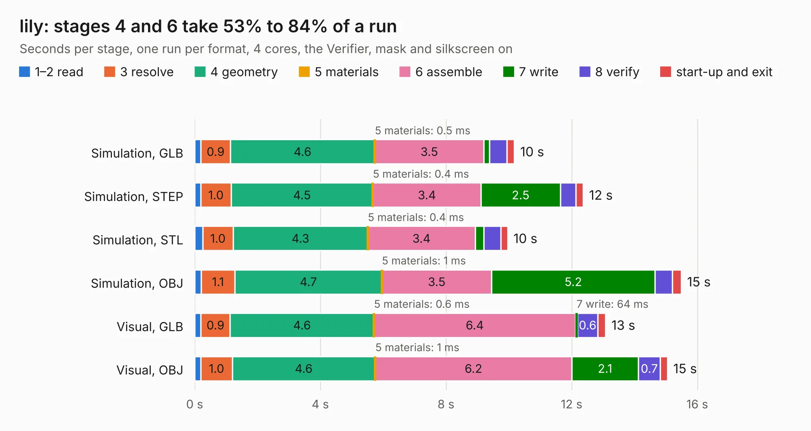

# 1098. lily

Board 1,098 of the 3,104 of [Corpus Testing](../Corpus-Testing.md), on [Corpus Page 11](../CorpusTestingPages/Corpus-Testing-11.md#1098-lily).

| Mode and format | 1–2 read | 3 resolve | 4 geometry | 5 materials | 6 assemble | 7 write | 8 verify | start-up and exit | Total |
|---|---:|---:|---:|---:|---:|---:|---:|---:|---:|
| Simulation, GLB | 0.2 | 0.9 | 4.6 | 0.5&nbsp;ms | 3.5 | 0.2 | 0.6 | 0.2 | 10.2 |
| Simulation, STEP | 0.2 | 1.0 | 4.5 | 0.4&nbsp;ms | 3.4 | 2.5 | 0.5 | 0.2 | 12.4 |
| Simulation, STL | 0.3 | 1.0 | 4.3 | 0.4&nbsp;ms | 3.4 | 0.3 | 0.5 | 0.2 | 10.0 |
| Simulation, OBJ | 0.2 | 1.1 | 4.7 | 1&nbsp;ms | 3.5 | 5.2 | 0.6 | 0.3 | 15.5 |
| Visual, GLB | 0.2 | 0.9 | 4.6 | 0.6&nbsp;ms | 6.4 | 64&nbsp;ms | 0.6 | 0.3 | 13.1 |
| Visual, OBJ | 0.2 | 1.0 | 4.6 | 1&nbsp;ms | 6.2 | 2.1 | 0.7 | 0.2 | 15.1 |

<table align="center"><tr><td valign="top">

| Board | Repo: [greatscottgadgets/greatfet-hardware](https://github.com/greatscottgadgets/greatfet-hardware) Board: `lily.kicad_pcb` |
|---|---|
| Folder | lily |
| Complexity | 212&nbsp;/&nbsp;1000 (size&nbsp;157, features&nbsp;55) |
| KESE&nbsp;features | through vias, filled zones, copper text, curved board outline |
| Tested | 9th November 2026 |
| Copper&nbsp;layers | 4 |
| File&nbsp;format | KiCad 4 (4) |
| Parts,&nbsp;tracks,&nbsp;vias | 31, 139, 17 |
| Triangles,&nbsp;simulation | 1,061,168 in 122 parts |
| Verifier | PASS in all six runs |

</td><td valign="top">

<table>
<tr><th>File type</th><th>File size</th><th>Peak memory used</th></tr>
<tr><th colspan="3" align="left">Simulation</th></tr>
<tr><td>GLB</td><td align="right">35&nbsp;MB</td><td align="right">383&nbsp;MB</td></tr>
<tr><td>STEP</td><td align="right">134&nbsp;MB</td><td align="right">472&nbsp;MB</td></tr>
<tr><td>STL</td><td align="right">53&nbsp;MB</td><td align="right">394&nbsp;MB</td></tr>
<tr><td>OBJ</td><td align="right">107&nbsp;MB</td><td align="right">747&nbsp;MB</td></tr>
<tr><th colspan="3" align="left">Visual</th></tr>
<tr><td>GLB</td><td align="right">15&nbsp;MB</td><td align="right">436&nbsp;MB</td></tr>
<tr><td>OBJ</td><td align="right">44&nbsp;MB</td><td align="right">428&nbsp;MB</td></tr>
</table>

</td></tr></table>

| Previous | Next |
|:---|---:|
| [1097. jasmine](b1097b_greatfet-hardware_jasmine.md) | [1099. luckybamboo](b1099b_greatfet-hardware_luckybamboo.md) |
