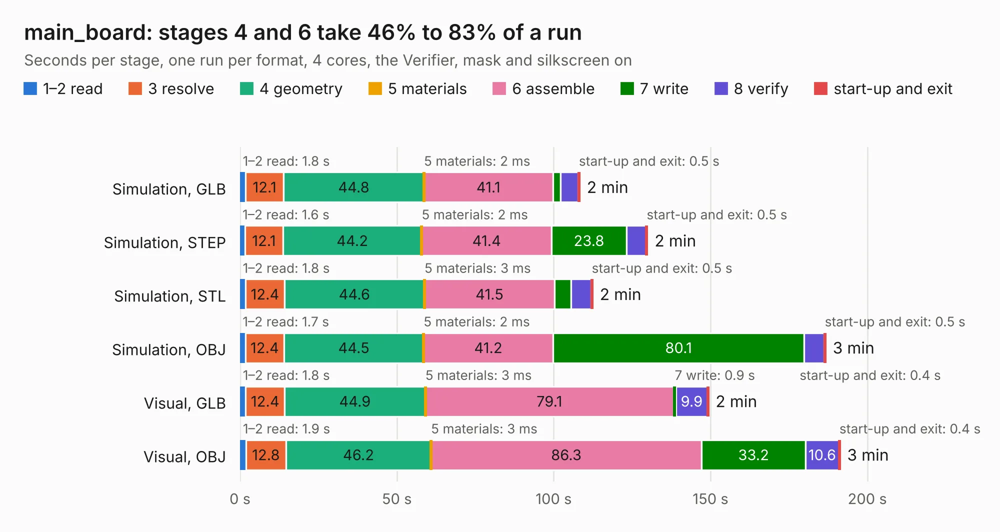

# 1101. main_board

Board 1,101 of the 3,121 of [Corpus Testing](../Corpus-Testing.md), on [Corpus Page 11](../CorpusTestingPages/Corpus-Testing-11.md#1101-main_board).

| Mode and format | 1–2 read | 3 resolve | 4 geometry | 5 materials | 6 assemble | 7 write | 8 verify | start-up and exit | Total |
|---|---:|---:|---:|---:|---:|---:|---:|---:|---:|
| Simulation, GLB | 1.8 | 12.1 | 44.8 | 2&nbsp;ms | 41.1 | 2.4 | 5.7 | 0.5 | 108.3 |
| Simulation, STEP | 1.6 | 12.1 | 44.2 | 2&nbsp;ms | 41.4 | 23.8 | 6.2 | 0.5 | 129.9 |
| Simulation, STL | 1.8 | 12.4 | 44.6 | 3&nbsp;ms | 41.5 | 5.2 | 6.4 | 0.5 | 112.4 |
| Simulation, OBJ | 1.7 | 12.4 | 44.5 | 2&nbsp;ms | 41.2 | 80.1 | 6.3 | 0.5 | 186.7 |
| Visual, GLB | 1.8 | 12.4 | 44.9 | 3&nbsp;ms | 79.1 | 0.9 | 9.9 | 0.4 | 149.3 |
| Visual, OBJ | 1.9 | 12.8 | 46.2 | 3&nbsp;ms | 86.3 | 33.2 | 10.6 | 0.4 | 191.3 |

<table align="center"><tr><td valign="top">

| Board | Repo: [greatscottgadgets/daisho](https://github.com/greatscottgadgets/daisho) Board: `main_board.kicad_pcb` |
|---|---|
| Folder | hw / main_board |
| Complexity | 375&nbsp;/&nbsp;1000 (size&nbsp;330, features&nbsp;45) |
| KESE&nbsp;features | through vias, filled zones, curved board outline |
| Tested | 9th November 2026 |
| Copper&nbsp;layers | 8 |
| File&nbsp;format | KiCad 4 (4) |
| Parts,&nbsp;tracks,&nbsp;vias | 383, 8,842, 1,485 |
| Triangles,&nbsp;simulation | 12,543,244 in 692 parts |
| Verifier | PASS in all six runs |

</td><td valign="top">

<table>
<tr><th>File type</th><th>File size</th><th>Peak memory used</th></tr>
<tr><th colspan="3" align="left">Simulation</th></tr>
<tr><td>GLB</td><td align="right">428&nbsp;MB</td><td align="right">2.4&nbsp;GB</td></tr>
<tr><td>STEP</td><td align="right">1.3&nbsp;GB</td><td align="right">3.6&nbsp;GB</td></tr>
<tr><td>STL</td><td align="right">627&nbsp;MB</td><td align="right">2.4&nbsp;GB</td></tr>
<tr><td>OBJ</td><td align="right">1.4&nbsp;GB</td><td align="right">7.9&nbsp;GB</td></tr>
<tr><th colspan="3" align="left">Visual</th></tr>
<tr><td>GLB</td><td align="right">192&nbsp;MB</td><td align="right">3.2&nbsp;GB</td></tr>
<tr><td>OBJ</td><td align="right">649&nbsp;MB</td><td align="right">4.2&nbsp;GB</td></tr>
</table>

</td></tr></table>

| Previous | Next |
|:---|---:|
| [1100. usb](b1100b_daisho_usb.md) | [1102. azalea](b1102b_greatfet-hardware_azalea.md) |
