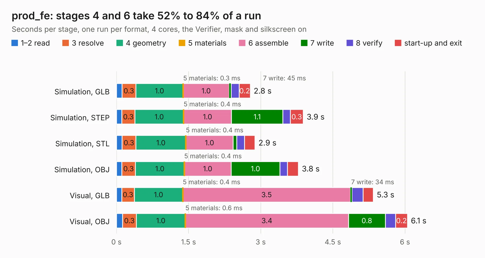

# 1101. prod_fe

Board 1,101 of the 3,131 of [Corpus Testing](../Corpus-Testing.md), on [Corpus Page 11](../CorpusTestingPages/Corpus-Testing-11.md#1101-prod_fe).

| Mode and format | 1–2 read | 3 resolve | 4 geometry | 5 materials | 6 assemble | 7 write | 8 verify | start-up and exit | Total |
|---|---:|---:|---:|---:|---:|---:|---:|---:|---:|
| Simulation, GLB | 0.1 | 0.3 | 1.0 | 0.3&nbsp;ms | 1.0 | 45&nbsp;ms | 0.2 | 0.2 | 2.8 |
| Simulation, STEP | 0.1 | 0.3 | 1.0 | 0.4&nbsp;ms | 1.0 | 1.1 | 0.2 | 0.3 | 3.9 |
| Simulation, STL | 0.1 | 0.3 | 1.0 | 0.4&nbsp;ms | 1.0 | 71&nbsp;ms | 0.2 | 0.2 | 2.9 |
| Simulation, OBJ | 0.1 | 0.3 | 1.0 | 0.4&nbsp;ms | 1.0 | 1.0 | 0.2 | 0.2 | 3.8 |
| Visual, GLB | 0.1 | 0.3 | 1.0 | 0.4&nbsp;ms | 3.5 | 34&nbsp;ms | 0.2 | 0.2 | 5.3 |
| Visual, OBJ | 0.1 | 0.3 | 1.0 | 0.6&nbsp;ms | 3.4 | 0.8 | 0.2 | 0.2 | 6.1 |

<table align="center"><tr><td valign="top">

| Board | Repo: [greatscottgadgets/daisho](https://github.com/greatscottgadgets/daisho) Board: `prod_fe.kicad_pcb` |
|---|---|
| Folder | hw / frontend / prod_fe_template |
| Complexity | 171&nbsp;/&nbsp;1000 (size&nbsp;146, features&nbsp;25) |
| KESE&nbsp;features | through vias, curved board outline |
| Tested | 9th November 2026 |
| Copper&nbsp;layers | 4 |
| File&nbsp;format | KiCad 3 (3) |
| Parts,&nbsp;tracks,&nbsp;vias | 5, 208, 28 |
| Triangles,&nbsp;simulation | 204,920 in 174 parts |
| Verifier | PASS in all six runs |

</td><td valign="top">

<table>
<tr><th>File type</th><th>File size</th><th>Peak memory used</th></tr>
<tr><th colspan="3" align="left">Simulation</th></tr>
<tr><td>GLB</td><td align="right">7.5&nbsp;MB</td><td align="right">224&nbsp;MB</td></tr>
<tr><td>STEP</td><td align="right">28&nbsp;MB</td><td align="right">232&nbsp;MB</td></tr>
<tr><td>STL</td><td align="right">10&nbsp;MB</td><td align="right">216&nbsp;MB</td></tr>
<tr><td>OBJ</td><td align="right">21&nbsp;MB</td><td align="right">224&nbsp;MB</td></tr>
<tr><th colspan="3" align="left">Visual</th></tr>
<tr><td>GLB</td><td align="right">5.3&nbsp;MB</td><td align="right">199&nbsp;MB</td></tr>
<tr><td>OBJ</td><td align="right">15&nbsp;MB</td><td align="right">204&nbsp;MB</td></tr>
</table>

</td></tr></table>

| Previous | Next |
|:---|---:|
| [1100. hdmi](b1100b_daisho_hw-frontend-hdmi_hdmi.md) | [1102. usb](b1102b_daisho_usb.md) |
