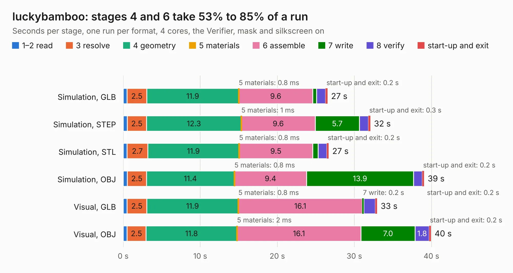

# 1102. luckybamboo

Board 1,102 of the 3,110 of [Corpus Testing](../Corpus-Testing.md), on [Corpus Page 11](../CorpusTestingPages/Corpus-Testing-11.md#1102-luckybamboo).

| Mode and format | 1–2 read | 3 resolve | 4 geometry | 5 materials | 6 assemble | 7 write | 8 verify | start-up and exit | Total |
|---|---:|---:|---:|---:|---:|---:|---:|---:|---:|
| Simulation, GLB | 0.5 | 2.5 | 11.9 | 0.8&nbsp;ms | 9.6 | 0.5 | 1.2 | 0.2 | 26.5 |
| Simulation, STEP | 0.5 | 2.5 | 12.3 | 1&nbsp;ms | 9.6 | 5.7 | 1.2 | 0.3 | 32.1 |
| Simulation, STL | 0.5 | 2.7 | 11.9 | 0.8&nbsp;ms | 9.5 | 0.7 | 1.1 | 0.2 | 26.7 |
| Simulation, OBJ | 0.5 | 2.5 | 11.4 | 0.8&nbsp;ms | 9.4 | 13.9 | 1.1 | 0.2 | 39.0 |
| Visual, GLB | 0.5 | 2.5 | 11.9 | 0.8&nbsp;ms | 16.1 | 0.2 | 1.5 | 0.2 | 32.9 |
| Visual, OBJ | 0.5 | 2.5 | 11.8 | 2&nbsp;ms | 16.1 | 7.0 | 1.8 | 0.2 | 39.9 |

<table align="center"><tr><td valign="top">

| Board | Repo: [greatscottgadgets/greatfet-hardware](https://github.com/greatscottgadgets/greatfet-hardware) Board: `luckybamboo.kicad_pcb` |
|---|---|
| Folder | luckybamboo |
| Complexity | 336&nbsp;/&nbsp;1000 (size&nbsp;281, features&nbsp;55) |
| KESE&nbsp;features | through vias, filled zones, copper text, curved board outline |
| Tested | 9th November 2026 |
| Copper&nbsp;layers | 4 |
| File&nbsp;format | KiCad 5 (20171130) |
| Parts,&nbsp;tracks,&nbsp;vias | 153, 1,754, 197 |
| Triangles,&nbsp;simulation | 2,657,326 in 183 parts |
| Verifier | PASS in all six runs |

</td><td valign="top">

<table>
<tr><th>File type</th><th>File size</th><th>Peak memory used</th></tr>
<tr><th colspan="3" align="left">Simulation</th></tr>
<tr><td>GLB</td><td align="right">92&nbsp;MB</td><td align="right">827&nbsp;MB</td></tr>
<tr><td>STEP</td><td align="right">351&nbsp;MB</td><td align="right">979&nbsp;MB</td></tr>
<tr><td>STL</td><td align="right">133&nbsp;MB</td><td align="right">884&nbsp;MB</td></tr>
<tr><td>OBJ</td><td align="right">283&nbsp;MB</td><td align="right">1.8&nbsp;GB</td></tr>
<tr><th colspan="3" align="left">Visual</th></tr>
<tr><td>GLB</td><td align="right">48&nbsp;MB</td><td align="right">901&nbsp;MB</td></tr>
<tr><td>OBJ</td><td align="right">147&nbsp;MB</td><td align="right">1.0&nbsp;GB</td></tr>
</table>

</td></tr></table>

| Previous | Next |
|:---|---:|
| [1101. lily](b1101b_greatfet-hardware_lily.md) | [1103. narcissus](b1103b_greatfet-hardware_narcissus.md) |
