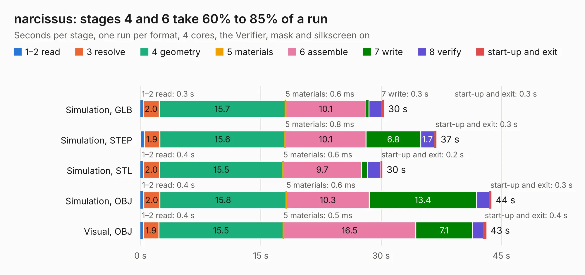

# 1102. narcissus

Board 1,102 of the 3,107 of [Corpus Testing](../Corpus-Testing.md), on [Corpus Page 11](../CorpusTestingPages/Corpus-Testing-11.md#1102-narcissus).

| Mode and format | 1–2 read | 3 resolve | 4 geometry | 5 materials | 6 assemble | 7 write | 8 verify | start-up and exit | Total |
|---|---:|---:|---:|---:|---:|---:|---:|---:|---:|
| Simulation, GLB | 0.3 | 2.0 | 15.7 | 0.6&nbsp;ms | 10.1 | 0.3 | 1.6 | 0.3 | 30.4 |
| Simulation, STEP | 0.5 | 1.9 | 15.6 | 0.8&nbsp;ms | 10.1 | 6.8 | 1.7 | 0.3 | 36.9 |
| Simulation, STL | 0.4 | 2.0 | 15.5 | 0.6&nbsp;ms | 9.7 | 0.8 | 1.6 | 0.2 | 30.2 |
| Simulation, OBJ | 0.4 | 2.0 | 15.8 | 0.6&nbsp;ms | 10.3 | 13.4 | 1.6 | 0.3 | 43.8 |
| Visual, GLB | 0.4 | 1.7 | 13.4 | 0.8&nbsp;ms | 18.6 | 0.3 | 1.7 | 0.3 | 36.4 |
| Visual, OBJ | 0.4 | 1.9 | 15.5 | 0.5&nbsp;ms | 16.5 | 7.1 | 1.4 | 0.4 | 43.1 |

<table align="center"><tr><td valign="top">

| Board | Repo: [greatscottgadgets/greatfet-hardware](https://github.com/greatscottgadgets/greatfet-hardware) Board: `narcissus.kicad_pcb` |
|---|---|
| Folder | narcissus |
| Complexity | 280&nbsp;/&nbsp;1000 (size&nbsp;225, features&nbsp;55) |
| KESE&nbsp;features | through vias, filled zones, copper text, curved board outline |
| Tested | 9th November 2026 |
| Copper&nbsp;layers | 2 |
| File&nbsp;format | KiCad 4 (4) |
| Parts,&nbsp;tracks,&nbsp;vias | 51, 1,212, 68 |
| Triangles,&nbsp;simulation | 2,432,446 in 193 parts |
| Verifier | PASS in all six runs |

</td><td valign="top">

<table>
<tr><th>File type</th><th>File size</th><th>Peak memory used</th></tr>
<tr><th colspan="3" align="left">Simulation</th></tr>
<tr><td>GLB</td><td align="right">83&nbsp;MB</td><td align="right">728&nbsp;MB</td></tr>
<tr><td>STEP</td><td align="right">424&nbsp;MB</td><td align="right">977&nbsp;MB</td></tr>
<tr><td>STL</td><td align="right">122&nbsp;MB</td><td align="right">752&nbsp;MB</td></tr>
<tr><td>OBJ</td><td align="right">257&nbsp;MB</td><td align="right">1.6&nbsp;GB</td></tr>
<tr><th colspan="3" align="left">Visual</th></tr>
<tr><td>GLB</td><td align="right">44&nbsp;MB</td><td align="right">977&nbsp;MB</td></tr>
<tr><td>OBJ</td><td align="right">135&nbsp;MB</td><td align="right">1.0&nbsp;GB</td></tr>
</table>

</td></tr></table>

| Previous | Next |
|:---|---:|
| [1101. luckybamboo](b1101b_greatfet-hardware_luckybamboo.md) | [1103. neighbor-template](b1103b_greatfet-hardware_neighbor-template.md) |
