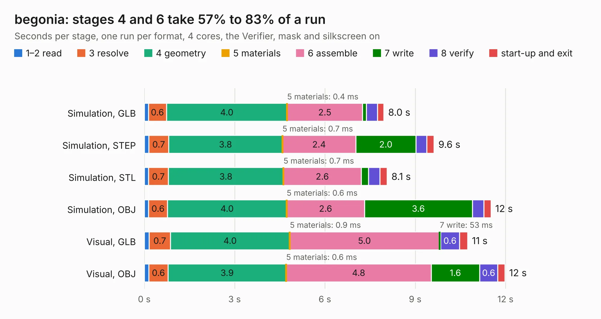

# 1103. begonia

Board 1,103 of the 3,121 of [Corpus Testing](../Corpus-Testing.md), on [Corpus Page 11](../CorpusTestingPages/Corpus-Testing-11.md#1103-begonia).

| Mode and format | 1–2 read | 3 resolve | 4 geometry | 5 materials | 6 assemble | 7 write | 8 verify | start-up and exit | Total |
|---|---:|---:|---:|---:|---:|---:|---:|---:|---:|
| Simulation, GLB | 0.1 | 0.6 | 4.0 | 0.4&nbsp;ms | 2.5 | 0.1 | 0.4 | 0.2 | 8.0 |
| Simulation, STEP | 0.2 | 0.7 | 3.8 | 0.7&nbsp;ms | 2.4 | 2.0 | 0.4 | 0.2 | 9.6 |
| Simulation, STL | 0.1 | 0.7 | 3.8 | 0.7&nbsp;ms | 2.6 | 0.2 | 0.4 | 0.2 | 8.1 |
| Simulation, OBJ | 0.1 | 0.6 | 4.0 | 0.6&nbsp;ms | 2.6 | 3.6 | 0.4 | 0.2 | 11.5 |
| Visual, GLB | 0.2 | 0.7 | 4.0 | 0.9&nbsp;ms | 5.0 | 53&nbsp;ms | 0.6 | 0.3 | 10.7 |
| Visual, OBJ | 0.2 | 0.6 | 3.9 | 0.6&nbsp;ms | 4.8 | 1.6 | 0.6 | 0.2 | 12.0 |

<table align="center"><tr><td valign="top">

| Board | Repo: [greatscottgadgets/greatfet-hardware](https://github.com/greatscottgadgets/greatfet-hardware) Board: `begonia.kicad_pcb` |
|---|---|
| Folder | begonia |
| Complexity | 162&nbsp;/&nbsp;1000 (size&nbsp;117, features&nbsp;45) |
| KESE&nbsp;features | through vias, filled zones, curved board outline |
| Tested | 9th November 2026 |
| Copper&nbsp;layers | 2 |
| File&nbsp;format | KiCad 4 (4) |
| Parts,&nbsp;tracks,&nbsp;vias | 13, 68, 3 |
| Triangles,&nbsp;simulation | 705,624 in 117 parts |
| Verifier | PASS in all six runs |

</td><td valign="top">

<table>
<tr><th>File type</th><th>File size</th><th>Peak memory used</th></tr>
<tr><th colspan="3" align="left">Simulation</th></tr>
<tr><td>GLB</td><td align="right">23&nbsp;MB</td><td align="right">327&nbsp;MB</td></tr>
<tr><td>STEP</td><td align="right">106&nbsp;MB</td><td align="right">411&nbsp;MB</td></tr>
<tr><td>STL</td><td align="right">35&nbsp;MB</td><td align="right">326&nbsp;MB</td></tr>
<tr><td>OBJ</td><td align="right">71&nbsp;MB</td><td align="right">506&nbsp;MB</td></tr>
<tr><th colspan="3" align="left">Visual</th></tr>
<tr><td>GLB</td><td align="right">12&nbsp;MB</td><td align="right">363&nbsp;MB</td></tr>
<tr><td>OBJ</td><td align="right">34&nbsp;MB</td><td align="right">368&nbsp;MB</td></tr>
</table>

</td></tr></table>

| Previous | Next |
|:---|---:|
| [1102. azalea](b1102b_greatfet-hardware_azalea.md) | [1104. crocus](b1104b_greatfet-hardware_crocus.md) |
