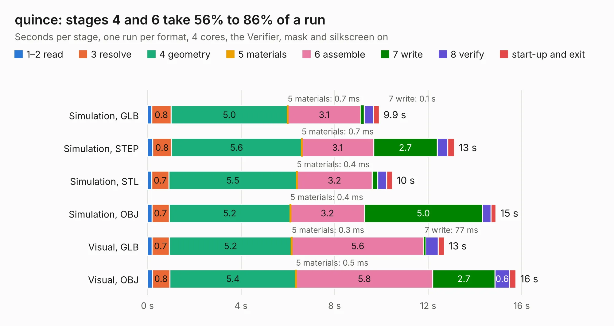

# 1104. quince

Board 1,104 of the 3,107 of [Corpus Testing](../Corpus-Testing.md), on [Corpus Page 11](../CorpusTestingPages/Corpus-Testing-11.md#1104-quince).

| Mode and format | 1–2 read | 3 resolve | 4 geometry | 5 materials | 6 assemble | 7 write | 8 verify | start-up and exit | Total |
|---|---:|---:|---:|---:|---:|---:|---:|---:|---:|
| Simulation, GLB | 0.2 | 0.8 | 5.0 | 0.7&nbsp;ms | 3.1 | 0.1 | 0.4 | 0.2 | 9.9 |
| Simulation, STEP | 0.2 | 0.8 | 5.6 | 0.7&nbsp;ms | 3.1 | 2.7 | 0.4 | 0.3 | 13.1 |
| Simulation, STL | 0.2 | 0.7 | 5.5 | 0.4&nbsp;ms | 3.2 | 0.2 | 0.4 | 0.2 | 10.5 |
| Simulation, OBJ | 0.2 | 0.7 | 5.2 | 0.4&nbsp;ms | 3.2 | 5.0 | 0.4 | 0.2 | 14.9 |
| Visual, GLB | 0.2 | 0.7 | 5.2 | 0.3&nbsp;ms | 5.6 | 77&nbsp;ms | 0.5 | 0.3 | 12.7 |
| Visual, OBJ | 0.2 | 0.8 | 5.4 | 0.5&nbsp;ms | 5.8 | 2.7 | 0.6 | 0.3 | 15.7 |

<table align="center"><tr><td valign="top">

| Board | Repo: [greatscottgadgets/greatfet-hardware](https://github.com/greatscottgadgets/greatfet-hardware) Board: `quince.kicad_pcb` |
|---|---|
| Folder | quince |
| Complexity | 184&nbsp;/&nbsp;1000 (size&nbsp;129, features&nbsp;55) |
| KESE&nbsp;features | through vias, filled zones, copper text, curved board outline |
| Tested | 9th November 2026 |
| Copper&nbsp;layers | 2 |
| File&nbsp;format | KiCad 4 (4) |
| Parts,&nbsp;tracks,&nbsp;vias | 26, 76, 10 |
| Triangles,&nbsp;simulation | 859,922 in 26 parts |
| Verifier | PASS in all six runs |

</td><td valign="top">

<table>
<tr><th>File type</th><th>File size</th><th>Peak memory used</th></tr>
<tr><th colspan="3" align="left">Simulation</th></tr>
<tr><td>GLB</td><td align="right">30&nbsp;MB</td><td align="right">390&nbsp;MB</td></tr>
<tr><td>STEP</td><td align="right">134&nbsp;MB</td><td align="right">456&nbsp;MB</td></tr>
<tr><td>STL</td><td align="right">43&nbsp;MB</td><td align="right">421&nbsp;MB</td></tr>
<tr><td>OBJ</td><td align="right">88&nbsp;MB</td><td align="right">627&nbsp;MB</td></tr>
<tr><th colspan="3" align="left">Visual</th></tr>
<tr><td>GLB</td><td align="right">15&nbsp;MB</td><td align="right">439&nbsp;MB</td></tr>
<tr><td>OBJ</td><td align="right">46&nbsp;MB</td><td align="right">424&nbsp;MB</td></tr>
</table>

</td></tr></table>

| Previous | Next |
|:---|---:|
| [1103. neighbor-template](b1103b_greatfet-hardware_neighbor-template.md) | [1105. hackrf-one](b1105b_hackrf_hackrf-one.md) |
