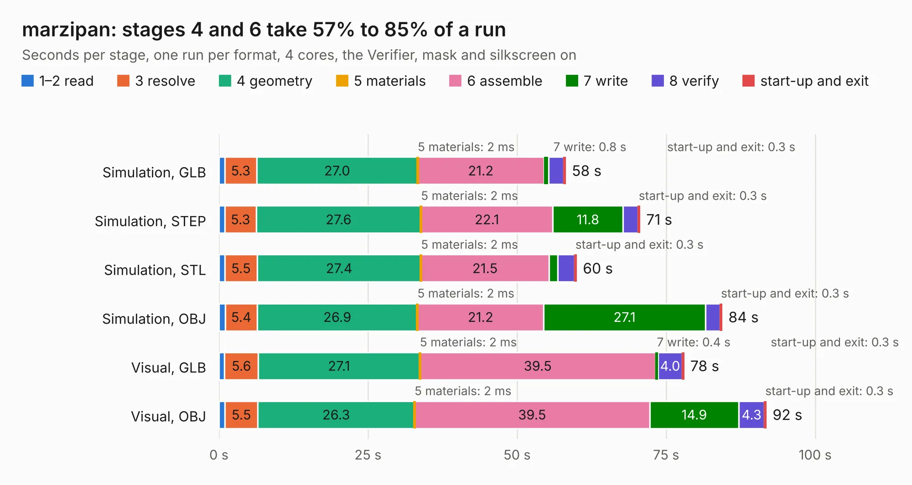

# 1105. marzipan

Board 1,105 of the 3,104 of [Corpus Testing](../Corpus-Testing.md), on [Corpus Page 11](../CorpusTestingPages/Corpus-Testing-11.md#1105-marzipan).

| Mode and format | 1–2 read | 3 resolve | 4 geometry | 5 materials | 6 assemble | 7 write | 8 verify | start-up and exit | Total |
|---|---:|---:|---:|---:|---:|---:|---:|---:|---:|
| Simulation, GLB | 1.0 | 5.3 | 27.0 | 2&nbsp;ms | 21.2 | 0.8 | 2.5 | 0.3 | 58.1 |
| Simulation, STEP | 1.0 | 5.3 | 27.6 | 2&nbsp;ms | 22.1 | 11.8 | 2.5 | 0.3 | 70.6 |
| Simulation, STL | 1.0 | 5.5 | 27.4 | 2&nbsp;ms | 21.5 | 1.5 | 2.8 | 0.3 | 59.9 |
| Simulation, OBJ | 1.0 | 5.4 | 26.9 | 2&nbsp;ms | 21.2 | 27.1 | 2.5 | 0.3 | 84.4 |
| Visual, GLB | 0.9 | 5.6 | 27.1 | 2&nbsp;ms | 39.5 | 0.4 | 4.0 | 0.3 | 78.0 |
| Visual, OBJ | 1.0 | 5.5 | 26.3 | 2&nbsp;ms | 39.5 | 14.9 | 4.3 | 0.3 | 91.8 |

<table align="center"><tr><td valign="top">

| Board | Repo: [greatscottgadgets/hackrf](https://github.com/greatscottgadgets/hackrf) Board: `marzipan.kicad_pcb` |
|---|---|
| Folder | hardware / marzipan |
| Complexity | 336&nbsp;/&nbsp;1000 (size&nbsp;291, features&nbsp;45) |
| KESE&nbsp;features | through vias, filled zones, curved board outline |
| Tested | 9th November 2026 |
| Copper&nbsp;layers | 4 |
| File&nbsp;format | KiCad 4 (4) |
| Parts,&nbsp;tracks,&nbsp;vias | 340, 3,928, 500 |
| Triangles,&nbsp;simulation | 4,858,612 in 391 parts |
| Verifier | PASS in all six runs |

</td><td valign="top">

<table>
<tr><th>File type</th><th>File size</th><th>Peak memory used</th></tr>
<tr><th colspan="3" align="left">Simulation</th></tr>
<tr><td>GLB</td><td align="right">170&nbsp;MB</td><td align="right">1.4&nbsp;GB</td></tr>
<tr><td>STEP</td><td align="right">669&nbsp;MB</td><td align="right">1.8&nbsp;GB</td></tr>
<tr><td>STL</td><td align="right">243&nbsp;MB</td><td align="right">1.4&nbsp;GB</td></tr>
<tr><td>OBJ</td><td align="right">539&nbsp;MB</td><td align="right">3.2&nbsp;GB</td></tr>
<tr><th colspan="3" align="left">Visual</th></tr>
<tr><td>GLB</td><td align="right">95&nbsp;MB</td><td align="right">1.6&nbsp;GB</td></tr>
<tr><td>OBJ</td><td align="right">303&nbsp;MB</td><td align="right">2.1&nbsp;GB</td></tr>
</table>

</td></tr></table>

| Previous | Next |
|:---|---:|
| [1104. LNA915](b1104b_hackrf_LNA915.md) | [1106. neapolitan](b1106b_hackrf_neapolitan.md) |
