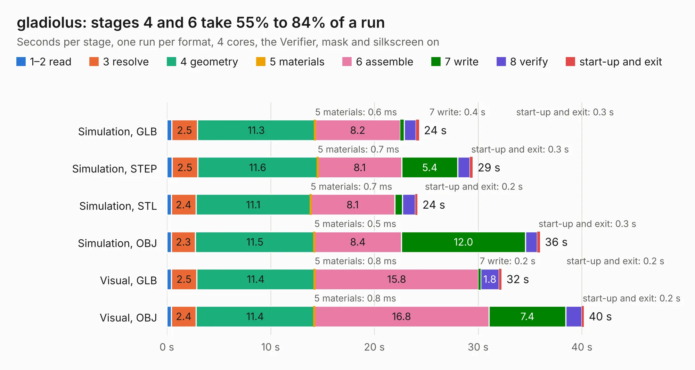

# 1109. gladiolus

Board 1,109 of the 3,126 of [Corpus Testing](../Corpus-Testing.md), on [Corpus Page 11](../CorpusTestingPages/Corpus-Testing-11.md#1109-gladiolus).

| Mode and format | 1–2 read | 3 resolve | 4 geometry | 5 materials | 6 assemble | 7 write | 8 verify | start-up and exit | Total |
|---|---:|---:|---:|---:|---:|---:|---:|---:|---:|
| Simulation, GLB | 0.5 | 2.5 | 11.3 | 0.6&nbsp;ms | 8.2 | 0.4 | 1.1 | 0.3 | 24.3 |
| Simulation, STEP | 0.5 | 2.5 | 11.6 | 0.7&nbsp;ms | 8.1 | 5.4 | 1.2 | 0.3 | 29.5 |
| Simulation, STL | 0.4 | 2.4 | 11.1 | 0.7&nbsp;ms | 8.1 | 0.8 | 1.2 | 0.2 | 24.2 |
| Simulation, OBJ | 0.4 | 2.3 | 11.5 | 0.5&nbsp;ms | 8.4 | 12.0 | 1.1 | 0.3 | 36.0 |
| Visual, GLB | 0.4 | 2.5 | 11.4 | 0.8&nbsp;ms | 15.8 | 0.2 | 1.8 | 0.2 | 32.3 |
| Visual, OBJ | 0.4 | 2.4 | 11.4 | 0.8&nbsp;ms | 16.8 | 7.4 | 1.5 | 0.2 | 40.2 |

<table align="center"><tr><td valign="top">

| Board | Repo: [greatscottgadgets/greatfet-hardware](https://github.com/greatscottgadgets/greatfet-hardware) Board: `gladiolus.kicad_pcb` |
|---|---|
| Folder | gladiolus |
| Complexity | 299&nbsp;/&nbsp;1000 (size&nbsp;244, features&nbsp;55) |
| KESE&nbsp;features | through vias, filled zones, copper text, curved board outline |
| Tested | 9th November 2026 |
| Copper&nbsp;layers | 4 |
| File&nbsp;format | KiCad 5 (20171130) |
| Parts,&nbsp;tracks,&nbsp;vias | 138, 962, 106 |
| Triangles,&nbsp;simulation | 2,062,476 in 114 parts |
| Verifier | PASS in all six runs |

</td><td valign="top">

<table>
<tr><th>File type</th><th>File size</th><th>Peak memory used</th></tr>
<tr><th colspan="3" align="left">Simulation</th></tr>
<tr><td>GLB</td><td align="right">71&nbsp;MB</td><td align="right">782&nbsp;MB</td></tr>
<tr><td>STEP</td><td align="right">326&nbsp;MB</td><td align="right">859&nbsp;MB</td></tr>
<tr><td>STL</td><td align="right">103&nbsp;MB</td><td align="right">661&nbsp;MB</td></tr>
<tr><td>OBJ</td><td align="right">217&nbsp;MB</td><td align="right">1.3&nbsp;GB</td></tr>
<tr><th colspan="3" align="left">Visual</th></tr>
<tr><td>GLB</td><td align="right">40&nbsp;MB</td><td align="right">856&nbsp;MB</td></tr>
<tr><td>OBJ</td><td align="right">122&nbsp;MB</td><td align="right">938&nbsp;MB</td></tr>
</table>

</td></tr></table>

| Previous | Next |
|:---|---:|
| [1108. foxglove](b1108b_greatfet-hardware_foxglove.md) | [1110. jasmine](b1110b_greatfet-hardware_jasmine.md) |
