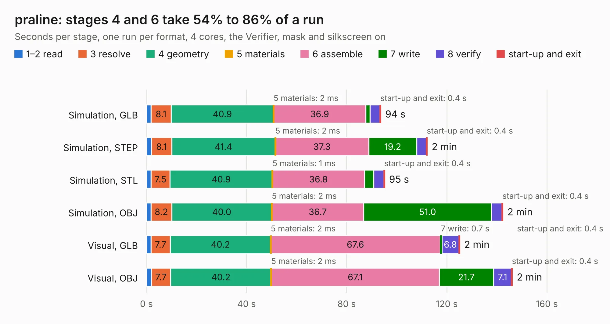

# 1109. praline

Board 1,109 of the 3,105 of [Corpus Testing](../Corpus-Testing.md), on [Corpus Page 11](../CorpusTestingPages/Corpus-Testing-11.md#1109-praline).

| Mode and format | 1–2 read | 3 resolve | 4 geometry | 5 materials | 6 assemble | 7 write | 8 verify | start-up and exit | Total |
|---|---:|---:|---:|---:|---:|---:|---:|---:|---:|
| Simulation, GLB | 1.8 | 8.1 | 40.9 | 2&nbsp;ms | 36.9 | 1.6 | 4.0 | 0.4 | 93.7 |
| Simulation, STEP | 2.0 | 8.1 | 41.4 | 2&nbsp;ms | 37.3 | 19.2 | 3.8 | 0.4 | 112.2 |
| Simulation, STL | 1.9 | 7.5 | 40.9 | 1&nbsp;ms | 36.8 | 3.7 | 4.0 | 0.4 | 95.2 |
| Simulation, OBJ | 1.9 | 8.2 | 40.0 | 2&nbsp;ms | 36.7 | 51.0 | 4.2 | 0.4 | 142.5 |
| Visual, GLB | 1.8 | 7.7 | 40.2 | 2&nbsp;ms | 67.6 | 0.7 | 6.8 | 0.4 | 125.2 |
| Visual, OBJ | 1.9 | 7.7 | 40.2 | 2&nbsp;ms | 67.1 | 21.7 | 7.1 | 0.4 | 146.2 |

<table align="center"><tr><td valign="top">

| Board | Repo: [greatscottgadgets/hackrf-pro](https://github.com/greatscottgadgets/hackrf-pro) Board: `praline.kicad_pcb` |
|---|---|
| Complexity | 466&nbsp;/&nbsp;1000 (size&nbsp;316, features&nbsp;150) |
| KESE&nbsp;features | through vias, slotted holes, custom pads, rounded, trapezoid or chamfered pads, filled zones, copper drawings, copper text, curved board outline, stack-up, dielectric εr and tanδ, copper finish, mask and silkscreen colours |
| Tested | 9th November 2026 |
| Copper&nbsp;layers | 6 |
| File&nbsp;format | KiCad 9 (20241229) |
| Parts,&nbsp;tracks,&nbsp;vias | 511, 4,690, 953 |
| Triangles,&nbsp;simulation | 9,435,120 in 508 parts |
| Verifier | PASS in all six runs |

</td><td valign="top">

<table>
<tr><th>File type</th><th>File size</th><th>Peak memory used</th></tr>
<tr><th colspan="3" align="left">Simulation</th></tr>
<tr><td>GLB</td><td align="right">319&nbsp;MB</td><td align="right">2.2&nbsp;GB</td></tr>
<tr><td>STEP</td><td align="right">1.2&nbsp;GB</td><td align="right">3.3&nbsp;GB</td></tr>
<tr><td>STL</td><td align="right">472&nbsp;MB</td><td align="right">2.2&nbsp;GB</td></tr>
<tr><td>OBJ</td><td align="right">1.0&nbsp;GB</td><td align="right">6.1&nbsp;GB</td></tr>
<tr><th colspan="3" align="left">Visual</th></tr>
<tr><td>GLB</td><td align="right">149&nbsp;MB</td><td align="right">2.6&nbsp;GB</td></tr>
<tr><td>OBJ</td><td align="right">491&nbsp;MB</td><td align="right">3.3&nbsp;GB</td></tr>
</table>

</td></tr></table>

| Previous | Next |
|:---|---:|
| [1108. operacake](b1108b_hackrf_operacake.md) | [1110. swg_test](b1110b_lab-notes_swg-test.md) |
