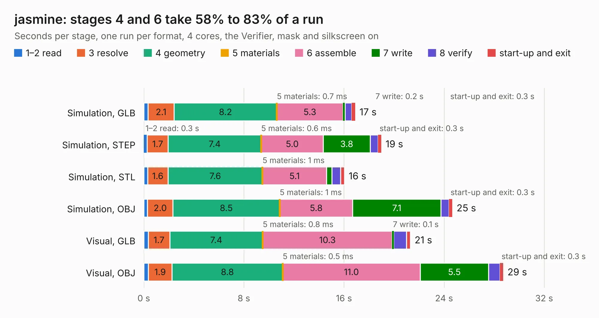

# 1110. jasmine

Board 1,110 of the 3,128 of [Corpus Testing](../Corpus-Testing.md), on [Corpus Page 11](../CorpusTestingPages/Corpus-Testing-11.md#1110-jasmine).

| Mode and format | 1–2 read | 3 resolve | 4 geometry | 5 materials | 6 assemble | 7 write | 8 verify | start-up and exit | Total |
|---|---:|---:|---:|---:|---:|---:|---:|---:|---:|
| Simulation, GLB | 0.3 | 2.1 | 8.2 | 0.7&nbsp;ms | 5.3 | 0.2 | 0.5 | 0.3 | 16.9 |
| Simulation, STEP | 0.3 | 1.7 | 7.4 | 0.6&nbsp;ms | 5.0 | 3.8 | 0.6 | 0.3 | 19.0 |
| Simulation, STL | 0.3 | 1.6 | 7.6 | 1&nbsp;ms | 5.1 | 0.4 | 0.7 | 0.3 | 16.0 |
| Simulation, OBJ | 0.3 | 2.0 | 8.5 | 1&nbsp;ms | 5.8 | 7.1 | 0.6 | 0.3 | 24.7 |
| Visual, GLB | 0.4 | 1.7 | 7.4 | 0.8&nbsp;ms | 10.3 | 0.1 | 1.0 | 0.3 | 21.3 |
| Visual, OBJ | 0.3 | 1.9 | 8.8 | 0.5&nbsp;ms | 11.0 | 5.5 | 0.9 | 0.3 | 28.7 |

<table align="center"><tr><td valign="top">

| Board | Repo: [greatscottgadgets/greatfet-hardware](https://github.com/greatscottgadgets/greatfet-hardware) Board: `jasmine.kicad_pcb` |
|---|---|
| Folder | jasmine |
| Complexity | 218&nbsp;/&nbsp;1000 (size&nbsp;163, features&nbsp;55) |
| KESE&nbsp;features | through vias, filled zones, copper text, curved board outline |
| Tested | 9th November 2026 |
| Copper&nbsp;layers | 2 |
| File&nbsp;format | KiCad 5 (20171130) |
| Parts,&nbsp;tracks,&nbsp;vias | 69, 349, 37 |
| Triangles,&nbsp;simulation | 1,031,328 in 156 parts |
| Verifier | PASS in all six runs |

</td><td valign="top">

<table>
<tr><th>File type</th><th>File size</th><th>Peak memory used</th></tr>
<tr><th colspan="3" align="left">Simulation</th></tr>
<tr><td>GLB</td><td align="right">35&nbsp;MB</td><td align="right">408&nbsp;MB</td></tr>
<tr><td>STEP</td><td align="right">163&nbsp;MB</td><td align="right">510&nbsp;MB</td></tr>
<tr><td>STL</td><td align="right">52&nbsp;MB</td><td align="right">428&nbsp;MB</td></tr>
<tr><td>OBJ</td><td align="right">106&nbsp;MB</td><td align="right">754&nbsp;MB</td></tr>
<tr><th colspan="3" align="left">Visual</th></tr>
<tr><td>GLB</td><td align="right">20&nbsp;MB</td><td align="right">504&nbsp;MB</td></tr>
<tr><td>OBJ</td><td align="right">59&nbsp;MB</td><td align="right">484&nbsp;MB</td></tr>
</table>

</td></tr></table>

| Previous | Next |
|:---|---:|
| [1109. gladiolus](b1109b_greatfet-hardware_gladiolus.md) | [1111. lily](b1111b_greatfet-hardware_lily.md) |
