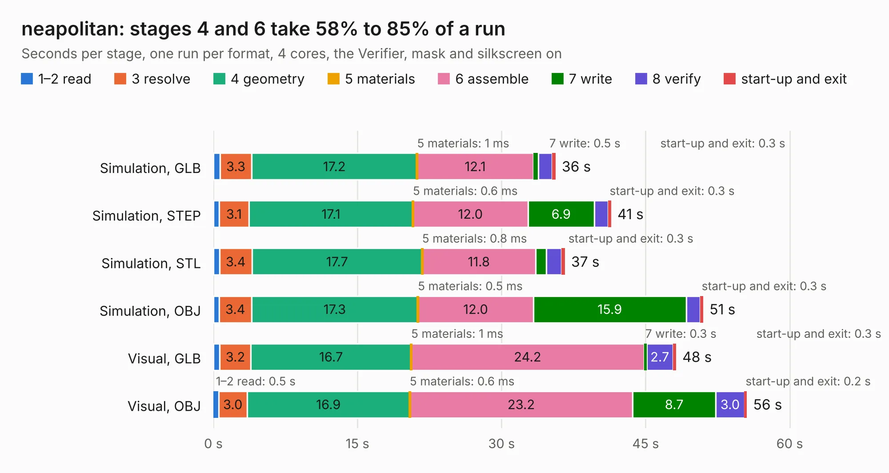

# 1110. neapolitan

Board 1,110 of the 3,111 of [Corpus Testing](../Corpus-Testing.md), on [Corpus Page 11](../CorpusTestingPages/Corpus-Testing-11.md#1110-neapolitan).

| Mode and format | 1–2 read | 3 resolve | 4 geometry | 5 materials | 6 assemble | 7 write | 8 verify | start-up and exit | Total |
|---|---:|---:|---:|---:|---:|---:|---:|---:|---:|
| Simulation, GLB | 0.7 | 3.3 | 17.2 | 1&nbsp;ms | 12.1 | 0.5 | 1.4 | 0.3 | 35.6 |
| Simulation, STEP | 0.6 | 3.1 | 17.1 | 0.6&nbsp;ms | 12.0 | 6.9 | 1.5 | 0.3 | 41.4 |
| Simulation, STL | 0.6 | 3.4 | 17.7 | 0.8&nbsp;ms | 11.8 | 1.1 | 1.6 | 0.3 | 36.6 |
| Simulation, OBJ | 0.6 | 3.4 | 17.3 | 0.5&nbsp;ms | 12.0 | 15.9 | 1.5 | 0.3 | 51.0 |
| Visual, GLB | 0.7 | 3.2 | 16.7 | 1&nbsp;ms | 24.2 | 0.3 | 2.7 | 0.3 | 48.2 |
| Visual, OBJ | 0.5 | 3.0 | 16.9 | 0.6&nbsp;ms | 23.2 | 8.7 | 3.0 | 0.2 | 55.5 |

<table align="center"><tr><td valign="top">

| Board | Repo: [greatscottgadgets/hackrf](https://github.com/greatscottgadgets/hackrf) Board: `neapolitan.kicad_pcb` |
|---|---|
| Folder | hardware / neapolitan |
| Complexity | 318&nbsp;/&nbsp;1000 (size&nbsp;273, features&nbsp;45) |
| KESE&nbsp;features | through vias, filled zones, curved board outline |
| Tested | 9th November 2026 |
| Copper&nbsp;layers | 4 |
| File&nbsp;format | KiCad 4 (4) |
| Parts,&nbsp;tracks,&nbsp;vias | 241, 1,961, 272 |
| Triangles,&nbsp;simulation | 3,033,820 in 180 parts |
| Verifier | PASS in all six runs |

</td><td valign="top">

<table>
<tr><th>File type</th><th>File size</th><th>Peak memory used</th></tr>
<tr><th colspan="3" align="left">Simulation</th></tr>
<tr><td>GLB</td><td align="right">106&nbsp;MB</td><td align="right">1.0&nbsp;GB</td></tr>
<tr><td>STEP</td><td align="right">411&nbsp;MB</td><td align="right">1.2&nbsp;GB</td></tr>
<tr><td>STL</td><td align="right">152&nbsp;MB</td><td align="right">948&nbsp;MB</td></tr>
<tr><td>OBJ</td><td align="right">334&nbsp;MB</td><td align="right">2.1&nbsp;GB</td></tr>
<tr><th colspan="3" align="left">Visual</th></tr>
<tr><td>GLB</td><td align="right">58&nbsp;MB</td><td align="right">1.2&nbsp;GB</td></tr>
<tr><td>OBJ</td><td align="right">181&nbsp;MB</td><td align="right">1.3&nbsp;GB</td></tr>
</table>

</td></tr></table>

| Previous | Next |
|:---|---:|
| [1109. marzipan](b1109b_hackrf_marzipan.md) | [1111. operacake](b1111b_hackrf_operacake.md) |
