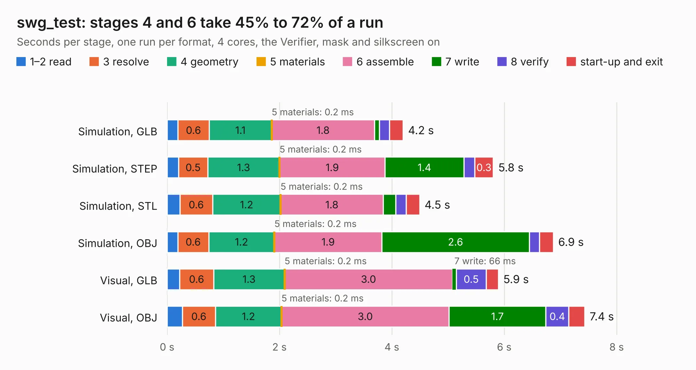

# 1111. swg_test

Board 1,111 of the 3,106 of [Corpus Testing](../Corpus-Testing.md), on [Corpus Page 11](../CorpusTestingPages/Corpus-Testing-11.md#1111-swg_test).

| Mode and format | 1–2 read | 3 resolve | 4 geometry | 5 materials | 6 assemble | 7 write | 8 verify | start-up and exit | Total |
|---|---:|---:|---:|---:|---:|---:|---:|---:|---:|
| Simulation, GLB | 0.2 | 0.6 | 1.1 | 0.2&nbsp;ms | 1.8 | 85&nbsp;ms | 0.2 | 0.2 | 4.2 |
| Simulation, STEP | 0.2 | 0.5 | 1.3 | 0.2&nbsp;ms | 1.9 | 1.4 | 0.2 | 0.3 | 5.8 |
| Simulation, STL | 0.2 | 0.6 | 1.2 | 0.2&nbsp;ms | 1.8 | 0.2 | 0.2 | 0.2 | 4.5 |
| Simulation, OBJ | 0.2 | 0.6 | 1.2 | 0.2&nbsp;ms | 1.9 | 2.6 | 0.2 | 0.2 | 6.9 |
| Visual, GLB | 0.2 | 0.6 | 1.3 | 0.2&nbsp;ms | 3.0 | 66&nbsp;ms | 0.5 | 0.2 | 5.9 |
| Visual, OBJ | 0.3 | 0.6 | 1.2 | 0.2&nbsp;ms | 3.0 | 1.7 | 0.4 | 0.3 | 7.4 |

<table align="center"><tr><td valign="top">

| Board | Repo: [greatscottgadgets/lab-notes](https://github.com/greatscottgadgets/lab-notes) Board: `swg_test.kicad_pcb` |
|---|---|
| Folder | rf-testing / 2023-05-16-swg-test-board / swg_test_kicad |
| Complexity | 266&nbsp;/&nbsp;1000 (size&nbsp;166, features&nbsp;100) |
| KESE&nbsp;features | through vias, rounded, trapezoid or chamfered pads, filled zones, copper text, stack-up, dielectric εr and tanδ, copper finish |
| Tested | 9th November 2026 |
| Copper&nbsp;layers | 4 |
| File&nbsp;format | KiCad 7 (20221018) |
| Parts,&nbsp;tracks,&nbsp;vias | 23, 17, 129 |
| Triangles,&nbsp;simulation | 425,002 in 29 parts |
| Verifier | PASS in all six runs |

</td><td valign="top">

<table>
<tr><th>File type</th><th>File size</th><th>Peak memory used</th></tr>
<tr><th colspan="3" align="left">Simulation</th></tr>
<tr><td>GLB</td><td align="right">14&nbsp;MB</td><td align="right">313&nbsp;MB</td></tr>
<tr><td>STEP</td><td align="right">46&nbsp;MB</td><td align="right">357&nbsp;MB</td></tr>
<tr><td>STL</td><td align="right">21&nbsp;MB</td><td align="right">315&nbsp;MB</td></tr>
<tr><td>OBJ</td><td align="right">42&nbsp;MB</td><td align="right">342&nbsp;MB</td></tr>
<tr><th colspan="3" align="left">Visual</th></tr>
<tr><td>GLB</td><td align="right">9.3&nbsp;MB</td><td align="right">297&nbsp;MB</td></tr>
<tr><td>OBJ</td><td align="right">27&nbsp;MB</td><td align="right">294&nbsp;MB</td></tr>
</table>

</td></tr></table>

| Previous | Next |
|:---|---:|
| [1110. praline](b1110b_hackrf-pro_praline.md) | [1112. LNA1109](b1112b_LNA1109_LNA1109.md) |
