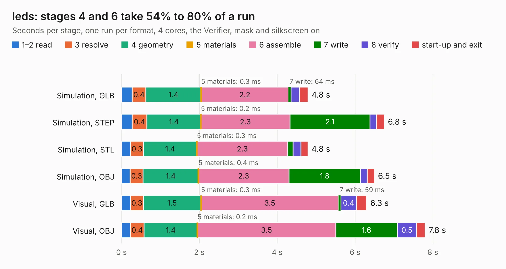

# 1113. leds

Board 1,113 of the 3,100 of [Corpus Testing](../Corpus-Testing.md), on [Corpus Page 11](../CorpusTestingPages/Corpus-Testing-11.md#1113-leds).

| Mode and format | 1–2 read | 3 resolve | 4 geometry | 5 materials | 6 assemble | 7 write | 8 verify | start-up and exit | Total |
|---|---:|---:|---:|---:|---:|---:|---:|---:|---:|
| Simulation, GLB | 0.3 | 0.4 | 1.4 | 0.3&nbsp;ms | 2.2 | 64&nbsp;ms | 0.2 | 0.2 | 4.8 |
| Simulation, STEP | 0.3 | 0.4 | 1.4 | 0.2&nbsp;ms | 2.3 | 2.1 | 0.2 | 0.2 | 6.8 |
| Simulation, STL | 0.2 | 0.3 | 1.4 | 0.3&nbsp;ms | 2.3 | 0.1 | 0.2 | 0.2 | 4.8 |
| Simulation, OBJ | 0.2 | 0.3 | 1.4 | 0.4&nbsp;ms | 2.3 | 1.8 | 0.2 | 0.2 | 6.5 |
| Visual, GLB | 0.2 | 0.3 | 1.5 | 0.3&nbsp;ms | 3.5 | 59&nbsp;ms | 0.4 | 0.3 | 6.3 |
| Visual, OBJ | 0.2 | 0.4 | 1.4 | 0.2&nbsp;ms | 3.5 | 1.6 | 0.5 | 0.2 | 7.8 |

<table align="center"><tr><td valign="top">

| Board | Repo: [greatscottgadgets/misc](https://github.com/greatscottgadgets/misc) Board: `leds.kicad_pcb` |
|---|---|
| Folder | evaluation-boards / leds |
| Complexity | 247&nbsp;/&nbsp;1000 (size&nbsp;172, features&nbsp;75) |
| KESE&nbsp;features | through vias, rounded, trapezoid or chamfered pads, filled zones, stack-up, dielectric εr and tanδ |
| Tested | 9th November 2026 |
| Copper&nbsp;layers | 2 |
| File&nbsp;format | KiCad 8 (20240108) |
| Parts,&nbsp;tracks,&nbsp;vias | 128, 372, 54 |
| Triangles,&nbsp;simulation | 457,374 in 66 parts |
| Verifier | PASS in all six runs |

</td><td valign="top">

<table>
<tr><th>File type</th><th>File size</th><th>Peak memory used</th></tr>
<tr><th colspan="3" align="left">Simulation</th></tr>
<tr><td>GLB</td><td align="right">15&nbsp;MB</td><td align="right">331&nbsp;MB</td></tr>
<tr><td>STEP</td><td align="right">79&nbsp;MB</td><td align="right">384&nbsp;MB</td></tr>
<tr><td>STL</td><td align="right">23&nbsp;MB</td><td align="right">331&nbsp;MB</td></tr>
<tr><td>OBJ</td><td align="right">46&nbsp;MB</td><td align="right">370&nbsp;MB</td></tr>
<tr><th colspan="3" align="left">Visual</th></tr>
<tr><td>GLB</td><td align="right">13&nbsp;MB</td><td align="right">427&nbsp;MB</td></tr>
<tr><td>OBJ</td><td align="right">37&nbsp;MB</td><td align="right">421&nbsp;MB</td></tr>
</table>

</td></tr></table>

| Previous | Next |
|:---|---:|
| [1112. filters](b1112b_misc_filters.md) | [1114. limiters](b1114b_misc_limiters.md) |
