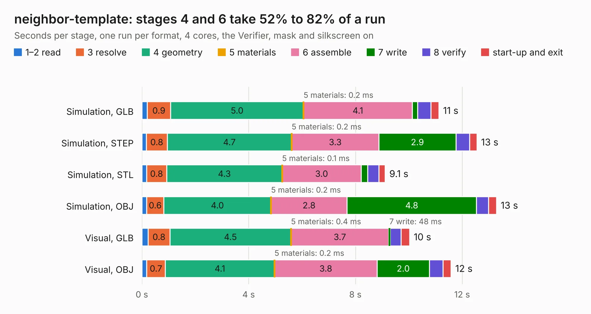

# 1115. neighbor-template

Board 1,115 of the 3,131 of [Corpus Testing](../Corpus-Testing.md), on [Corpus Page 11](../CorpusTestingPages/Corpus-Testing-11.md#1115-neighbor-template).

| Mode and format | 1–2 read | 3 resolve | 4 geometry | 5 materials | 6 assemble | 7 write | 8 verify | start-up and exit | Total |
|---|---:|---:|---:|---:|---:|---:|---:|---:|---:|
| Simulation, GLB | 0.2 | 0.9 | 5.0 | 0.2&nbsp;ms | 4.1 | 0.2 | 0.5 | 0.3 | 11.1 |
| Simulation, STEP | 0.2 | 0.8 | 4.7 | 0.2&nbsp;ms | 3.3 | 2.9 | 0.5 | 0.3 | 12.6 |
| Simulation, STL | 0.2 | 0.8 | 4.3 | 0.1&nbsp;ms | 3.0 | 0.2 | 0.4 | 0.2 | 9.1 |
| Simulation, OBJ | 0.2 | 0.6 | 4.0 | 0.2&nbsp;ms | 2.8 | 4.8 | 0.5 | 0.3 | 13.3 |
| Visual, GLB | 0.2 | 0.8 | 4.5 | 0.4&nbsp;ms | 3.7 | 48&nbsp;ms | 0.4 | 0.3 | 10.0 |
| Visual, OBJ | 0.2 | 0.7 | 4.1 | 0.2&nbsp;ms | 3.8 | 2.0 | 0.5 | 0.3 | 11.6 |

<table align="center"><tr><td valign="top">

| Board | Repo: [greatscottgadgets/greatfet-hardware](https://github.com/greatscottgadgets/greatfet-hardware) Board: `neighbor-template.kicad_pcb` |
|---|---|
| Folder | neighbor-template |
| Complexity | 96&nbsp;/&nbsp;1000 (size&nbsp;56, features&nbsp;40) |
| KESE&nbsp;features | filled zones, copper text, curved board outline |
| Tested | 9th November 2026 |
| Copper&nbsp;layers | 4 |
| File&nbsp;format | KiCad 4 (4) |
| Parts,&nbsp;tracks,&nbsp;vias | 7, 0, 0 |
| Triangles,&nbsp;simulation | 829,656 in 16 parts |
| Verifier | PASS in all six runs |

</td><td valign="top">

<table>
<tr><th>File type</th><th>File size</th><th>Peak memory used</th></tr>
<tr><th colspan="3" align="left">Simulation</th></tr>
<tr><td>GLB</td><td align="right">28&nbsp;MB</td><td align="right">353&nbsp;MB</td></tr>
<tr><td>STEP</td><td align="right">99&nbsp;MB</td><td align="right">441&nbsp;MB</td></tr>
<tr><td>STL</td><td align="right">41&nbsp;MB</td><td align="right">380&nbsp;MB</td></tr>
<tr><td>OBJ</td><td align="right">83&nbsp;MB</td><td align="right">589&nbsp;MB</td></tr>
<tr><th colspan="3" align="left">Visual</th></tr>
<tr><td>GLB</td><td align="right">10&nbsp;MB</td><td align="right">360&nbsp;MB</td></tr>
<tr><td>OBJ</td><td align="right">30&nbsp;MB</td><td align="right">365&nbsp;MB</td></tr>
</table>

</td></tr></table>

| Previous | Next |
|:---|---:|
| [1114. narcissus](b1114b_greatfet-hardware_narcissus.md) | [1116. quince](b1116b_greatfet-hardware_quince.md) |
