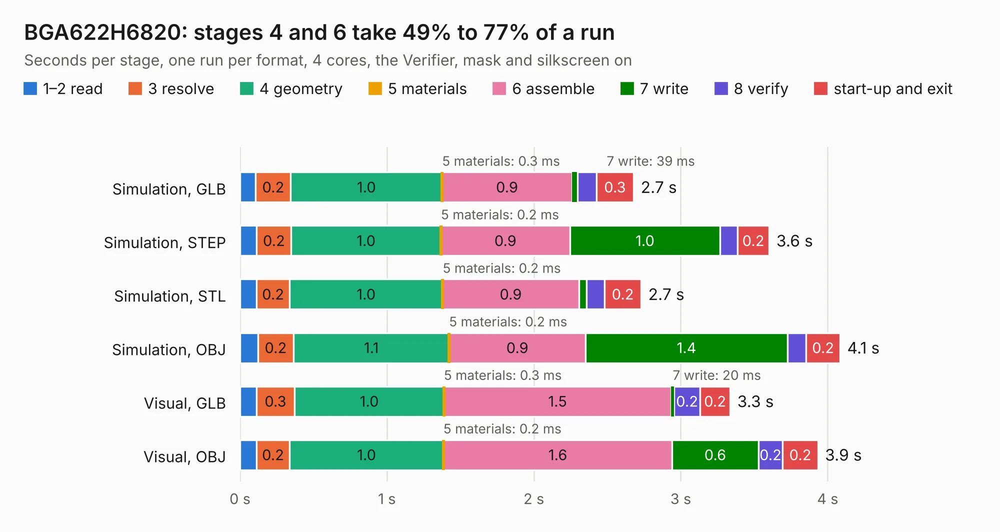

# 1115. BGA622H6820

Board 1,115 of the 3,107 of [Corpus Testing](../Corpus-Testing.md), on [Corpus Page 11](../CorpusTestingPages/Corpus-Testing-11.md#1115-bga622h6820).

| Mode and format | 1–2 read | 3 resolve | 4 geometry | 5 materials | 6 assemble | 7 write | 8 verify | start-up and exit | Total |
|---|---:|---:|---:|---:|---:|---:|---:|---:|---:|
| Simulation, GLB | 0.1 | 0.2 | 1.0 | 0.3&nbsp;ms | 0.9 | 39&nbsp;ms | 0.1 | 0.3 | 2.7 |
| Simulation, STEP | 0.1 | 0.2 | 1.0 | 0.2&nbsp;ms | 0.9 | 1.0 | 0.1 | 0.2 | 3.6 |
| Simulation, STL | 0.1 | 0.2 | 1.0 | 0.2&nbsp;ms | 0.9 | 53&nbsp;ms | 0.1 | 0.2 | 2.7 |
| Simulation, OBJ | 0.1 | 0.2 | 1.1 | 0.2&nbsp;ms | 0.9 | 1.4 | 0.1 | 0.2 | 4.1 |
| Visual, GLB | 0.1 | 0.3 | 1.0 | 0.3&nbsp;ms | 1.5 | 20&nbsp;ms | 0.2 | 0.2 | 3.3 |
| Visual, OBJ | 0.1 | 0.2 | 1.0 | 0.2&nbsp;ms | 1.6 | 0.6 | 0.2 | 0.2 | 3.9 |

<table align="center"><tr><td valign="top">

| Board | Repo: [greatscottgadgets/misc](https://github.com/greatscottgadgets/misc) Board: `BGA622H6820.kicad_pcb` |
|---|---|
| Folder | evaluation-boards / BGA622H6820 |
| Complexity | 163&nbsp;/&nbsp;1000 (size&nbsp;128, features&nbsp;35) |
| KESE&nbsp;features | through vias, filled zones |
| Tested | 9th November 2026 |
| Copper&nbsp;layers | 4 |
| File&nbsp;format | KiCad 4 (4) |
| Parts,&nbsp;tracks,&nbsp;vias | 15, 33, 6 |
| Triangles,&nbsp;simulation | 226,944 in 22 parts |
| Verifier | PASS in all six runs |

</td><td valign="top">

<table>
<tr><th>File type</th><th>File size</th><th>Peak memory used</th></tr>
<tr><th colspan="3" align="left">Simulation</th></tr>
<tr><td>GLB</td><td align="right">7.8&nbsp;MB</td><td align="right">212&nbsp;MB</td></tr>
<tr><td>STEP</td><td align="right">30&nbsp;MB</td><td align="right">222&nbsp;MB</td></tr>
<tr><td>STL</td><td align="right">11&nbsp;MB</td><td align="right">214&nbsp;MB</td></tr>
<tr><td>OBJ</td><td align="right">23&nbsp;MB</td><td align="right">212&nbsp;MB</td></tr>
<tr><th colspan="3" align="left">Visual</th></tr>
<tr><td>GLB</td><td align="right">3.5&nbsp;MB</td><td align="right">166&nbsp;MB</td></tr>
<tr><td>OBJ</td><td align="right">9.9&nbsp;MB</td><td align="right">166&nbsp;MB</td></tr>
</table>

</td></tr></table>

| Previous | Next |
|:---|---:|
| [1114. baluns](b1114b_misc_baluns.md) | [1116. CC-test](b1116b_misc_CC-test.md) |
