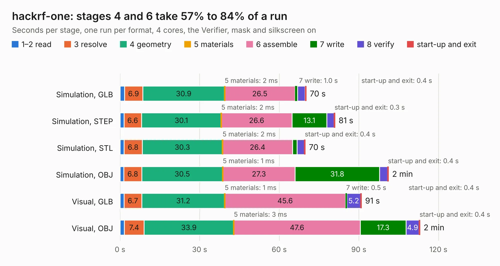

# 1116. hackrf-one

Board 1,116 of the 3,123 of [Corpus Testing](../Corpus-Testing.md), on [Corpus Page 11](../CorpusTestingPages/Corpus-Testing-11.md#1116-hackrf-one).

| Mode and format | 1–2 read | 3 resolve | 4 geometry | 5 materials | 6 assemble | 7 write | 8 verify | start-up and exit | Total |
|---|---:|---:|---:|---:|---:|---:|---:|---:|---:|
| Simulation, GLB | 1.6 | 6.9 | 30.9 | 2&nbsp;ms | 26.5 | 1.0 | 2.8 | 0.4 | 70.2 |
| Simulation, STEP | 1.5 | 6.6 | 30.1 | 2&nbsp;ms | 26.6 | 13.1 | 2.7 | 0.3 | 81.0 |
| Simulation, STL | 1.5 | 6.8 | 30.3 | 2&nbsp;ms | 26.4 | 1.7 | 2.7 | 0.4 | 69.8 |
| Simulation, OBJ | 1.4 | 6.8 | 30.5 | 1&nbsp;ms | 27.3 | 31.8 | 3.0 | 0.4 | 101.2 |
| Visual, GLB | 1.5 | 6.7 | 31.2 | 1&nbsp;ms | 45.6 | 0.5 | 5.2 | 0.4 | 91.0 |
| Visual, OBJ | 1.6 | 7.4 | 33.9 | 3&nbsp;ms | 47.6 | 17.3 | 4.9 | 0.4 | 113.1 |

<table align="center"><tr><td valign="top">

| Board | Repo: [greatscottgadgets/hackrf](https://github.com/greatscottgadgets/hackrf) Board: `hackrf-one.kicad_pcb` |
|---|---|
| Folder | hardware / hackrf-one |
| Complexity | 396&nbsp;/&nbsp;1000 (size&nbsp;291, features&nbsp;105) |
| KESE&nbsp;features | through vias, filled zones, copper text, curved board outline, stack-up, dielectric εr and tanδ, copper finish, mask and silkscreen colours |
| Tested | 9th November 2026 |
| Copper&nbsp;layers | 4 |
| File&nbsp;format | KiCad 6 (20211014) |
| Parts,&nbsp;tracks,&nbsp;vias | 346, 3,817, 498 |
| Triangles,&nbsp;simulation | 4,917,978 in 392 parts |
| Verifier | PASS in all six runs |

</td><td valign="top">

<table>
<tr><th>File type</th><th>File size</th><th>Peak memory used</th></tr>
<tr><th colspan="3" align="left">Simulation</th></tr>
<tr><td>GLB</td><td align="right">173&nbsp;MB</td><td align="right">1.5&nbsp;GB</td></tr>
<tr><td>STEP</td><td align="right">687&nbsp;MB</td><td align="right">1.8&nbsp;GB</td></tr>
<tr><td>STL</td><td align="right">246&nbsp;MB</td><td align="right">1.5&nbsp;GB</td></tr>
<tr><td>OBJ</td><td align="right">541&nbsp;MB</td><td align="right">3.3&nbsp;GB</td></tr>
<tr><th colspan="3" align="left">Visual</th></tr>
<tr><td>GLB</td><td align="right">95&nbsp;MB</td><td align="right">1.6&nbsp;GB</td></tr>
<tr><td>OBJ</td><td align="right">304&nbsp;MB</td><td align="right">2.1&nbsp;GB</td></tr>
</table>

</td></tr></table>

| Previous | Next |
|:---|---:|
| [1115. quince](b1115b_greatfet-hardware_quince.md) | [1117. LNA915](b1117b_hackrf_LNA915.md) |
