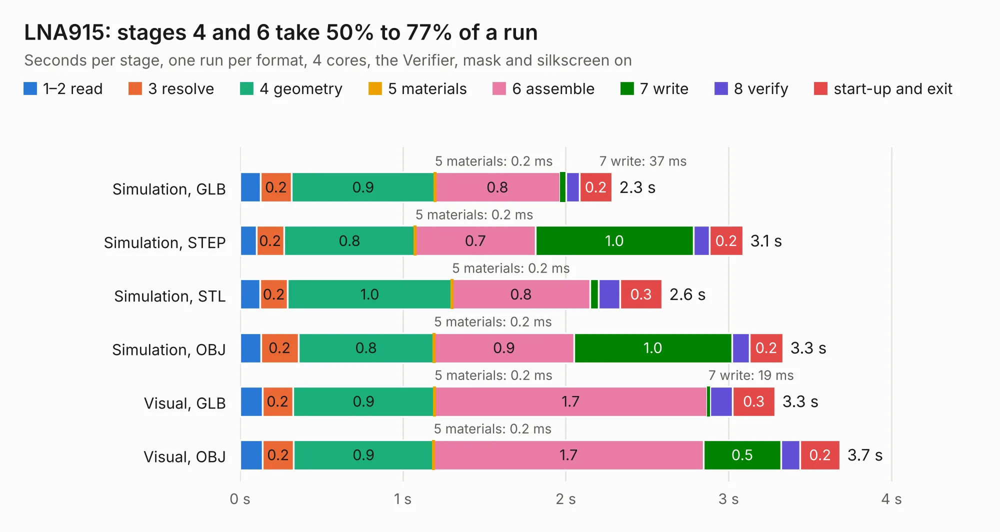

# 1117. LNA915

Board 1,117 of the 3,128 of [Corpus Testing](../Corpus-Testing.md), on [Corpus Page 11](../CorpusTestingPages/Corpus-Testing-11.md#1117-lna915).

| Mode and format | 1–2 read | 3 resolve | 4 geometry | 5 materials | 6 assemble | 7 write | 8 verify | start-up and exit | Total |
|---|---:|---:|---:|---:|---:|---:|---:|---:|---:|
| Simulation, GLB | 0.1 | 0.2 | 0.9 | 0.2&nbsp;ms | 0.8 | 37&nbsp;ms | 84&nbsp;ms | 0.2 | 2.3 |
| Simulation, STEP | 0.1 | 0.2 | 0.8 | 0.2&nbsp;ms | 0.7 | 1.0 | 98&nbsp;ms | 0.2 | 3.1 |
| Simulation, STL | 0.1 | 0.2 | 1.0 | 0.2&nbsp;ms | 0.8 | 50&nbsp;ms | 0.1 | 0.3 | 2.6 |
| Simulation, OBJ | 0.1 | 0.2 | 0.8 | 0.2&nbsp;ms | 0.9 | 1.0 | 0.1 | 0.2 | 3.3 |
| Visual, GLB | 0.1 | 0.2 | 0.9 | 0.2&nbsp;ms | 1.7 | 19&nbsp;ms | 0.1 | 0.3 | 3.3 |
| Visual, OBJ | 0.1 | 0.2 | 0.9 | 0.2&nbsp;ms | 1.7 | 0.5 | 0.1 | 0.2 | 3.7 |

<table align="center"><tr><td valign="top">

| Board | Repo: [greatscottgadgets/hackrf](https://github.com/greatscottgadgets/hackrf) Board: `LNA915.kicad_pcb` |
|---|---|
| Folder | hardware / LNA915 |
| Complexity | 186&nbsp;/&nbsp;1000 (size&nbsp;151, features&nbsp;35) |
| KESE&nbsp;features | through vias, filled zones |
| Tested | 9th November 2026 |
| Copper&nbsp;layers | 4 |
| File&nbsp;format | KiCad 5 (20171130) |
| Parts,&nbsp;tracks,&nbsp;vias | 25, 124, 8 |
| Triangles,&nbsp;simulation | 207,672 in 30 parts |
| Verifier | PASS in all six runs |

</td><td valign="top">

<table>
<tr><th>File type</th><th>File size</th><th>Peak memory used</th></tr>
<tr><th colspan="3" align="left">Simulation</th></tr>
<tr><td>GLB</td><td align="right">7.5&nbsp;MB</td><td align="right">205&nbsp;MB</td></tr>
<tr><td>STEP</td><td align="right">26&nbsp;MB</td><td align="right">221&nbsp;MB</td></tr>
<tr><td>STL</td><td align="right">10&nbsp;MB</td><td align="right">211&nbsp;MB</td></tr>
<tr><td>OBJ</td><td align="right">22&nbsp;MB</td><td align="right">214&nbsp;MB</td></tr>
<tr><th colspan="3" align="left">Visual</th></tr>
<tr><td>GLB</td><td align="right">3.8&nbsp;MB</td><td align="right">167&nbsp;MB</td></tr>
<tr><td>OBJ</td><td align="right">11&nbsp;MB</td><td align="right">165&nbsp;MB</td></tr>
</table>

</td></tr></table>

| Previous | Next |
|:---|---:|
| [1116. hackrf-one](b1116b_hackrf_hackrf-one.md) | [1118. marzipan](b1118b_hackrf_marzipan.md) |
