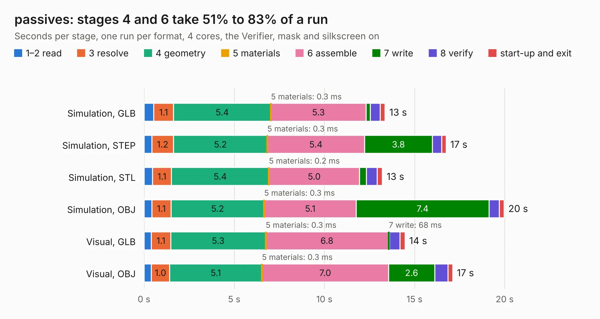

# 1119. passives

Board 1,119 of the 3,104 of [Corpus Testing](../Corpus-Testing.md), on [Corpus Page 11](../CorpusTestingPages/Corpus-Testing-11.md#1119-passives).

| Mode and format | 1–2 read | 3 resolve | 4 geometry | 5 materials | 6 assemble | 7 write | 8 verify | start-up and exit | Total |
|---|---:|---:|---:|---:|---:|---:|---:|---:|---:|
| Simulation, GLB | 0.5 | 1.1 | 5.4 | 0.3&nbsp;ms | 5.3 | 0.2 | 0.6 | 0.3 | 13.4 |
| Simulation, STEP | 0.4 | 1.2 | 5.2 | 0.3&nbsp;ms | 5.4 | 3.8 | 0.5 | 0.2 | 16.7 |
| Simulation, STL | 0.5 | 1.1 | 5.4 | 0.2&nbsp;ms | 5.0 | 0.4 | 0.6 | 0.3 | 13.2 |
| Simulation, OBJ | 0.4 | 1.1 | 5.2 | 0.3&nbsp;ms | 5.1 | 7.4 | 0.6 | 0.3 | 20.0 |
| Visual, GLB | 0.4 | 1.1 | 5.3 | 0.3&nbsp;ms | 6.8 | 68&nbsp;ms | 0.6 | 0.3 | 14.5 |
| Visual, OBJ | 0.4 | 1.0 | 5.1 | 0.3&nbsp;ms | 7.0 | 2.6 | 0.7 | 0.3 | 17.1 |

<table align="center"><tr><td valign="top">

| Board | Repo: [greatscottgadgets/misc](https://github.com/greatscottgadgets/misc) Board: `passives.kicad_pcb` |
|---|---|
| Folder | evaluation-boards / passives |
| Complexity | 239&nbsp;/&nbsp;1000 (size&nbsp;164, features&nbsp;75) |
| KESE&nbsp;features | through vias, rounded, trapezoid or chamfered pads, filled zones, stack-up, dielectric εr and tanδ |
| Tested | 9th November 2026 |
| Copper&nbsp;layers | 4 |
| File&nbsp;format | KiCad 8 (20240108) |
| Parts,&nbsp;tracks,&nbsp;vias | 59, 82, 38 |
| Triangles,&nbsp;simulation | 1,229,348 in 40 parts |
| Verifier | PASS in all six runs |

</td><td valign="top">

<table>
<tr><th>File type</th><th>File size</th><th>Peak memory used</th></tr>
<tr><th colspan="3" align="left">Simulation</th></tr>
<tr><td>GLB</td><td align="right">42&nbsp;MB</td><td align="right">599&nbsp;MB</td></tr>
<tr><td>STEP</td><td align="right">137&nbsp;MB</td><td align="right">661&nbsp;MB</td></tr>
<tr><td>STL</td><td align="right">61&nbsp;MB</td><td align="right">608&nbsp;MB</td></tr>
<tr><td>OBJ</td><td align="right">124&nbsp;MB</td><td align="right">835&nbsp;MB</td></tr>
<tr><th colspan="3" align="left">Visual</th></tr>
<tr><td>GLB</td><td align="right">15&nbsp;MB</td><td align="right">455&nbsp;MB</td></tr>
<tr><td>OBJ</td><td align="right">44&nbsp;MB</td><td align="right">483&nbsp;MB</td></tr>
</table>

</td></tr></table>

| Previous | Next |
|:---|---:|
| [1118. limiters](b1118b_misc_limiters.md) | [1120. pmos-or](b1120b_misc_pmos-or.md) |
