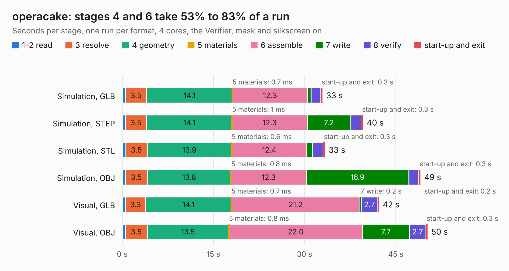

# 1120. operacake

Board 1,120 of the 3,124 of [Corpus Testing](../Corpus-Testing.md), on [Corpus Page 11](../CorpusTestingPages/Corpus-Testing-11.md#1120-operacake).

| Mode and format | 1–2 read | 3 resolve | 4 geometry | 5 materials | 6 assemble | 7 write | 8 verify | start-up and exit | Total |
|---|---:|---:|---:|---:|---:|---:|---:|---:|---:|
| Simulation, GLB | 0.5 | 3.5 | 14.1 | 0.7&nbsp;ms | 12.3 | 0.6 | 1.6 | 0.3 | 33.0 |
| Simulation, STEP | 0.5 | 3.5 | 14.1 | 1&nbsp;ms | 12.3 | 7.2 | 1.7 | 0.3 | 39.6 |
| Simulation, STL | 0.6 | 3.5 | 13.9 | 0.6&nbsp;ms | 12.4 | 0.9 | 1.7 | 0.3 | 33.4 |
| Simulation, OBJ | 0.6 | 3.5 | 13.8 | 0.8&nbsp;ms | 12.3 | 16.9 | 1.6 | 0.3 | 49.1 |
| Visual, GLB | 0.5 | 3.3 | 14.1 | 0.7&nbsp;ms | 21.2 | 0.2 | 2.7 | 0.2 | 42.3 |
| Visual, OBJ | 0.6 | 3.5 | 13.5 | 0.8&nbsp;ms | 22.0 | 7.7 | 2.7 | 0.3 | 50.2 |

<table align="center"><tr><td valign="top">

| Board | Repo: [greatscottgadgets/hackrf](https://github.com/greatscottgadgets/hackrf) Board: `operacake.kicad_pcb` |
|---|---|
| Folder | hardware / operacake |
| Complexity | 252&nbsp;/&nbsp;1000 (size&nbsp;207, features&nbsp;45) |
| KESE&nbsp;features | through vias, filled zones, curved board outline |
| Tested | 9th November 2026 |
| Copper&nbsp;layers | 4 |
| File&nbsp;format | KiCad 4 (4) |
| Parts,&nbsp;tracks,&nbsp;vias | 122, 1,091, 182 |
| Triangles,&nbsp;simulation | 3,263,706 in 217 parts |
| Verifier | PASS in all six runs |

</td><td valign="top">

<table>
<tr><th>File type</th><th>File size</th><th>Peak memory used</th></tr>
<tr><th colspan="3" align="left">Simulation</th></tr>
<tr><td>GLB</td><td align="right">110&nbsp;MB</td><td align="right">1.0&nbsp;GB</td></tr>
<tr><td>STEP</td><td align="right">391&nbsp;MB</td><td align="right">1.2&nbsp;GB</td></tr>
<tr><td>STL</td><td align="right">163&nbsp;MB</td><td align="right">993&nbsp;MB</td></tr>
<tr><td>OBJ</td><td align="right">354&nbsp;MB</td><td align="right">2.2&nbsp;GB</td></tr>
<tr><th colspan="3" align="left">Visual</th></tr>
<tr><td>GLB</td><td align="right">50&nbsp;MB</td><td align="right">975&nbsp;MB</td></tr>
<tr><td>OBJ</td><td align="right">157&nbsp;MB</td><td align="right">1.2&nbsp;GB</td></tr>
</table>

</td></tr></table>

| Previous | Next |
|:---|---:|
| [1119. neapolitan](b1119b_hackrf_neapolitan.md) | [1121. praline](b1121b_hackrf-pro_praline.md) |
