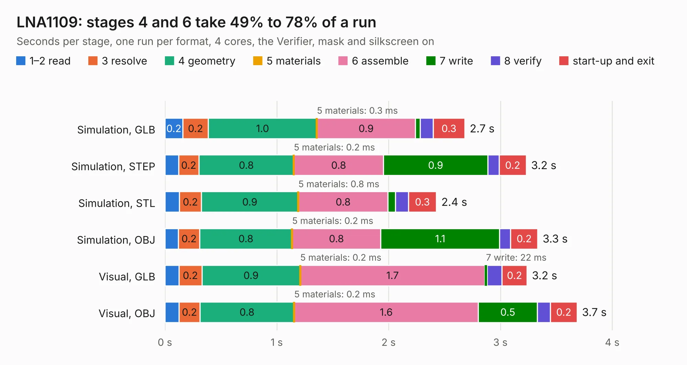

# 1123. LNA1109

Board 1,123 of the 3,123 of [Corpus Testing](../Corpus-Testing.md), on [Corpus Page 11](../CorpusTestingPages/Corpus-Testing-11.md#1123-lna1109).

| Mode and format | 1–2 read | 3 resolve | 4 geometry | 5 materials | 6 assemble | 7 write | 8 verify | start-up and exit | Total |
|---|---:|---:|---:|---:|---:|---:|---:|---:|---:|
| Simulation, GLB | 0.2 | 0.2 | 1.0 | 0.3&nbsp;ms | 0.9 | 44&nbsp;ms | 0.1 | 0.3 | 2.7 |
| Simulation, STEP | 0.1 | 0.2 | 0.8 | 0.2&nbsp;ms | 0.8 | 0.9 | 0.1 | 0.2 | 3.2 |
| Simulation, STL | 0.1 | 0.2 | 0.9 | 0.8&nbsp;ms | 0.8 | 66&nbsp;ms | 0.1 | 0.3 | 2.4 |
| Simulation, OBJ | 0.1 | 0.2 | 0.8 | 0.2&nbsp;ms | 0.8 | 1.1 | 98&nbsp;ms | 0.2 | 3.3 |
| Visual, GLB | 0.1 | 0.2 | 0.9 | 0.2&nbsp;ms | 1.7 | 22&nbsp;ms | 0.1 | 0.2 | 3.2 |
| Visual, OBJ | 0.1 | 0.2 | 0.8 | 0.2&nbsp;ms | 1.6 | 0.5 | 0.1 | 0.2 | 3.7 |

<table align="center"><tr><td valign="top">

| Board | Repo: [greatscottgadgets/LNA1109](https://github.com/greatscottgadgets/LNA1109) Board: `LNA1109.kicad_pcb` |
|---|---|
| Complexity | 186&nbsp;/&nbsp;1000 (size&nbsp;151, features&nbsp;35) |
| KESE&nbsp;features | through vias, filled zones |
| Tested | 9th November 2026 |
| Copper&nbsp;layers | 4 |
| File&nbsp;format | KiCad 5 (20171130) |
| Parts,&nbsp;tracks,&nbsp;vias | 25, 129, 8 |
| Triangles,&nbsp;simulation | 207,670 in 30 parts |
| Verifier | PASS in all six runs |

</td><td valign="top">

<table>
<tr><th>File type</th><th>File size</th><th>Peak memory used</th></tr>
<tr><th colspan="3" align="left">Simulation</th></tr>
<tr><td>GLB</td><td align="right">7.5&nbsp;MB</td><td align="right">211&nbsp;MB</td></tr>
<tr><td>STEP</td><td align="right">26&nbsp;MB</td><td align="right">224&nbsp;MB</td></tr>
<tr><td>STL</td><td align="right">10&nbsp;MB</td><td align="right">218&nbsp;MB</td></tr>
<tr><td>OBJ</td><td align="right">22&nbsp;MB</td><td align="right">212&nbsp;MB</td></tr>
<tr><th colspan="3" align="left">Visual</th></tr>
<tr><td>GLB</td><td align="right">3.9&nbsp;MB</td><td align="right">167&nbsp;MB</td></tr>
<tr><td>OBJ</td><td align="right">11&nbsp;MB</td><td align="right">167&nbsp;MB</td></tr>
</table>

</td></tr></table>

| Previous | Next |
|:---|---:|
| [1122. swg_test](b1122b_lab-notes_swg-test.md) | [1124. LNA3030](b1124b_LNA3030_LNA3030.md) |
