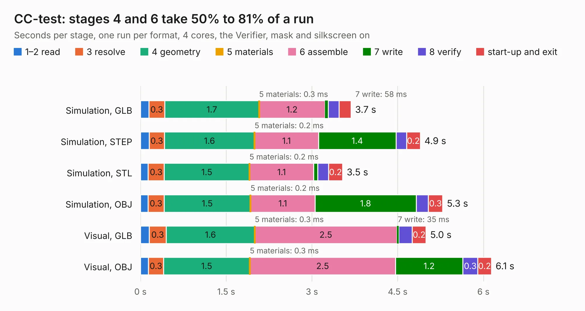

# 1124. CC-test

Board 1,124 of the 3,118 of [Corpus Testing](../Corpus-Testing.md), on [Corpus Page 11](../CorpusTestingPages/Corpus-Testing-11.md#1124-cc-test).

| Mode and format | 1–2 read | 3 resolve | 4 geometry | 5 materials | 6 assemble | 7 write | 8 verify | start-up and exit | Total |
|---|---:|---:|---:|---:|---:|---:|---:|---:|---:|
| Simulation, GLB | 0.1 | 0.3 | 1.7 | 0.3&nbsp;ms | 1.2 | 58&nbsp;ms | 0.2 | 0.2 | 3.7 |
| Simulation, STEP | 0.2 | 0.3 | 1.6 | 0.2&nbsp;ms | 1.1 | 1.4 | 0.2 | 0.2 | 4.9 |
| Simulation, STL | 0.1 | 0.3 | 1.5 | 0.2&nbsp;ms | 1.1 | 68&nbsp;ms | 0.2 | 0.2 | 3.5 |
| Simulation, OBJ | 0.1 | 0.3 | 1.5 | 0.2&nbsp;ms | 1.1 | 1.8 | 0.2 | 0.3 | 5.3 |
| Visual, GLB | 0.2 | 0.3 | 1.6 | 0.3&nbsp;ms | 2.5 | 35&nbsp;ms | 0.2 | 0.2 | 5.0 |
| Visual, OBJ | 0.1 | 0.3 | 1.5 | 0.3&nbsp;ms | 2.5 | 1.2 | 0.3 | 0.2 | 6.1 |

<table align="center"><tr><td valign="top">

| Board | Repo: [greatscottgadgets/misc](https://github.com/greatscottgadgets/misc) Board: `CC-test.kicad_pcb` |
|---|---|
| Folder | evaluation-boards / CC-test |
| Complexity | 206&nbsp;/&nbsp;1000 (size&nbsp;141, features&nbsp;65) |
| KESE&nbsp;features | through vias, slotted holes, rounded, trapezoid or chamfered pads, filled zones, curved board outline |
| Tested | 9th November 2026 |
| Copper&nbsp;layers | 2 |
| File&nbsp;format | KiCad 5 (20171130) |
| Parts,&nbsp;tracks,&nbsp;vias | 23, 186, 20 |
| Triangles,&nbsp;simulation | 303,426 in 35 parts |
| Verifier | PASS in all six runs |

</td><td valign="top">

<table>
<tr><th>File type</th><th>File size</th><th>Peak memory used</th></tr>
<tr><th colspan="3" align="left">Simulation</th></tr>
<tr><td>GLB</td><td align="right">11&nbsp;MB</td><td align="right">240&nbsp;MB</td></tr>
<tr><td>STEP</td><td align="right">52&nbsp;MB</td><td align="right">258&nbsp;MB</td></tr>
<tr><td>STL</td><td align="right">15&nbsp;MB</td><td align="right">238&nbsp;MB</td></tr>
<tr><td>OBJ</td><td align="right">31&nbsp;MB</td><td align="right">258&nbsp;MB</td></tr>
<tr><th colspan="3" align="left">Visual</th></tr>
<tr><td>GLB</td><td align="right">6.8&nbsp;MB</td><td align="right">218&nbsp;MB</td></tr>
<tr><td>OBJ</td><td align="right">20&nbsp;MB</td><td align="right">218&nbsp;MB</td></tr>
</table>

</td></tr></table>

| Previous | Next |
|:---|---:|
| [1123. BGA622H6820](b1123b_misc_BGA622H6820.md) | [1125. DC1722J5005AHF](b1125b_misc_DC1722J5005AHF.md) |
