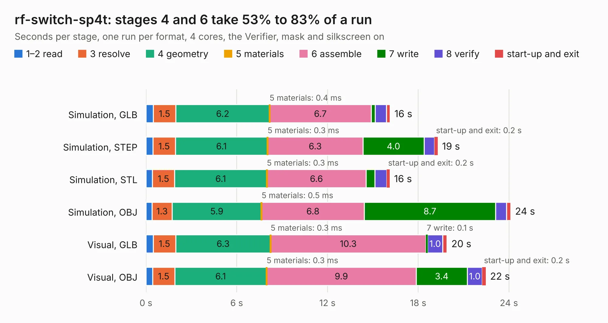

# 1125. rf-switch-sp4t

Board 1,125 of the 3,104 of [Corpus Testing](../Corpus-Testing.md), on [Corpus Page 11](../CorpusTestingPages/Corpus-Testing-11.md#1125-rf-switch-sp4t).

| Mode and format | 1–2 read | 3 resolve | 4 geometry | 5 materials | 6 assemble | 7 write | 8 verify | start-up and exit | Total |
|---|---:|---:|---:|---:|---:|---:|---:|---:|---:|
| Simulation, GLB | 0.5 | 1.5 | 6.2 | 0.4&nbsp;ms | 6.7 | 0.3 | 0.7 | 0.2 | 16.1 |
| Simulation, STEP | 0.5 | 1.5 | 6.1 | 0.3&nbsp;ms | 6.3 | 4.0 | 0.7 | 0.2 | 19.3 |
| Simulation, STL | 0.4 | 1.5 | 6.1 | 0.3&nbsp;ms | 6.6 | 0.6 | 0.8 | 0.2 | 16.1 |
| Simulation, OBJ | 0.4 | 1.3 | 5.9 | 0.5&nbsp;ms | 6.8 | 8.7 | 0.7 | 0.3 | 24.1 |
| Visual, GLB | 0.5 | 1.5 | 6.3 | 0.3&nbsp;ms | 10.3 | 0.1 | 1.0 | 0.3 | 19.9 |
| Visual, OBJ | 0.4 | 1.5 | 6.1 | 0.3&nbsp;ms | 9.9 | 3.4 | 1.0 | 0.2 | 22.5 |

<table align="center"><tr><td valign="top">

| Board | Repo: [greatscottgadgets/misc](https://github.com/greatscottgadgets/misc) Board: `rf-switch-sp4t.kicad_pcb` |
|---|---|
| Folder | evaluation-boards / rf-switch-sp4t |
| Complexity | 287&nbsp;/&nbsp;1000 (size&nbsp;187, features&nbsp;100) |
| KESE&nbsp;features | through vias, custom pads, rounded, trapezoid or chamfered pads, filled zones, copper drawings, stack-up, dielectric εr and tanδ |
| Tested | 9th November 2026 |
| Copper&nbsp;layers | 4 |
| File&nbsp;format | KiCad 8 (20240108) |
| Parts,&nbsp;tracks,&nbsp;vias | 73, 347, 109 |
| Triangles,&nbsp;simulation | 2,124,978 in 64 parts |
| Verifier | PASS in all six runs |

</td><td valign="top">

<table>
<tr><th>File type</th><th>File size</th><th>Peak memory used</th></tr>
<tr><th colspan="3" align="left">Simulation</th></tr>
<tr><td>GLB</td><td align="right">72&nbsp;MB</td><td align="right">865&nbsp;MB</td></tr>
<tr><td>STEP</td><td align="right">238&nbsp;MB</td><td align="right">950&nbsp;MB</td></tr>
<tr><td>STL</td><td align="right">106&nbsp;MB</td><td align="right">881&nbsp;MB</td></tr>
<tr><td>OBJ</td><td align="right">220&nbsp;MB</td><td align="right">1.4&nbsp;GB</td></tr>
<tr><th colspan="3" align="left">Visual</th></tr>
<tr><td>GLB</td><td align="right">28&nbsp;MB</td><td align="right">811&nbsp;MB</td></tr>
<tr><td>OBJ</td><td align="right">85&nbsp;MB</td><td align="right">718&nbsp;MB</td></tr>
</table>

</td></tr></table>

| Previous | Next |
|:---|---:|
| [1124. rf-switch-sp3t](b1124b_misc_rf-switch-sp3t.md) | [1126. rf-switch-spdt](b1126b_misc_rf-switch-spdt.md) |
