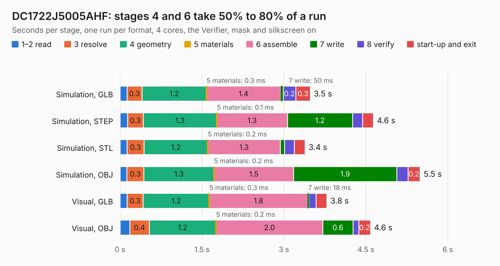

# 1127. DC1722J5005AHF

Board 1,127 of the 3,122 of [Corpus Testing](../Corpus-Testing.md), on [Corpus Page 11](../CorpusTestingPages/Corpus-Testing-11.md#1127-dc1722j5005ahf).

| Mode and format | 1–2 read | 3 resolve | 4 geometry | 5 materials | 6 assemble | 7 write | 8 verify | start-up and exit | Total |
|---|---:|---:|---:|---:|---:|---:|---:|---:|---:|
| Simulation, GLB | 0.1 | 0.3 | 1.2 | 0.3&nbsp;ms | 1.4 | 50&nbsp;ms | 0.2 | 0.3 | 3.5 |
| Simulation, STEP | 0.1 | 0.3 | 1.3 | 0.1&nbsp;ms | 1.3 | 1.2 | 0.2 | 0.2 | 4.6 |
| Simulation, STL | 0.1 | 0.3 | 1.2 | 0.2&nbsp;ms | 1.3 | 79&nbsp;ms | 0.2 | 0.2 | 3.4 |
| Simulation, OBJ | 0.1 | 0.3 | 1.3 | 0.2&nbsp;ms | 1.5 | 1.9 | 0.2 | 0.2 | 5.5 |
| Visual, GLB | 0.1 | 0.3 | 1.2 | 0.3&nbsp;ms | 1.8 | 18&nbsp;ms | 0.1 | 0.2 | 3.8 |
| Visual, OBJ | 0.2 | 0.4 | 1.2 | 0.2&nbsp;ms | 2.0 | 0.6 | 0.1 | 0.2 | 4.6 |

<table align="center"><tr><td valign="top">

| Board | Repo: [greatscottgadgets/misc](https://github.com/greatscottgadgets/misc) Board: `DC1722J5005AHF.kicad_pcb` |
|---|---|
| Folder | evaluation-boards / DC1722J5005AHF |
| Complexity | 172&nbsp;/&nbsp;1000 (size&nbsp;117, features&nbsp;55) |
| KESE&nbsp;features | through vias, rounded, trapezoid or chamfered pads, filled zones, curved board outline |
| Tested | 9th November 2026 |
| Copper&nbsp;layers | 4 |
| File&nbsp;format | KiCad 5 (20171130) |
| Parts,&nbsp;tracks,&nbsp;vias | 9, 16, 6 |
| Triangles,&nbsp;simulation | 333,628 in 18 parts |
| Verifier | PASS in all six runs |

</td><td valign="top">

<table>
<tr><th>File type</th><th>File size</th><th>Peak memory used</th></tr>
<tr><th colspan="3" align="left">Simulation</th></tr>
<tr><td>GLB</td><td align="right">11&nbsp;MB</td><td align="right">266&nbsp;MB</td></tr>
<tr><td>STEP</td><td align="right">37&nbsp;MB</td><td align="right">292&nbsp;MB</td></tr>
<tr><td>STL</td><td align="right">17&nbsp;MB</td><td align="right">268&nbsp;MB</td></tr>
<tr><td>OBJ</td><td align="right">33&nbsp;MB</td><td align="right">284&nbsp;MB</td></tr>
<tr><th colspan="3" align="left">Visual</th></tr>
<tr><td>GLB</td><td align="right">3.7&nbsp;MB</td><td align="right">202&nbsp;MB</td></tr>
<tr><td>OBJ</td><td align="right">10&nbsp;MB</td><td align="right">199&nbsp;MB</td></tr>
</table>

</td></tr></table>

| Previous | Next |
|:---|---:|
| [1126. CC-test](b1126b_misc_CC-test.md) | [1128. filters](b1128b_misc_filters.md) |
