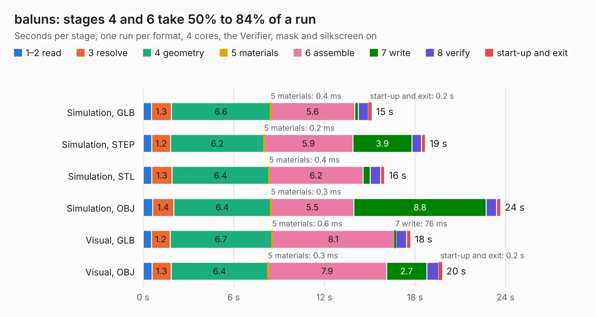

# 1127. baluns

Board 1,127 of the 3,138 of [Corpus Testing](../Corpus-Testing.md), on [Corpus Page 11](../CorpusTestingPages/Corpus-Testing-11.md#1127-baluns).

| Mode and format | 1–2 read | 3 resolve | 4 geometry | 5 materials | 6 assemble | 7 write | 8 verify | start-up and exit | Total |
|---|---:|---:|---:|---:|---:|---:|---:|---:|---:|
| Simulation, GLB | 0.6 | 1.3 | 6.6 | 0.4&nbsp;ms | 5.6 | 0.2 | 0.7 | 0.2 | 15.1 |
| Simulation, STEP | 0.6 | 1.2 | 6.2 | 0.2&nbsp;ms | 5.9 | 3.9 | 0.6 | 0.3 | 18.7 |
| Simulation, STL | 0.6 | 1.3 | 6.4 | 0.4&nbsp;ms | 6.2 | 0.5 | 0.7 | 0.3 | 16.0 |
| Simulation, OBJ | 0.6 | 1.4 | 6.4 | 0.3&nbsp;ms | 5.5 | 8.8 | 0.7 | 0.3 | 23.7 |
| Visual, GLB | 0.5 | 1.2 | 6.7 | 0.6&nbsp;ms | 8.1 | 76&nbsp;ms | 0.7 | 0.3 | 17.7 |
| Visual, OBJ | 0.6 | 1.3 | 6.4 | 0.3&nbsp;ms | 7.9 | 2.7 | 0.8 | 0.2 | 19.8 |

<table align="center"><tr><td valign="top">

| Board | Repo: [greatscottgadgets/misc](https://github.com/greatscottgadgets/misc) Board: `baluns.kicad_pcb` |
|---|---|
| Folder | evaluation-boards / baluns |
| Complexity | 232&nbsp;/&nbsp;1000 (size&nbsp;177, features&nbsp;55) |
| KESE&nbsp;features | through vias, rounded, trapezoid or chamfered pads, filled zones, copper text |
| Tested | 9th November 2026 |
| Copper&nbsp;layers | 4 |
| File&nbsp;format | KiCad 9 (20241229) |
| Parts,&nbsp;tracks,&nbsp;vias | 92, 230, 30 |
| Triangles,&nbsp;simulation | 1,559,312 in 64 parts |
| Verifier | PASS in all six runs |

</td><td valign="top">

<table>
<tr><th>File type</th><th>File size</th><th>Peak memory used</th></tr>
<tr><th colspan="3" align="left">Simulation</th></tr>
<tr><td>GLB</td><td align="right">54&nbsp;MB</td><td align="right">662&nbsp;MB</td></tr>
<tr><td>STEP</td><td align="right">192&nbsp;MB</td><td align="right">770&nbsp;MB</td></tr>
<tr><td>STL</td><td align="right">78&nbsp;MB</td><td align="right">645&nbsp;MB</td></tr>
<tr><td>OBJ</td><td align="right">162&nbsp;MB</td><td align="right">1.1&nbsp;GB</td></tr>
<tr><th colspan="3" align="left">Visual</th></tr>
<tr><td>GLB</td><td align="right">17&nbsp;MB</td><td align="right">551&nbsp;MB</td></tr>
<tr><td>OBJ</td><td align="right">51&nbsp;MB</td><td align="right">552&nbsp;MB</td></tr>
</table>

</td></tr></table>

| Previous | Next |
|:---|---:|
| [1126. LNA3030](b1126b_LNA3030_LNA3030.md) | [1128. BGA622H6820](b1128b_misc_BGA622H6820.md) |
