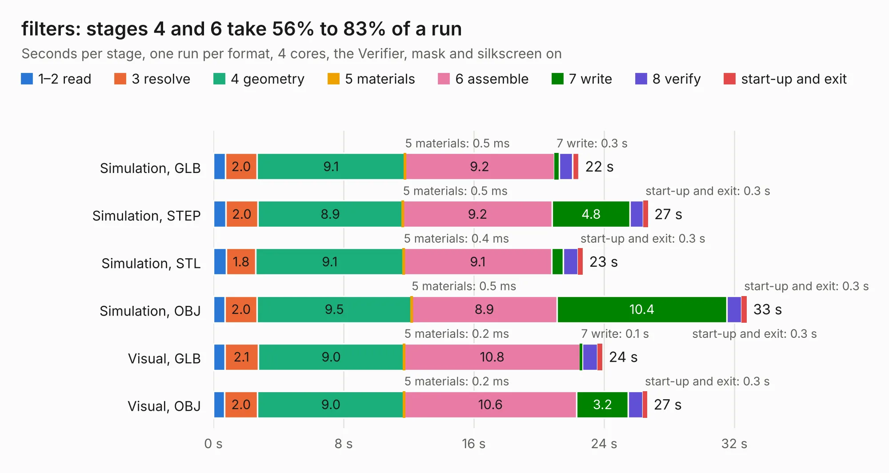

# 1128. filters

Board 1,128 of the 3,120 of [Corpus Testing](../Corpus-Testing.md), on [Corpus Page 11](../CorpusTestingPages/Corpus-Testing-11.md#1128-filters).

| Mode and format | 1–2 read | 3 resolve | 4 geometry | 5 materials | 6 assemble | 7 write | 8 verify | start-up and exit | Total |
|---|---:|---:|---:|---:|---:|---:|---:|---:|---:|
| Simulation, GLB | 0.7 | 2.0 | 9.1 | 0.5&nbsp;ms | 9.2 | 0.3 | 0.8 | 0.4 | 22.4 |
| Simulation, STEP | 0.8 | 2.0 | 8.9 | 0.5&nbsp;ms | 9.2 | 4.8 | 0.8 | 0.3 | 26.7 |
| Simulation, STL | 0.8 | 1.8 | 9.1 | 0.4&nbsp;ms | 9.1 | 0.7 | 0.9 | 0.3 | 22.7 |
| Simulation, OBJ | 0.7 | 2.0 | 9.5 | 0.5&nbsp;ms | 8.9 | 10.4 | 0.9 | 0.3 | 32.8 |
| Visual, GLB | 0.7 | 2.1 | 9.0 | 0.2&nbsp;ms | 10.8 | 0.1 | 1.0 | 0.3 | 23.9 |
| Visual, OBJ | 0.7 | 2.0 | 9.0 | 0.2&nbsp;ms | 10.6 | 3.2 | 0.9 | 0.3 | 26.7 |

<table align="center"><tr><td valign="top">

| Board | Repo: [greatscottgadgets/misc](https://github.com/greatscottgadgets/misc) Board: `filters.kicad_pcb` |
|---|---|
| Folder | evaluation-boards / filters |
| Complexity | 218&nbsp;/&nbsp;1000 (size&nbsp;163, features&nbsp;55) |
| KESE&nbsp;features | through vias, rounded, trapezoid or chamfered pads, filled zones, curved board outline |
| Tested | 9th November 2026 |
| Copper&nbsp;layers | 4 |
| File&nbsp;format | KiCad 9 (20241229) |
| Parts,&nbsp;tracks,&nbsp;vias | 30, 41, 78 |
| Triangles,&nbsp;simulation | 2,127,510 in 31 parts |
| Verifier | PASS in all six runs |

</td><td valign="top">

<table>
<tr><th>File type</th><th>File size</th><th>Peak memory used</th></tr>
<tr><th colspan="3" align="left">Simulation</th></tr>
<tr><td>GLB</td><td align="right">70&nbsp;MB</td><td align="right">911&nbsp;MB</td></tr>
<tr><td>STEP</td><td align="right">237&nbsp;MB</td><td align="right">1.0&nbsp;GB</td></tr>
<tr><td>STL</td><td align="right">106&nbsp;MB</td><td align="right">985&nbsp;MB</td></tr>
<tr><td>OBJ</td><td align="right">223&nbsp;MB</td><td align="right">1.4&nbsp;GB</td></tr>
<tr><th colspan="3" align="left">Visual</th></tr>
<tr><td>GLB</td><td align="right">23&nbsp;MB</td><td align="right">624&nbsp;MB</td></tr>
<tr><td>OBJ</td><td align="right">69&nbsp;MB</td><td align="right">626&nbsp;MB</td></tr>
</table>

</td></tr></table>

| Previous | Next |
|:---|---:|
| [1127. DC1722J5005AHF](b1127b_misc_DC1722J5005AHF.md) | [1129. leds](b1129b_misc_leds.md) |
