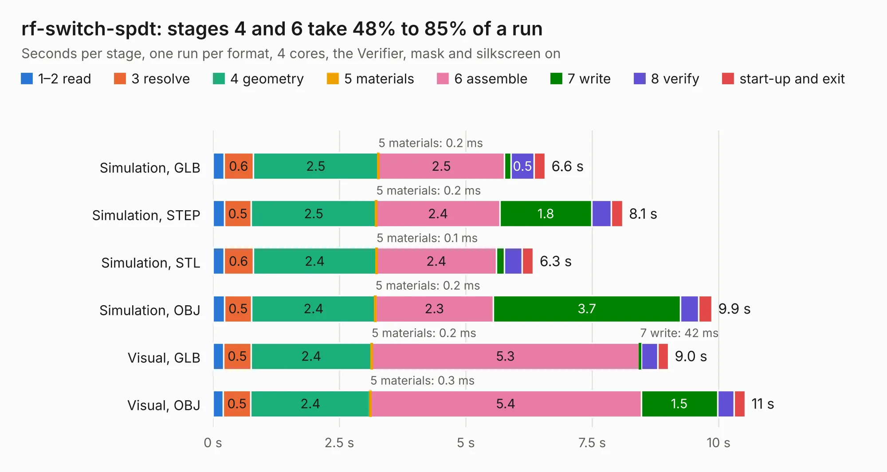

# 1128. rf-switch-spdt

Board 1,128 of the 3,106 of [Corpus Testing](../Corpus-Testing.md), on [Corpus Page 11](../CorpusTestingPages/Corpus-Testing-11.md#1128-rf-switch-spdt).

| Mode and format | 1–2 read | 3 resolve | 4 geometry | 5 materials | 6 assemble | 7 write | 8 verify | start-up and exit | Total |
|---|---:|---:|---:|---:|---:|---:|---:|---:|---:|
| Simulation, GLB | 0.2 | 0.6 | 2.5 | 0.2&nbsp;ms | 2.5 | 0.1 | 0.5 | 0.2 | 6.6 |
| Simulation, STEP | 0.2 | 0.5 | 2.5 | 0.2&nbsp;ms | 2.4 | 1.8 | 0.4 | 0.2 | 8.1 |
| Simulation, STL | 0.2 | 0.6 | 2.4 | 0.1&nbsp;ms | 2.4 | 0.2 | 0.3 | 0.2 | 6.3 |
| Simulation, OBJ | 0.2 | 0.5 | 2.4 | 0.2&nbsp;ms | 2.3 | 3.7 | 0.4 | 0.3 | 9.9 |
| Visual, GLB | 0.2 | 0.5 | 2.4 | 0.2&nbsp;ms | 5.3 | 42&nbsp;ms | 0.3 | 0.2 | 9.0 |
| Visual, OBJ | 0.2 | 0.5 | 2.4 | 0.3&nbsp;ms | 5.4 | 1.5 | 0.3 | 0.2 | 10.5 |

<table align="center"><tr><td valign="top">

| Board | Repo: [greatscottgadgets/misc](https://github.com/greatscottgadgets/misc) Board: `rf-switch-spdt.kicad_pcb` |
|---|---|
| Folder | evaluation-boards / rf-switch-spdt |
| Complexity | 259&nbsp;/&nbsp;1000 (size&nbsp;159, features&nbsp;100) |
| KESE&nbsp;features | through vias, custom pads, rounded, trapezoid or chamfered pads, filled zones, copper drawings, stack-up, dielectric εr and tanδ |
| Tested | 9th November 2026 |
| Copper&nbsp;layers | 4 |
| File&nbsp;format | KiCad 8 (20240108) |
| Parts,&nbsp;tracks,&nbsp;vias | 28, 85, 48 |
| Triangles,&nbsp;simulation | 729,262 in 31 parts |
| Verifier | PASS in all six runs |

</td><td valign="top">

<table>
<tr><th>File type</th><th>File size</th><th>Peak memory used</th></tr>
<tr><th colspan="3" align="left">Simulation</th></tr>
<tr><td>GLB</td><td align="right">25&nbsp;MB</td><td align="right">391&nbsp;MB</td></tr>
<tr><td>STEP</td><td align="right">79&nbsp;MB</td><td align="right">447&nbsp;MB</td></tr>
<tr><td>STL</td><td align="right">36&nbsp;MB</td><td align="right">393&nbsp;MB</td></tr>
<tr><td>OBJ</td><td align="right">73&nbsp;MB</td><td align="right">523&nbsp;MB</td></tr>
<tr><th colspan="3" align="left">Visual</th></tr>
<tr><td>GLB</td><td align="right">10&nbsp;MB</td><td align="right">354&nbsp;MB</td></tr>
<tr><td>OBJ</td><td align="right">30&nbsp;MB</td><td align="right">352&nbsp;MB</td></tr>
</table>

</td></tr></table>

| Previous | Next |
|:---|---:|
| [1127. rf-switch-sp4t](b1127b_misc_rf-switch-sp4t.md) | [1129. Si5351A](b1129b_misc_Si5351A.md) |
