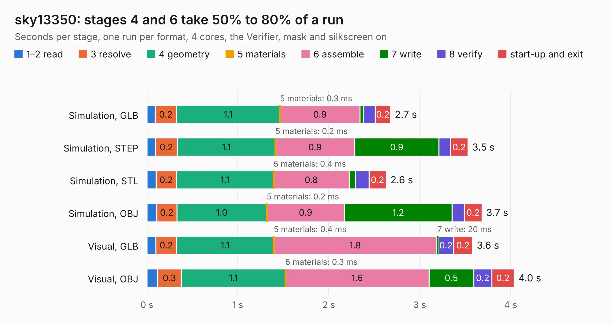

# 1128. sky13350

Board 1,128 of the 3,104 of [Corpus Testing](../Corpus-Testing.md), on [Corpus Page 11](../CorpusTestingPages/Corpus-Testing-11.md#1128-sky13350).

| Mode and format | 1–2 read | 3 resolve | 4 geometry | 5 materials | 6 assemble | 7 write | 8 verify | start-up and exit | Total |
|---|---:|---:|---:|---:|---:|---:|---:|---:|---:|
| Simulation, GLB | 91&nbsp;ms | 0.2 | 1.1 | 0.3&nbsp;ms | 0.9 | 42&nbsp;ms | 0.1 | 0.2 | 2.7 |
| Simulation, STEP | 94&nbsp;ms | 0.2 | 1.1 | 0.2&nbsp;ms | 0.9 | 0.9 | 0.1 | 0.2 | 3.5 |
| Simulation, STL | 0.1 | 0.2 | 1.1 | 0.4&nbsp;ms | 0.8 | 68&nbsp;ms | 0.2 | 0.2 | 2.6 |
| Simulation, OBJ | 0.1 | 0.2 | 1.0 | 0.2&nbsp;ms | 0.9 | 1.2 | 0.1 | 0.2 | 3.7 |
| Visual, GLB | 99&nbsp;ms | 0.2 | 1.1 | 0.4&nbsp;ms | 1.8 | 20&nbsp;ms | 0.2 | 0.2 | 3.6 |
| Visual, OBJ | 0.1 | 0.3 | 1.1 | 0.3&nbsp;ms | 1.6 | 0.5 | 0.2 | 0.2 | 4.0 |

<table align="center"><tr><td valign="top">

| Board | Repo: [greatscottgadgets/misc](https://github.com/greatscottgadgets/misc) Board: `sky13350.kicad_pcb` |
|---|---|
| Folder | evaluation-boards / sky13350 |
| Complexity | 164&nbsp;/&nbsp;1000 (size&nbsp;129, features&nbsp;35) |
| KESE&nbsp;features | through vias, filled zones |
| Tested | 9th November 2026 |
| Copper&nbsp;layers | 4 |
| File&nbsp;format | KiCad 4 (4) |
| Parts,&nbsp;tracks,&nbsp;vias | 22, 34, 3 |
| Triangles,&nbsp;simulation | 292,626 in 27 parts |
| Verifier | PASS in all six runs |

</td><td valign="top">

<table>
<tr><th>File type</th><th>File size</th><th>Peak memory used</th></tr>
<tr><th colspan="3" align="left">Simulation</th></tr>
<tr><td>GLB</td><td align="right">10&nbsp;MB</td><td align="right">222&nbsp;MB</td></tr>
<tr><td>STEP</td><td align="right">39&nbsp;MB</td><td align="right">241&nbsp;MB</td></tr>
<tr><td>STL</td><td align="right">15&nbsp;MB</td><td align="right">225&nbsp;MB</td></tr>
<tr><td>OBJ</td><td align="right">30&nbsp;MB</td><td align="right">229&nbsp;MB</td></tr>
<tr><th colspan="3" align="left">Visual</th></tr>
<tr><td>GLB</td><td align="right">4.4&nbsp;MB</td><td align="right">203&nbsp;MB</td></tr>
<tr><td>OBJ</td><td align="right">13&nbsp;MB</td><td align="right">197&nbsp;MB</td></tr>
</table>

</td></tr></table>

| Previous | Next |
|:---|---:|
| [1127. Si5351A](b1127b_misc_Si5351A.md) | [1129. sky13351](b1129b_misc_sky13351.md) |
