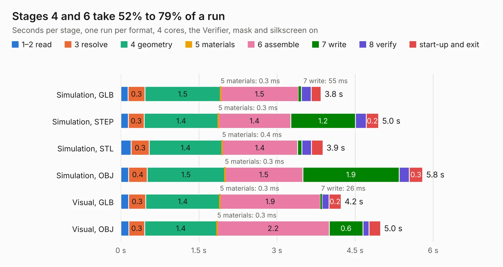

# 1129. quad-balun-directional-coupler

Board 1,129 of the 3,116 of [Corpus Testing](../Corpus-Testing.md), on [Corpus Page 11](../CorpusTestingPages/Corpus-Testing-11.md#1129-quad-balun-directional-coupler).

| Mode and format | 1–2 read | 3 resolve | 4 geometry | 5 materials | 6 assemble | 7 write | 8 verify | start-up and exit | Total |
|---|---:|---:|---:|---:|---:|---:|---:|---:|---:|
| Simulation, GLB | 0.1 | 0.3 | 1.5 | 0.3&nbsp;ms | 1.5 | 55&nbsp;ms | 0.2 | 0.2 | 3.8 |
| Simulation, STEP | 0.1 | 0.3 | 1.4 | 0.3&nbsp;ms | 1.4 | 1.2 | 0.2 | 0.2 | 5.0 |
| Simulation, STL | 0.2 | 0.3 | 1.4 | 0.4&nbsp;ms | 1.4 | 81&nbsp;ms | 0.2 | 0.2 | 3.9 |
| Simulation, OBJ | 0.1 | 0.4 | 1.5 | 0.3&nbsp;ms | 1.5 | 1.9 | 0.2 | 0.3 | 5.8 |
| Visual, GLB | 0.2 | 0.3 | 1.4 | 0.3&nbsp;ms | 1.9 | 26&nbsp;ms | 0.1 | 0.2 | 4.2 |
| Visual, OBJ | 0.2 | 0.3 | 1.4 | 0.3&nbsp;ms | 2.2 | 0.6 | 0.1 | 0.2 | 5.0 |

<table align="center"><tr><td valign="top">

| Board | Repo: [greatscottgadgets/misc](https://github.com/greatscottgadgets/misc) Board: `quad-balun-directional-coupler.kicad_pcb` |
|---|---|
| Folder | evaluation-boards / quad-balun-directional-coupler |
| Complexity | 167&nbsp;/&nbsp;1000 (size&nbsp;132, features&nbsp;35) |
| KESE&nbsp;features | through vias, filled zones |
| Tested | 9th November 2026 |
| Copper&nbsp;layers | 4 |
| File&nbsp;format | KiCad 5 (20171130) |
| Parts,&nbsp;tracks,&nbsp;vias | 14, 55, 4 |
| Triangles,&nbsp;simulation | 337,942 in 27 parts |
| Verifier | PASS in all six runs |

</td><td valign="top">

<table>
<tr><th>File type</th><th>File size</th><th>Peak memory used</th></tr>
<tr><th colspan="3" align="left">Simulation</th></tr>
<tr><td>GLB</td><td align="right">11&nbsp;MB</td><td align="right">250&nbsp;MB</td></tr>
<tr><td>STEP</td><td align="right">37&nbsp;MB</td><td align="right">295&nbsp;MB</td></tr>
<tr><td>STL</td><td align="right">17&nbsp;MB</td><td align="right">252&nbsp;MB</td></tr>
<tr><td>OBJ</td><td align="right">34&nbsp;MB</td><td align="right">288&nbsp;MB</td></tr>
<tr><th colspan="3" align="left">Visual</th></tr>
<tr><td>GLB</td><td align="right">4.0&nbsp;MB</td><td align="right">205&nbsp;MB</td></tr>
<tr><td>OBJ</td><td align="right">11&nbsp;MB</td><td align="right">203&nbsp;MB</td></tr>
</table>

</td></tr></table>

| Previous | Next |
|:---|---:|
| [1128. pmos-or](b1128b_misc_pmos-or.md) | [1130. rf-amps](b1130b_misc_rf-amps.md) |
