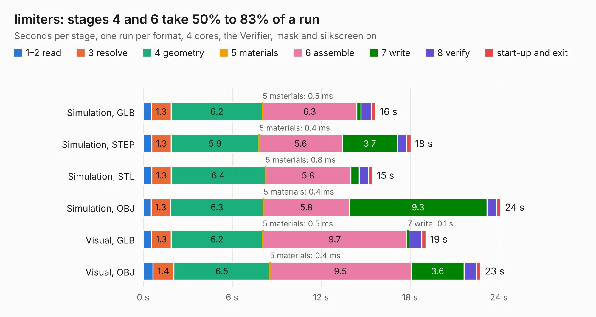

# 1131. limiters

Board 1,131 of the 3,126 of [Corpus Testing](../Corpus-Testing.md), on [Corpus Page 11](../CorpusTestingPages/Corpus-Testing-11.md#1131-limiters).

| Mode and format | 1–2 read | 3 resolve | 4 geometry | 5 materials | 6 assemble | 7 write | 8 verify | start-up and exit | Total |
|---|---:|---:|---:|---:|---:|---:|---:|---:|---:|
| Simulation, GLB | 0.6 | 1.3 | 6.2 | 0.5&nbsp;ms | 6.3 | 0.3 | 0.7 | 0.3 | 15.7 |
| Simulation, STEP | 0.6 | 1.3 | 5.9 | 0.4&nbsp;ms | 5.6 | 3.7 | 0.6 | 0.3 | 18.1 |
| Simulation, STL | 0.6 | 1.3 | 6.4 | 0.8&nbsp;ms | 5.8 | 0.6 | 0.6 | 0.3 | 15.5 |
| Simulation, OBJ | 0.5 | 1.3 | 6.3 | 0.4&nbsp;ms | 5.8 | 9.3 | 0.6 | 0.3 | 24.1 |
| Visual, GLB | 0.6 | 1.3 | 6.2 | 0.5&nbsp;ms | 9.7 | 0.1 | 0.9 | 0.3 | 19.1 |
| Visual, OBJ | 0.7 | 1.4 | 6.5 | 0.4&nbsp;ms | 9.5 | 3.6 | 0.8 | 0.3 | 22.8 |

<table align="center"><tr><td valign="top">

| Board | Repo: [greatscottgadgets/misc](https://github.com/greatscottgadgets/misc) Board: `limiters.kicad_pcb` |
|---|---|
| Folder | evaluation-boards / limiters |
| Complexity | 267&nbsp;/&nbsp;1000 (size&nbsp;192, features&nbsp;75) |
| KESE&nbsp;features | through vias, rounded, trapezoid or chamfered pads, filled zones, stack-up, dielectric εr and tanδ |
| Tested | 9th November 2026 |
| Copper&nbsp;layers | 4 |
| File&nbsp;format | KiCad 8 (20240108) |
| Parts,&nbsp;tracks,&nbsp;vias | 143, 397, 61 |
| Triangles,&nbsp;simulation | 1,536,570 in 79 parts |
| Verifier | PASS in all six runs |

</td><td valign="top">

<table>
<tr><th>File type</th><th>File size</th><th>Peak memory used</th></tr>
<tr><th colspan="3" align="left">Simulation</th></tr>
<tr><td>GLB</td><td align="right">52&nbsp;MB</td><td align="right">735&nbsp;MB</td></tr>
<tr><td>STEP</td><td align="right">184&nbsp;MB</td><td align="right">748&nbsp;MB</td></tr>
<tr><td>STL</td><td align="right">77&nbsp;MB</td><td align="right">667&nbsp;MB</td></tr>
<tr><td>OBJ</td><td align="right">157&nbsp;MB</td><td align="right">1.1&nbsp;GB</td></tr>
<tr><th colspan="3" align="left">Visual</th></tr>
<tr><td>GLB</td><td align="right">21&nbsp;MB</td><td align="right">611&nbsp;MB</td></tr>
<tr><td>OBJ</td><td align="right">65&nbsp;MB</td><td align="right">614&nbsp;MB</td></tr>
</table>

</td></tr></table>

| Previous | Next |
|:---|---:|
| [1130. leds](b1130b_misc_leds.md) | [1132. passives](b1132b_misc_passives.md) |
