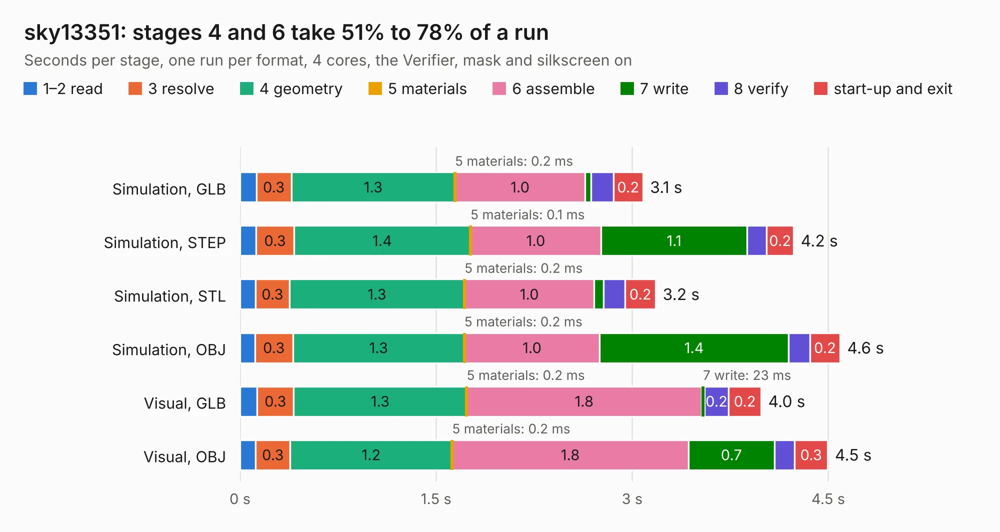

# 1131. sky13351

Board 1,131 of the 3,107 of [Corpus Testing](../Corpus-Testing.md), on [Corpus Page 11](../CorpusTestingPages/Corpus-Testing-11.md#1131-sky13351).

| Mode and format | 1–2 read | 3 resolve | 4 geometry | 5 materials | 6 assemble | 7 write | 8 verify | start-up and exit | Total |
|---|---:|---:|---:|---:|---:|---:|---:|---:|---:|
| Simulation, GLB | 0.1 | 0.3 | 1.3 | 0.2&nbsp;ms | 1.0 | 47&nbsp;ms | 0.2 | 0.2 | 3.1 |
| Simulation, STEP | 0.1 | 0.3 | 1.4 | 0.1&nbsp;ms | 1.0 | 1.1 | 0.1 | 0.2 | 4.2 |
| Simulation, STL | 0.1 | 0.3 | 1.3 | 0.2&nbsp;ms | 1.0 | 70&nbsp;ms | 0.2 | 0.2 | 3.2 |
| Simulation, OBJ | 0.1 | 0.3 | 1.3 | 0.2&nbsp;ms | 1.0 | 1.4 | 0.2 | 0.2 | 4.6 |
| Visual, GLB | 0.1 | 0.3 | 1.3 | 0.2&nbsp;ms | 1.8 | 23&nbsp;ms | 0.2 | 0.2 | 4.0 |
| Visual, OBJ | 0.1 | 0.3 | 1.2 | 0.2&nbsp;ms | 1.8 | 0.7 | 0.2 | 0.3 | 4.5 |

<table align="center"><tr><td valign="top">

| Board | Repo: [greatscottgadgets/misc](https://github.com/greatscottgadgets/misc) Board: `sky13351.kicad_pcb` |
|---|---|
| Folder | evaluation-boards / sky13351 |
| Complexity | 167&nbsp;/&nbsp;1000 (size&nbsp;132, features&nbsp;35) |
| KESE&nbsp;features | through vias, filled zones |
| Tested | 9th November 2026 |
| Copper&nbsp;layers | 4 |
| File&nbsp;format | KiCad 4 (4) |
| Parts,&nbsp;tracks,&nbsp;vias | 22, 42, 3 |
| Triangles,&nbsp;simulation | 294,750 in 27 parts |
| Verifier | PASS in all six runs |

</td><td valign="top">

<table>
<tr><th>File type</th><th>File size</th><th>Peak memory used</th></tr>
<tr><th colspan="3" align="left">Simulation</th></tr>
<tr><td>GLB</td><td align="right">10&nbsp;MB</td><td align="right">233&nbsp;MB</td></tr>
<tr><td>STEP</td><td align="right">40&nbsp;MB</td><td align="right">241&nbsp;MB</td></tr>
<tr><td>STL</td><td align="right">15&nbsp;MB</td><td align="right">228&nbsp;MB</td></tr>
<tr><td>OBJ</td><td align="right">30&nbsp;MB</td><td align="right">231&nbsp;MB</td></tr>
<tr><th colspan="3" align="left">Visual</th></tr>
<tr><td>GLB</td><td align="right">4.5&nbsp;MB</td><td align="right">192&nbsp;MB</td></tr>
<tr><td>OBJ</td><td align="right">13&nbsp;MB</td><td align="right">193&nbsp;MB</td></tr>
</table>

</td></tr></table>

| Previous | Next |
|:---|---:|
| [1130. sky13350](b1130b_misc_sky13350.md) | [1132. sky13374](b1132b_misc_sky13374.md) |
